# Architecture plan: health monitor for astronauts

> NASA Space Apps 2026 · challenge *Create Health Monitoring Software for Astronauts on Space Missions*
> Status: **proposal, pending confirmation**. No code has been written.
> Date: November 14, 2026. Source context: [`spaceapps-health-monitor-context.md`](spaceapps-health-monitor-context.md).
> Visual, interactive artifact for working with this plan: https://claude.ai/artifact/LMrTxLRghTr9h3v2Q79am8

This document defines how the system is built. It does not repeat the medical thresholds or the sources: those live in the context document and are loaded as a rule catalog with its evidence state (`VERIFIED`, `TB`, `DEMO`).

## 1. What will be built

**Architecture requirements you asked for**

- Hexagonal architecture (ports and adapters), organized as a **modular monolith**.
- **Event bus with a transactional outbox**.
- Python with **FastAPI**, **PostgreSQL**, **GraphQL** and **WebSockets**.
- Diagrams: ER with its relations, sequence and communication between modules. Communication table per channel. A `.md` document and a visual artifact with interactive elements. User experience plan.
- **Daily crew tasks** of three kinds: health, ship (maintenance) and incidents wherever they are.
- **Ship panel:** floor plan with the physical zones. When an incident occurs, the **ticket** appears with description, severity and location, and the zone is marked with a color. Right there, charts show the CO₂, nitrogen, oxygen, humidity and other levels, measured continuously, with alerts on anomalies.
- A **human body** in the crew panel, with per-organ indicators.

**Constraints that come from the project context**

- It must work **without internet and without a ground link** (local voice, model and knowledge base).
- The **rules engine is deterministic**. The language model explains, it never decides an alert.
- It is a decision-support prototype, **not a medical device**. Every figure without a verified source is labeled `DEMO`.
- Oxygen is evaluated as partial pressure (`PIO₂ = (P_total − 47 mmHg) × FO₂`), not as a percentage.
- Reproducible delivery in Docker, with the profiles `dev1`, `dev2` and `jury`.

## 2. Principles

1. **The alert never waits for a model.** Rules decide. The LLM text arrives later and is optional.
2. **Every module owns its data.** Own schema, no foreign keys between modules, only ids as soft references.
3. **One state change, one event.** State and event are written in the same transaction. Nobody publishes from outside it.
4. **Adapters are swapped per profile.** dev1, dev2 and jury choose adapters at startup. The core does not notice.
5. **The floor plan is data, not code.** Zones, positions and maintenance tasks live in the ship schema. Switching from a ship to a base or rover means changing data.
6. **The crew commands on board, Ground plans.** Ground can schedule tasks, but the crew can create their own and block Ground's with a reason. Without a link, everything keeps working.
7. **Every data point says where it comes from.** evidence_state and origin travel from the rule to the screen: VERIFIED, TB, DEMO, SIMULATED.

## 3. Architecture decisions

| ID | Decision | Reason and consequence |
| --- | --- | --- |
| ADR-1 | **Modular monolith with hexagons per module** | A single process and a single Docker deployment. Boundaries are enforced with import-linter, so a module can be extracted later. |
| ADR-2 | **In-process bus with outbox in PostgreSQL** | No Kafka or Redis: it must work without internet and with few pieces. The EventBus port allows switching to NATS later. |
| ADR-3 | **REST for machine commands, GraphQL for the interface, WebSocket for push** | REST for audio and sensor batches. GraphQL for interface queries and mutations. WS for everything the server pushes. No GraphQL subscriptions. |
| ADR-4 | **One PostgreSQL schema per module** | No foreign keys between schemas. Eases extraction and avoids coupling through data. |
| ADR-5 | **Reads between modules only through public facades** | Synchronous read-only queries. Writes between modules always go through events. |
| ADR-6 | **pgvector in the same database** | Avoids a separate vector database. Falls back to full-text search if there is no embedding model. |
| ADR-8 | **Task plan from Ground: versioned, idempotent and with a local copy** | Ground publishes plans with an increasing version. The ship applies them in one transaction, keeps the last one and works the same without a link. Nothing completed or created by the crew is lost. |
| ADR-9 | **Incident type catalog as versioned data** | Each type defines category, detection (AUTO or MANUAL), default severity, typical zones, actions and evidence state. Adding a type means changing data. |
| ADR-7 | **Rules as versioned data, engine as pure code** | The catalog is auditable JSON. The engine does no I/O and is tested with vectors. |

## 4. Stack

| Layer | Choice | Reason |
| --- | --- | --- |
| Language and API | Python 3.12, FastAPI, Uvicorn | Requested. Native ASGI for HTTP, GraphQL and WebSocket in one process |
| GraphQL | Strawberry mounted on FastAPI, with DataLoaders | Typing with dataclasses and good ASGI integration |
| Realtime | Starlette WebSocket, a single `/ws` endpoint | A single push channel. No GraphQL subscriptions |
| Database | PostgreSQL 16, SQLAlchemy 2.0 async, asyncpg, Alembic | Requested. `LISTEN/NOTIFY` and `SKIP LOCKED` for the outbox |
| Vectors | pgvector | A single database. Falls back to full-text search |
| Validation | Pydantic v2 | Event contracts and DTOs |
| Voice and language (local) | Whisper (faster-whisper), Ollama. n8n optional | From the context document |
| Tests | pytest, pytest-asyncio, testcontainers, hypothesis | Real PostgreSQL for the outbox |
| Quality | ruff, mypy, import-linter | Enforces the boundaries between modules |
| Packaging | Docker and Docker Compose | Image for the jury |
| Interface | SPA with React, Vite and TypeScript. urql GraphQL client. Floor plan and body in SVG, charts with uPlot | **Assumption**: you did not specify a frontend. It does not affect the backend |

## 5. Architecture

### 5.1 Anatomy of a module

Each module is a small hexagon. The domain imports nothing from FastAPI, SQLAlchemy, Strawberry or other modules.

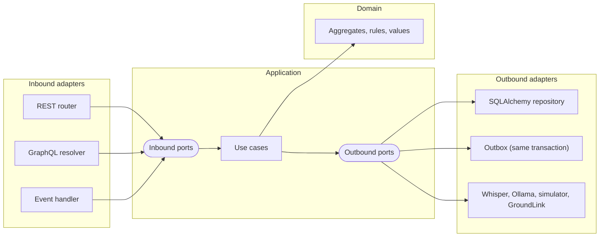

### 5.2 Repository structure

```text
src/spaceapp/
  main.py                    # composition root: picks adapters according to the profile
  platform/
    outbox/                  # OutboxEvent, UnitOfWork, relay, inbox
    profiles.py              # dev1, dev2, jury
    config.py, logging.py, db.py
  modules/
    <module>/                # telemetry, monitoring, knowledge, assistant, facility,
      domain/                #   crew, engagement, groundlink
      application/           # use cases and handlers
      ports/                 # inbound and outbound interfaces
      adapters/
        inbound/             # rest.py, graphql.py, events.py
        outbound/            # sql.py, ollama.py, whisper.py, simulator.py ...
      contracts.py           # public events and DTOs. The only thing other modules import
      facade.py              # read-only queries exposed to other modules
  interfaces/
    graphql/schema.py        # joins each module's resolvers
    ws/gateway.py            # realtime module
rules/catalog/*.json         # rule catalog with source and state
migrations/                  # one PostgreSQL schema per module
tests/{unit,contract,integration,e2e,architecture}
docker/                      # Dockerfile and compose
```

### 5.3 Dependency rules (checked by import-linter in CI)

1. `domain` imports nothing outside the standard library and its own module.
2. `application` imports `domain` and `ports` of the same module.
3. A module only imports another's `contracts` and `facade`. Never `domain`, `adapters` or SQL models.
4. The inbound adapters of one module do not call each other.
5. Only `main.py` knows all the adapters.
6. A module writes only to its own schema. There are no foreign keys between modules.

### 5.4 Module map: events and reads

Solid arrows are domain events through the outbox. Dashed arrows are read-only synchronous reads through a facade.

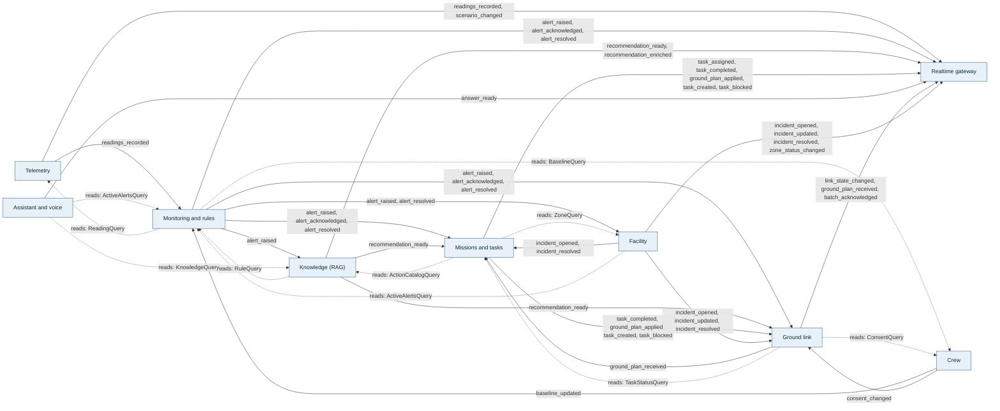

### 5.5 Modules

| Module | Responsibility | Aggregates | Inbound ports | Outbound ports |
| --- | --- | --- | --- | --- |
| **Telemetry** (`telemetry`) | Receives, validates and stores readings of the body, of each ship zone (O₂, CO₂, N₂, humidity, temperature, pressure) and of radiation. Aggregates per minute. Controls the simulated scenarios and labels the origin of every data point. | Sensor, ReadingBatch, ScenarioRun | IngestReadings; StartScenario / StopScenario; QueryReadings | ReadingRepository; SensorSource (simulator · RadLab replay · real); Clock |
| **Monitoring and rules** (`monitoring`) | Deterministic core. Computes derived quantities (PIO₂), evaluates the rule catalog per zone and over windows, detects trend anomalies, cross-checks body and environment, and manages the alert lifecycle. The language model never decides here. | Rule, Alert, AlertAck | EvaluateReadings; AcknowledgeAlert; QueryAlerts / Dashboard | AlertRepository; RuleCatalogSource (versioned JSON/YAML); ReadingQuery (from telemetry); BaselineQuery (from crew) |
| **Knowledge (RAG)** (`knowledge`) | Stores documents and citable passages, the action catalog and the recommendation per alert. Every answer carries a document, a requirement and an evidence state. If no passage supports it, it says so. | Document, Chunk, Action, Recommendation | BuildRecommendation; SearchPassages; IngestDocument | KnowledgeSource (demo · rag_nasa); TextComposer (template · Ollama); ChunkRepository (pgvector) |
| **Assistant and voice** (`assistant`) | Conversations by voice or text. Transcribes, asks for confirmation, queries Knowledge and answers with citations and streaming. An emergency never depends on the astronaut speaking. | Conversation, Utterance | SubmitAudio; ConfirmUtterance; AskText | SpeechToText (Whisper · Alexa · none); LlmGateway (Ollama · n8n · none); ConversationRepository |
| **Crew** (`crew`) | Crew member profiles, personal baseline and consents on what is shared with Ground. | CrewMember, Baseline, Consent | RecordBaseline; SetConsent; QueryCrew | CrewRepository |
| **Facility** (`facility`) | Habitat and floor plan of physical zones (laboratory, airlock, crew quarters…). Opens incident tickets with description, severity and location, automatically from zone alerts or manually from the crew, and keeps the color status of each zone. | Habitat, Zone, Incident, IncidentUpdate, IncidentType | ReportIncident; AcknowledgeIncident; ResolveIncident; QueryShip; QueryIncidentTypes | FacilityRepository; LayoutSource (floor plan JSON); IncidentCatalogSource (versioned JSON) |
| **Missions and tasks** (`engagement`) | Daily crew tasks of three kinds (health, ship and incidents) and three origins: Ground plan, system and crew. Keeps templates with recurrence, applies the plans that arrive from Ground idempotently, lets the crew create, block with a reason or delete their own tasks, and records whether a measure worked. It does not gamify the response to a critical alert. | TaskTemplate, Task, Reminder, Achievement | ApplyGroundPlan; AssignTask; CreateCrewTask; CompleteTask; BlockTask; SnoozeReminder | TaskRepository; Scheduler |
| **Ground link** (`groundlink`) | Link in both directions. Toward Ground: link state, outgoing queue and batches, filtered by consent. From Ground: receives versioned task plans, validates them and hands them to Missions. In the Ground deployment (or in the demo) it also hosts the mission control panel with its plan drafts. Works the same if there is never a link. | LinkState, OutboundBatch, OutboundItem, InboundPlan, GroundPlan, GroundTemplate | SetLinkState; SyncNow; EnqueueForGround; ReceiveGroundPlan; PublishGroundPlan | GroundLink (simulated · real); GroundLinkRepository; ConsentQuery (from crew) |
| **Realtime gateway** (`realtime`) | WebSocket inbound adapter. It has no tables or rules: it subscribes to bus events, translates them into messages per topic and allows resuming from an outbox id. | — | Subscribe / Unsubscribe; Resume | EventSubscriber (bus); OutboxReplay |
| **Platform (bus and outbox)** (`platform`) | Shared kernel: transactional outbox, relay, idempotency inbox, unit of work, execution profiles, configuration and logging. | OutboxEvent, InboxProcessed | EventBus.publish; EventBus.subscribe | Postgres (LISTEN/NOTIFY); Clock; IdGenerator |

**Allowed synchronous reads** (never writes):

| Reader | From whom | Facade | What for |
| --- | --- | --- | --- |
| Monitoring and rules | Telemetry | `ReadingQuery` | Window averages (e.g. 1 h ppCO₂) from reading_rollup_1m |
| Monitoring and rules | Crew | `BaselineQuery` | Personal baseline for relative rules |
| Knowledge (RAG) | Monitoring and rules | `RuleQuery` | Rule and action_key of an alert |
| Assistant and voice | Knowledge (RAG) | `KnowledgeQuery` | Citable passages to answer with |
| Assistant and voice | Monitoring and rules | `ActiveAlertsQuery` | Context of active alerts |
| Missions and tasks | Knowledge (RAG) | `ActionCatalogQuery` | Title and description of the action |
| Ground link | Crew | `ConsentQuery` | Which categories it may send |
| Facility | Monitoring and rules | `ActiveAlertsQuery` | Recomputes the status of each zone on startup |
| Missions and tasks | Facility | `ZoneQuery` | Name and location of a task's zone |
| Ground link | Missions and tasks | `TaskStatusQuery` | Task status for the batch toward Ground, filtered by consent |

## 6. Event bus with outbox

### 6.1 How it works

1. A use case changes the state **and** adds the event to the outbox within the **same transaction** (`UnitOfWork`). The dual write is avoided.
2. When the transaction commits, `pg_notify('outbox_new')` runs.
3. The **relay** (an `asyncio` task in the same process) wakes up on `LISTEN`, or after 500 ms by polling, and takes pending rows with `FOR UPDATE SKIP LOCKED`, in `id` order.
4. For each event it calls the subscribed handlers. Each handler runs in its own transaction and inserts `(consumer, event_id)` into `inbox_processed`. If it already exists, it is skipped.
5. If all handlers finish, the event becomes `done`. If any fails, `attempts + 1` and `next_attempt_at` with exponential wait (1, 2, 4 … 60 s). After 8 attempts it becomes `dead`.
6. Delivery guarantee: **at least once**. Handlers are idempotent thanks to the inbox.

### 6.2 Event envelope

```json
{
  "event_id": "0b6f5c1e-…",
  "type": "monitoring.alert_raised",
  "version": 1,
  "occurred_at": "2026-11-14T20:41:07.512Z",
  "aggregate_type": "alert",
  "aggregate_id": "a3c1…",
  "partition_key": "habitat:hab-01",
  "correlation_id": "…",
  "causation_id": "…",
  "payload": { "rule_key": "env-pio2-low", "severity": "CRITICAL", "evidence_state": "VERIFIED" }
}
```

Names: `module.past_tense_fact`. Payloads are Pydantic models in `contracts.py`. Only additive changes are allowed within a version. A breaking change creates `version: 2` and both are published in parallel for a while.

### 6.3 Outbox table

```sql
CREATE SCHEMA platform;

CREATE TABLE platform.outbox_event (
  id              bigserial PRIMARY KEY,
  event_id        uuid        NOT NULL UNIQUE,
  type            text        NOT NULL,
  aggregate_type  text        NOT NULL,
  aggregate_id    uuid        NOT NULL,
  partition_key   text        NOT NULL,
  payload         jsonb       NOT NULL,
  occurred_at     timestamptz NOT NULL DEFAULT now(),
  status          text        NOT NULL DEFAULT 'pending',  -- pending | done | dead
  attempts        int         NOT NULL DEFAULT 0,
  next_attempt_at timestamptz NOT NULL DEFAULT now(),
  last_error      text
);
CREATE INDEX outbox_pending_idx ON platform.outbox_event (next_attempt_at, id) WHERE status = 'pending';

CREATE TABLE platform.inbox_processed (
  consumer     text        NOT NULL,
  event_id     uuid        NOT NULL,
  processed_at timestamptz NOT NULL DEFAULT now(),
  PRIMARY KEY (consumer, event_id)
);
```

### 6.4 Detail decisions

- **Zones:** every sensor belongs to a ship zone. The `readings_recorded` event and the alert carry `zone_id`. That way Monitoring evaluates per zone and Facility knows where to paint.
- **Sensor readings:** no event is published per reading. The batch is stored and **one** `readings_recorded` is emitted per batch, with the latest values for instantaneous rules. Windowed rules query `ReadingQuery` over `reading_rollup_1m`.
- **Order:** a single worker guarantees order by `id`. If parallelizing is needed, it is split by `partition_key`.
- **Retention:** `done` events are kept for 24 h. They serve the WebSocket `resume` and debugging. After that they are deleted.
- **No Kafka or Redis:** the system must run without internet and with few pieces. The `EventBus` port allows replacing the transport without touching the modules.
- **Observability:** `/ready` reports pending, dead and the lag of the oldest.

## 7. Data model (ER)

Each module has its own PostgreSQL schema. Solid lines are foreign keys inside the module. Dashed lines are **soft references** to another module: they only store the id, with no constraint.

### 7.1 Overview across modules

```mermaid
erDiagram
  HABITAT ||..o{ CREW_MEMBER : "habitat_id"
  CREW_MEMBER ||--o{ BASELINE : "crew_member_id"
  CREW_MEMBER ||--o{ CONSENT : "crew_member_id"
  HABITAT ||--o{ ZONE : "habitat_id"
  ZONE ||--o{ INCIDENT : "zone_id"
  INCIDENT_TYPE ||--o{ INCIDENT : "type_id"
  ALERT |o..o{ INCIDENT : "source_alert_id"
  CREW_MEMBER |o..o{ INCIDENT : "reported_by"
  INCIDENT ||--o{ INCIDENT_UPDATE : "incident_id"
  CREW_MEMBER |o..o{ INCIDENT_UPDATE : "author_id"
  HABITAT ||..o{ SENSOR : "habitat_id"
  ZONE |o..o{ SENSOR : "zone_id"
  CREW_MEMBER |o..o{ SENSOR : "crew_member_id"
  SENSOR ||--o{ READING : "sensor_id"
  SENSOR ||--o{ READING_ROLLUP_1M : "sensor_id"
  HABITAT ||..o{ SCENARIO_RUN : "habitat_id"
  ZONE |o..o{ SCENARIO_RUN : "zone_id"
  RULE ||--o{ ALERT : "rule_id"
  HABITAT ||..o{ ALERT : "habitat_id"
  ZONE |o..o{ ALERT : "zone_id"
  CREW_MEMBER |o..o{ ALERT : "crew_member_id"
  ALERT ||--o{ ALERT_ACK : "alert_id"
  CREW_MEMBER ||..o{ ALERT_ACK : "crew_member_id"
  DOCUMENT ||--o{ CHUNK : "document_id"
  CHUNK |o--o{ ACTION : "source_chunk_id"
  ALERT ||..o{ RECOMMENDATION : "alert_id"
  RECOMMENDATION ||--o{ RECOMMENDATION_ACTION : "recommendation_id"
  ACTION ||--o{ RECOMMENDATION_ACTION : "action_id"
  CREW_MEMBER ||..o{ CONVERSATION : "crew_member_id"
  CONVERSATION ||--o{ UTTERANCE : "conversation_id"
  ZONE |o..o{ TASK_TEMPLATE : "zone_id"
  CREW_MEMBER |o..o{ TASK_TEMPLATE : "assignee_id"
  CREW_MEMBER |o..o{ TASK_TEMPLATE : "created_by"
  CREW_MEMBER ||..o{ TASK : "crew_member_id"
  TASK_TEMPLATE |o--o{ TASK : "template_id"
  ACTION |o..o{ TASK : "action_id"
  ALERT |o..o{ TASK : "source_alert_id"
  INCIDENT |o..o{ TASK : "incident_id"
  ZONE |o..o{ TASK : "zone_id"
  TASK ||--o{ REMINDER : "task_id"
  CREW_MEMBER ||..o{ CREW_ACHIEVEMENT : "crew_member_id"
  ACHIEVEMENT ||--o{ CREW_ACHIEVEMENT : "achievement_id"
  GROUND_PLAN ||--o{ GROUND_TEMPLATE : "plan_id"
  TASK_TEMPLATE |o..o{ GROUND_TEMPLATE : "target_template_id"
  OUTBOUND_BATCH |o--o{ OUTBOUND_ITEM : "batch_id"
  OUTBOX_EVENT ||..o{ OUTBOUND_ITEM : "source_event_id"
  OUTBOX_EVENT ||--o{ INBOX_PROCESSED : "event_id"
```

### 7.2 Schema `crew` · Crew

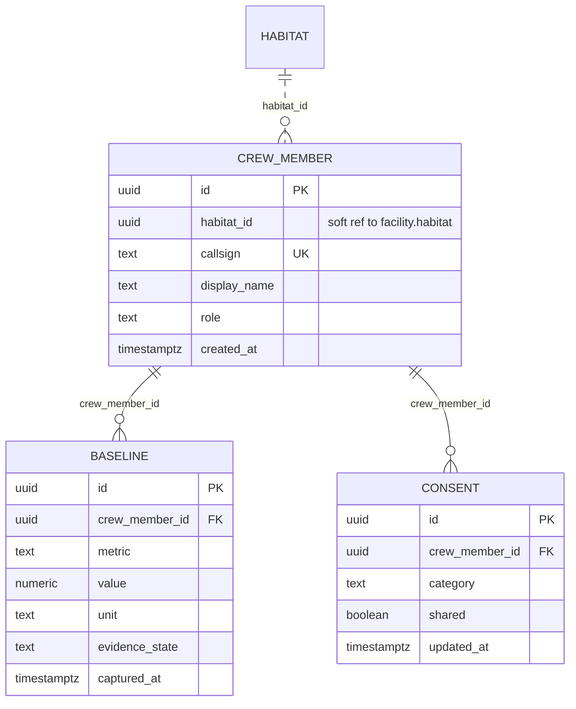

### 7.3 Schema `facility` · Facility

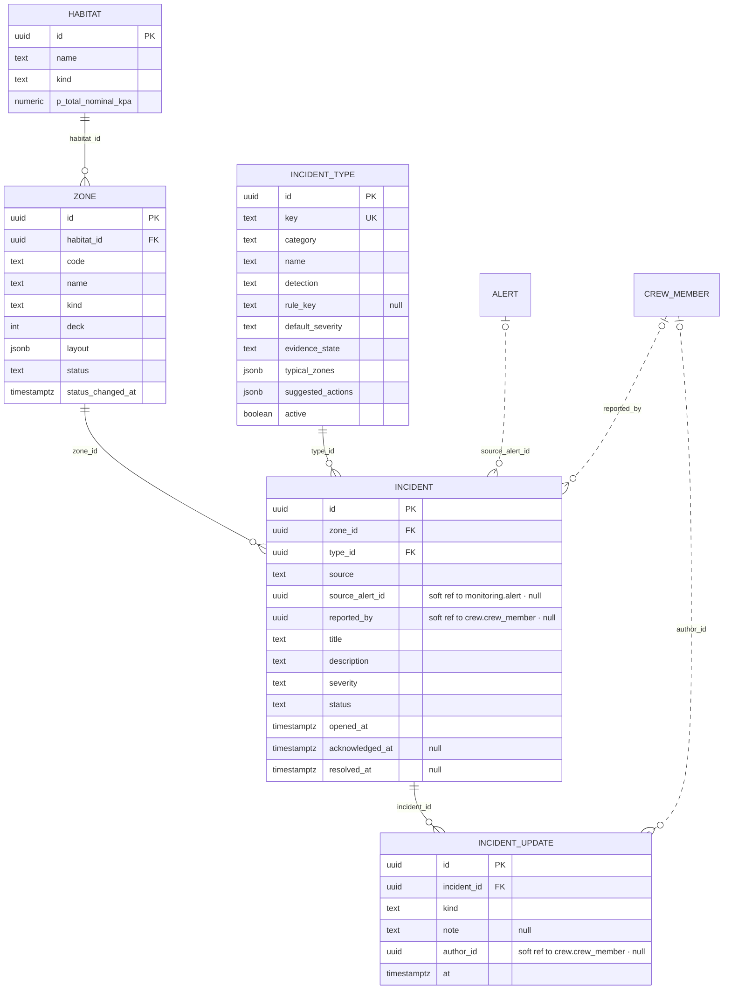

### 7.4 Schema `telemetry` · Telemetry

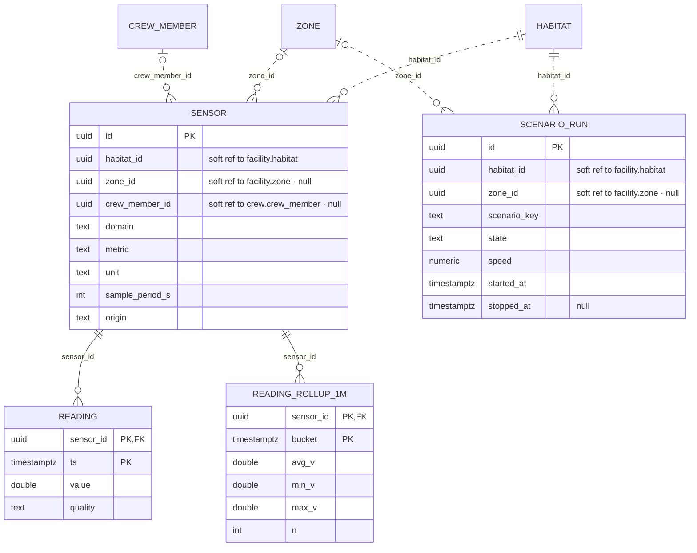

### 7.5 Schema `monitoring` · Monitoring and rules

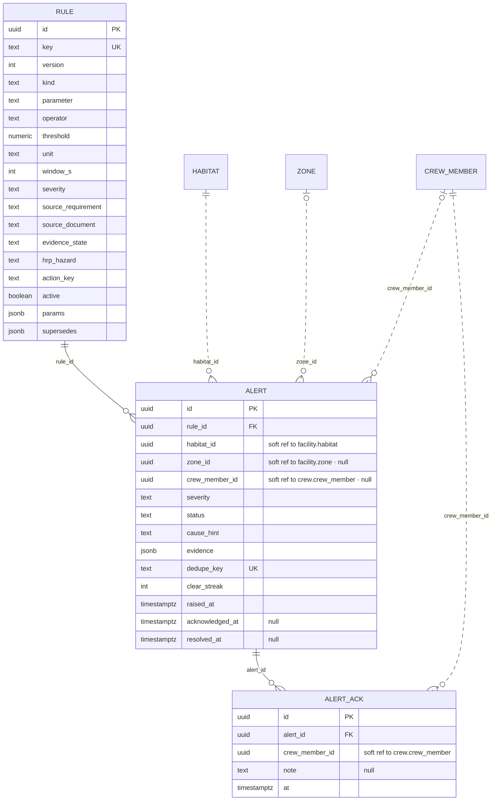

### 7.6 Schema `knowledge` · Knowledge (RAG)

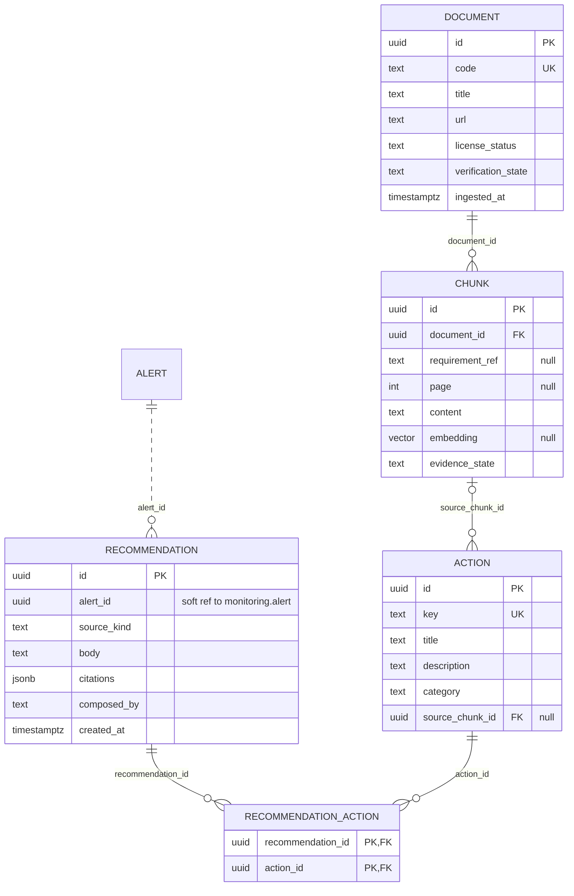

### 7.7 Schema `assistant` · Assistant and voice

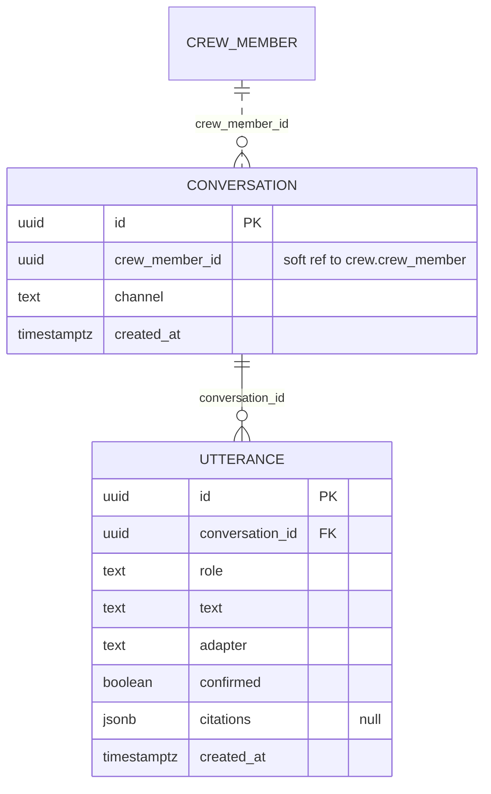

### 7.8 Schema `engagement` · Missions and tasks

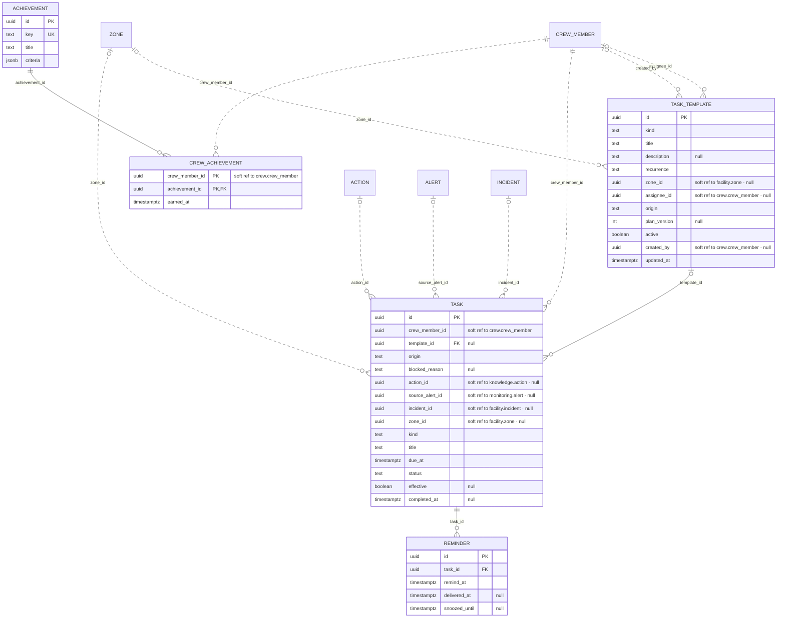

### 7.9 Schema `groundlink` · Ground link

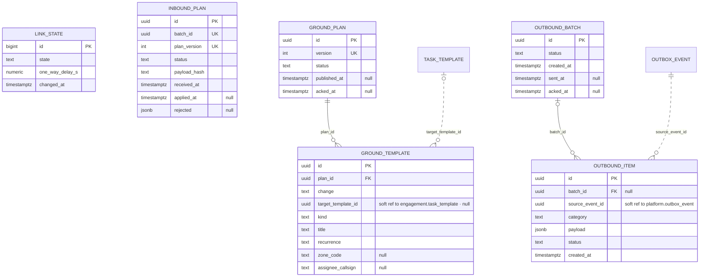

### 7.10 Schema `platform` · Platform (bus and outbox)

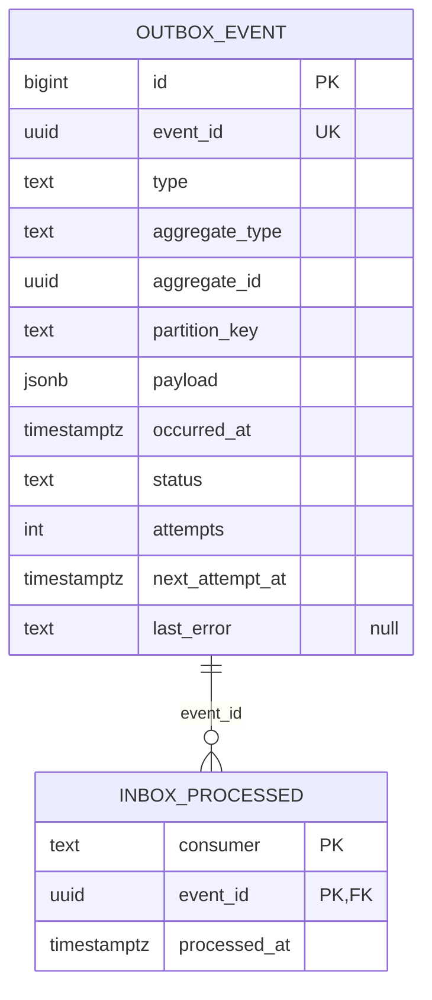

Model notes:

- `reading` is **partitioned by day** and has a BRIN index on `ts`. `reading_rollup_1m` is maintained from the ingestion handler.
- `alert.dedupe_key` is unique while the alert is active (partial index). It prevents storms of identical alerts.
- `rule.evidence_state` and `sensor.origin` are mandatory and travel all the way to the interface.
- `chunk.embedding` is optional. Without it, search is full-text.
- `habitat` and `zone` live in `facility`. Each zone's floor plan (`zone.layout`) is JSON, so switching from a ship to a lunar base means changing data.
- `incident.source` is `ALERT` or `MANUAL`. An automatic ticket stores `source_alert_id` as a soft reference.
- `task.kind` is `HEALTH`, `SHIP` or `INCIDENT`. Incident tasks carry `incident_id` and `zone_id`.
- `rule.kind` is `threshold` (standard limit or demo) or `trend` (anomaly against recent history, always demo).
- `rule.params` stores a rule's own settings (windows and minimums of the trend detector, minimum pressure change) and `rule.supersedes` the milder rules it replaces when it fires. Each rule has a fixed severity: going from Attention to Alert means resolving the mild alert and raising the serious one.
- `alert.clear_streak` counts consecutive clean evaluations. The alert resolves when it reaches the hysteresis (3 by default), unless another, more serious rule replaces it.

## 8. Sequence diagrams

### 8.1 From reading to alert

Scenario: ppCO₂ rises slowly and the astronaut reports a headache.

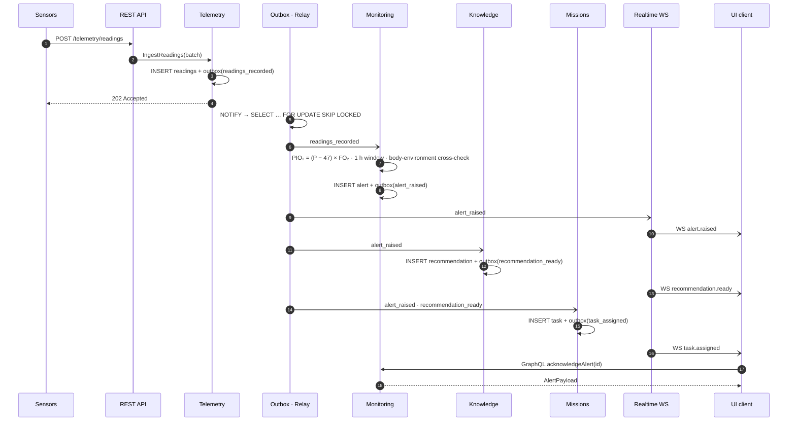

What happens at each step:

1. The simulator (or a real sensor) sends a batch with timestamps. Every reading carries the SIMULATED origin and the interface shows it.
2. The REST router only validates with Pydantic and calls the use case. There are no domain rules in the adapter.
3. A single transaction: readings and event. If anything fails, neither is stored. That removes the dual write.
4. The sensor does not wait for the rest of the chain.
5. The relay wakes up via LISTEN/NOTIFY, or after 500 ms by polling, and takes the pending ones in id order.
6. Before running the handler, inbox_processed is checked to ignore duplicates.
7. The rules engine is pure and deterministic. It computes derived values, evaluates the catalog and proposes a probable cause. The language model does not take part.
8. Deduplicates by (rule, habitat) while the alert stays active, with hysteresis so it does not flicker.
9. Realtime is just another bus subscriber.
10. Proposed latency budget: under 1 s from the reading to the screen. Still to be measured.
11. Knowledge looks up the catalog action and the citable passages for that rule.
12. Template text with citations. The alert never waits for the language model.
13. The interface shows what to do, with document, requirement and evidence state.
14. Missions turns the action into a task with a reminder.
15. Critical alerts generate no points or streaks. Only tasks.
16. The task appears in the alert detail.
17. The astronaut acknowledges. Same rule: transaction with outbox(alert_acknowledged).
18. The mutation response is the final state of the alert.

### 8.2 Voice query with confirmation

Profile dev1 or jury: local Whisper, local Ollama, no internet.

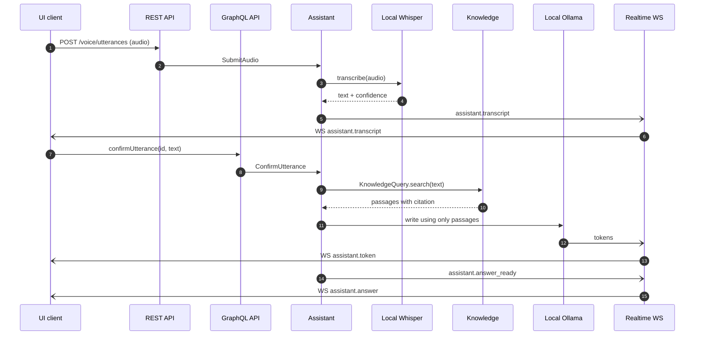

What happens at each step:

1. Hold to talk. Typed text input also exists as an alternative.
2. The use case stores the audio and answers 202 right away.
3. SpeechToText port. In dev2 the adapter is Alexa and the voice goes out to the cloud. This must be said.
4. Whisper can fail with medical terms or cabin noise.
5. Published through the outbox like everything else.
6. The interface shows what was understood, editable. Nothing is acted on without confirmation.
7. The astronaut confirms or corrects.
8. The resolver only translates into a call to the use case.
9. Synchronous read through a public facade. No access to another module's tables.
10. If no passage supports the answer, the assistant says it does not have that information.
11. With an 8 s timeout. If it expires, the answer is the passages as plain text.
12. Streaming goes out through the gateway, not through the module.
13. The answer is seen taking shape.
14. Final version with citations and evidence state.
15. The citations are links to the passage in Knowledge.

### 8.3 Incident in a ship zone

Scenario: laboratory CO₂ rises. The floor plan paints the zone and the ticket appears with description, severity and location.

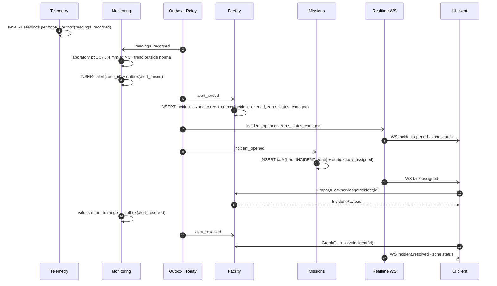

What happens at each step:

1. Every reading carries zone_id. Measured continuously: O₂, CO₂, N₂, humidity, temperature and pressure.
2. Monitoring evaluates the catalog per zone, not only for the whole cabin.
3. Two kinds of rule: threshold (from the standard) and trend (demo). Both deterministic.
4. Deduplicates by (rule, zone) while it stays active.
5. Facility subscribes to zone alerts. It does not read Monitoring tables.
6. The ticket is born with a description built from the rule, severity, location and source alert. The zone changes status in the same transaction.
7. Realtime translates them into messages per topic.
8. The floor plan marks the zone with its color and an icon, and the ticket appears with its description.
9. Missions creates the incident tasks.
10. They land in the tasks of the day, next to the health and maintenance ones.
11. The ticket shows its tasks with a checkbox.
12. The crew acknowledges the ticket.
13. The status becomes acknowledged. incident_updated is emitted.
14. When the zone normalizes, Monitoring reports it.
15. The ticket is marked "values normal, can be closed". It does not close by itself.
16. The decision to close belongs to the crew.
17. The zone goes back to green if there are no other active alerts.

### 8.4 Task plan from Ground

Option B: mission control publishes a versioned plan. The ship applies it and keeps the last one if the link drops. The crew also creates their own.

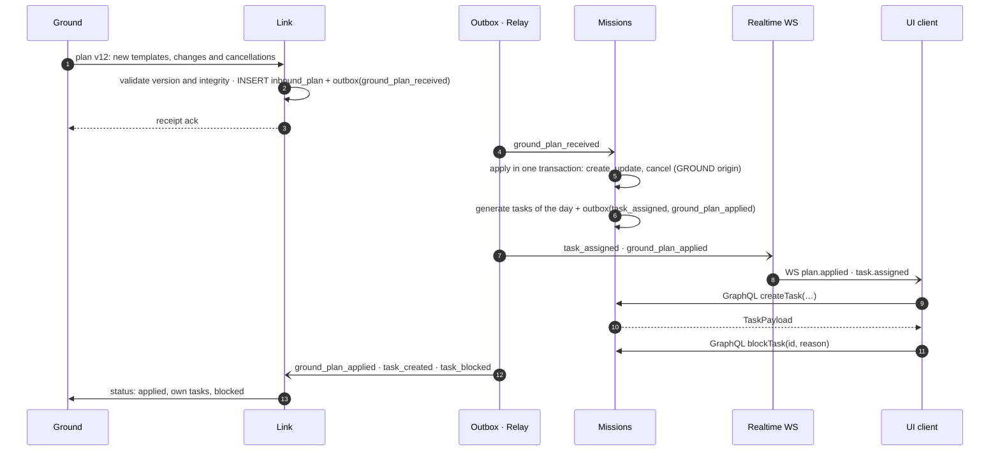

What happens at each step:

1. With the delay, it arrives when it arrives. The batch is idempotent by batch_id and plan_version.
2. A lower or repeated version is ignored. A corrupt one is rejected with a reason.
3. Ground knows it arrived, not yet that it was applied.
4. Missions owns the tasks. Ground link does not write to its tables.
5. What was already completed today is not touched. Changes apply to future instances. The crew's own tasks are not altered.
6. If something is rejected, the reason is reported and the rest is applied.
7. Realtime is just another subscriber.
8. A "Plan v12 applied" notice and the tasks with the Ground mark.
9. The crew creates their own task. It gets the CREW origin and does not depend on the link.
10. task_created is published through the outbox.
11. A Ground task cannot be done. It is not deleted: it is reported with a reason.
12. Only what the tasks category consent allows goes up.
13. Ground sees the result on reconnect and can publish the next version.

### 8.5 Link loss and reconnection with Ground

The system works the same without a link. When it returns, it uploads only what the astronaut authorized.

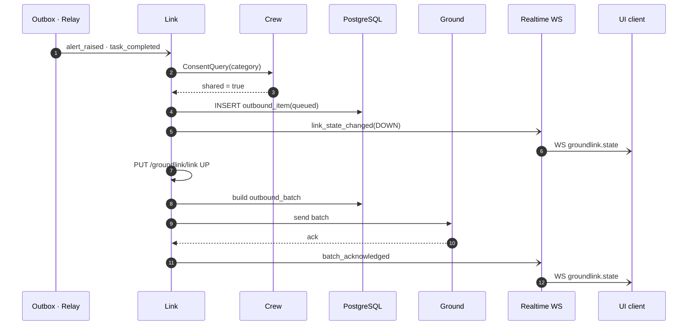

What happens at each step:

1. The link module subscribes to the events that Ground might see.
2. Read through a facade. If the category is not shared, the item stays withheld.
3. Critical alerts may have consent by default. Open decision.
4. With the link down it only queues. Nothing fails.
5. The interface shows the "No link · autonomous" chip.
6. The astronaut sees how many items are waiting.
7. Simulated in the demo. In real operation the GroundLink adapter reports it.
8. Groups in order of occurrence. Excludes what is withheld.
9. GroundLink port. The simulated adapter returns an ack with a configurable delay.
10. With the delay to Mars (3 to 22 min each way, unverified) the ack takes a while. That is why batches are idempotent.
11. Marked acked.
12. The queue goes back to zero.

### 8.6 Outbox: retries and dead events

What happens when a handler fails.

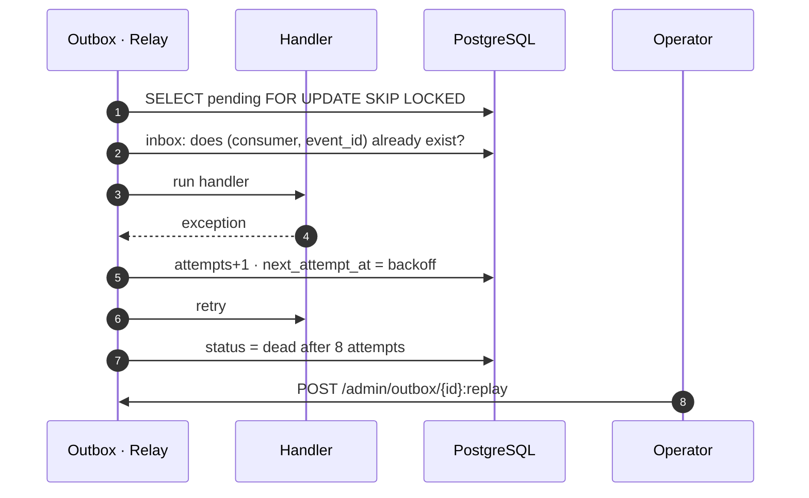

What happens at each step:

1. Takes up to 100 rows with status pending and next_attempt_at due.
2. If it exists, it is skipped. This makes the retry safe.
3. Each handler runs in its own transaction and writes its row to inbox_processed.
4. A failed handler does not block the other consumers of the same event.
5. Waits 1, 2, 4, 8 … seconds capped at 60 s.
6. Consumers that already finished are skipped by the inbox.
7. last_error is stored. /ready reports the lag.
8. An operator fixes the cause and requeues.

## 9. Communication diagram (scenario: rising CO₂)

The numbers are the order of the messages. Everything that leaves the outbox goes through the relay.

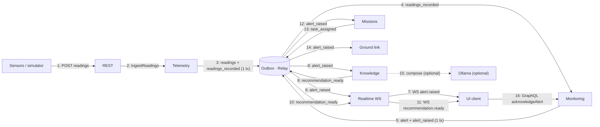

### 9.1 Scenario: incident in a ship zone

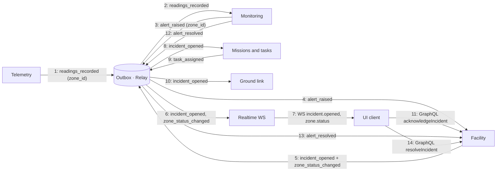

## 10. Communication channels and events

**When to use each channel**

| Channel | Use it for | Do not use it for |
| --- | --- | --- |
| REST | Machine inputs: sensor batches, audio, Alexa webhook, simulator control, health and operations | Interface queries |
| GraphQL | Everything the interface asks for or changes: queries with a tailored shape and mutations with a typed result | Server push. There are no subscriptions |
| WebSocket | Everything the server pushes: ticks, alerts, recommendations, tasks, assistant streaming, link state | Commands. User actions go through GraphQL |
| Event (outbox) | Communication between modules inside the process | High-frequency data, such as an individual reading |

### 10.1 REST

| ID | Method and route | Origin → destination | What it does | Payload | Response |
| --- | --- | --- | --- | --- | --- |
| R1 | `POST /api/v1/telemetry/readings` | Sensors / Simulator → Telemetry | Batch of readings from the body, the cabin or radiation | sensor_id, zone_id, ts, value, quality (batch of up to 500) | 202 Accepted. Idempotent by (sensor_id, ts) |
| R2 | `POST /api/v1/voice/utterances` | UI client → Assistant and voice | Uploads the astronaut's audio (multipart). The transcript comes back over WS | audio webm/wav, conversation_id | 202 + utterance_id |
| R3 | `POST /api/v1/alexa/webhook` | Alexa (dev2 only) → Assistant and voice | Alexa skill request. Only in the dev2 profile. Not standalone | Alexa request JSON | Only with the dev2 profile |
| R4 | `POST /api/v1/sim/scenarios/{key}:start · :stop` | UI client → Telemetry | Starts or stops a simulated scenario, optionally in one zone (slow CO₂, hypoxia, pressure leak) | key, zone_id, speed | 200. Emits telemetry.scenario_changed |
| R5 | `PUT /api/v1/groundlink/link` | UI client → Ground link | Simulates the ground link dropping or coming back | state UP\|DOWN\|DEGRADED, delay_s | 200. Emits groundlink.link_state_changed |
| R6 | `GET /api/v1/rules/catalog.json` | UI client → Monitoring and rules | Exports the versioned catalog with source and evidence state | — | 200. Cached by version |
| R7 | `GET /health · GET /ready` | Operations / dev → Platform (bus and outbox) | Health of the process, of PostgreSQL and of the relay lag | — | 200 / 503 |
| R8 | `POST /api/v1/admin/outbox/{id}:replay` | Operations / dev → Platform (bus and outbox) | Requeues an event in the dead state | id | 202 |
| R9 | `POST /api/v1/groundlink/inbound/plans` | Mission control (Ground) → Ground link | Delivers a task plan from Ground (new templates, changes and cancellations). In the demo it is sent by the Ground simulator | batch_id, plan_version, items[change, template], hash | 202. Idempotent by batch_id and plan_version |

### 10.2 GraphQL (`POST /graphql`)

| ID | Operation | Owner module | What it does | Returns | Notes |
| --- | --- | --- | --- | --- | --- |
| G1 | `Query dashboard(habitatId)` | Monitoring and rules | Snapshot: global status light, current values, derived PIO₂, active alerts | DashboardView | Read |
| G2 | `Query readings(sensorId, from, to, resolution)` | Telemetry | Series for the charts. Uses reading_rollup_1m | points[ts, avg, min, max] | Read |
| G3 | `Query alerts(filter, first, after)` | Monitoring and rules | History paginated by cursor | AlertConnection | Read |
| G4 | `Query alert(id)` | Monitoring and rules | Detail: rule, evidence, probable cause and recommendation with citations | Alert, Rule, Recommendation | Read |
| G5 | `Query rules(filter)` | Monitoring and rules | Catalog with source, requirement and state VERIFIED, TB or DEMO | Rule[] | Read |
| G6 | `Query knowledgeSearch(query, k)` | Knowledge (RAG) | Citable passages with document, requirement and page | Passage[] | Read |
| G7 | `Query crewMember(id)` | Crew | Profile, baseline and consents | CrewMember | Read |
| G8 | `Query tasks(crewMemberId, kind, status) · achievements` | Missions and tasks | Tasks of the day by kind (HEALTH, SHIP, INCIDENT), streak and achievements | Task[], Achievement[] | Read |
| G9 | `Query conversation(id)` | Assistant and voice | History with citations | Utterance[] | Read |
| G10 | `Query groundLinkStatus` | Ground link | Link state, queue and last sync | GroundLinkStatus | Read |
| G11 | `Query outboxStats` | Platform (bus and outbox) | Pending, dead and lag (dev profiles only) | OutboxStats | Read |
| G20 | `Query ship(habitatId)` | Facility | Floor plan: zones with their color status, open incidents and last reading per zone | Zone[], Incident[], ZoneReading | Read |
| G21 | `Query incidents(filter, first, after)` | Facility | Tickets paginated by zone, severity or status | IncidentConnection | Read |
| G22 | `Query incident(id)` | Facility | Full ticket: description, severity, location, history, tasks and source alert | Incident, IncidentUpdate[], Task[] | Read |
| G23 | `Query zoneReadings(zoneId, metrics, from, to, resolution)` | Telemetry | O₂, CO₂, N₂, humidity, temperature and pressure series of a zone for the charts | series[metric, points] | Read. Uses reading_rollup_1m |
| G27 | `Query groundPlan` | Missions and tasks | Applied Ground plan version, when it arrived and which changes are waiting | GroundPlanView | Read |
| G28 | `Query incidentTypes(category)` | Facility | Incident type catalog grouped by category, with severity and suggested actions | IncidentType[] | Read. Cached by catalog version |
| G12 | `Mutation acknowledgeAlert(id, note)` | Monitoring and rules | The astronaut acknowledges the alert | AlertPayload \| AlertError | Transaction + outbox. Idempotent |
| G13 | `Mutation completeTask(id, effective)` | Missions and tasks | Completes a measure and records whether it worked | TaskPayload | Transaction + outbox |
| G14 | `Mutation snoozeReminder(id, minutes)` | Missions and tasks | Snoozes a reminder | ReminderPayload | Transaction |
| G15 | `Mutation setConsent(category, shared)` | Crew | Decides which data category is shared with Ground | ConsentPayload | Transaction + outbox |
| G16 | `Mutation recordBaseline(metric, value)` | Crew | Records or updates the personal baseline | BaselinePayload | Transaction + outbox |
| G17 | `Mutation confirmUtterance(id, text)` | Assistant and voice | Confirms or corrects the transcript before acting | UtterancePayload | Transaction. Triggers the answer |
| G18 | `Mutation askAssistant(text, conversationId)` | Assistant and voice | Asks by text, an alternative to the microphone | UtterancePayload. The answer arrives over WS | Asynchronous answer |
| G24 | `Mutation reportIncident(typeKey, zoneId, title, description, severity)` | Facility | The crew opens a manual ticket by choosing category and type | IncidentPayload \| IncidentError | Transaction + outbox |
| G29 | `Mutation createTask(kind, title, zoneId, dueAt, recurrence)` | Missions and tasks | The crew creates a task of their own (CREW origin) | TaskPayload | Transaction + outbox |
| G30 | `Mutation updateTask(id, …) · deleteTask(id)` | Missions and tasks | Edits or deletes a task of their own. Ground tasks return a typed error | TaskPayload \| TaskError | CREW origin only |
| G31 | `Mutation blockTask(id, reason)` | Missions and tasks | Reports that a task cannot be done, with a reason. Does not delete it | TaskPayload | Transaction + outbox |
| G32 | `Query groundTasks(filter) · ground role` | Ground link | Ground panel: status of each template (sent, received, applied, completed, blocked) and shared own tasks | GroundTaskView[] | Only what consent allows |
| G33 | `Mutation saveGroundTemplate(planId, template) · ground role` | Ground link | Creates or edits a template in the plan draft | GroundTemplatePayload | Transaction |
| G34 | `Mutation cancelGroundTemplate(planId, templateId) · ground role` | Ground link | Marks a template for cancellation in the draft | GroundTemplatePayload | Transaction |
| G35 | `Mutation publishGroundPlan(planId) · ground role` | Ground link | Publishes the plan with the next version and sends it over the link. Waits for confirmation | GroundPlanPayload | Idempotent by plan and version |
| G25 | `Mutation acknowledgeIncident(id, note)` | Facility | Acknowledges the ticket and leaves a note | IncidentPayload | Transaction + outbox. Idempotent |
| G26 | `Mutation resolveIncident(id, note)` | Facility | Closes the ticket. The zone returns to its status according to the active alerts | IncidentPayload | Transaction + outbox |
| G19 | `Mutation syncGroundLinkNow` | Ground link | Forces the queue to be sent when there is a link | GroundLinkStatus | Idempotent by batch |

### 10.3 WebSocket (`/ws`)

Server message: `{ "seq": 18342, "topic": "alerts", "type": "alert.raised", "at": "…", "data": { … } }`. `seq` is the outbox `id` when the message comes from an event. On ticks it is `null`.

Backpressure: a per-client queue of 500 messages. If it fills up, `telemetry.tick` messages are dropped first. Alerts are never dropped.

| ID | Message | Direction | What it does | Payload | Delivery |
| --- | --- | --- | --- | --- | --- |
| W1 | `telemetry.tick` | Server → Client | Current values per zone and sensor, aggregated at 1 Hz | zone_id, metric, value, ts, state | Coalesced or dropped under pressure |
| W2 | `alert.raised · alert.updated · alert.resolved` | Server → Client | Alert lifecycle | alert_id, severity, rule_key, evidence_state | Never dropped. With resume |
| W3 | `recommendation.ready · recommendation.enriched` | Server → Client | First the deterministic version, then the LLM text | alert_id, actions[], citations[], composed_by | With resume |
| W4 | `task.assigned · reminder.due` | Server → Client | Missions and reminders | task_id, due_at | With resume |
| W5 | `assistant.transcript` | Server → Client | Transcript pending confirmation | utterance_id, text, confidence | With resume |
| W6 | `assistant.token · assistant.answer` | Server → Client | Streaming answer and final version with citations | utterance_id, delta \| text, citations[] | Tokens may be lost. The final answer is not |
| W7 | `groundlink.state` | Server → Client | Ground link changes | state, queued, last_sync | With resume |
| W12 | `incident.opened · incident.updated · incident.resolved` | Server → Client | Incident tickets with zone, severity and description | incident_id, zone_id, severity, title, status | Never dropped. With resume |
| W13 | `zone.status` | Server → Client | Color and status of a floor plan zone | zone_id, status, open_incidents | With resume |
| W14 | `plan.received · plan.applied` | Server → Client | A task plan from Ground arrived or was applied | plan_version, applied, rejected[] | With resume |
| W8 | `scenario.changed` | Server → Client | Active simulated scenario | key, state, speed | With resume |
| W9 | `subscribe · unsubscribe` | UI client → Server | Chooses topics (habitat, crew, alerts, assistant) | topics[] | Replies subscribed |
| W10 | `resume` | UI client → Server | Resumes after a drop. The server resends from that outbox id | after_outbox_id | Resend from outbox_event (24 h retention) |
| W11 | `ping · pong` | UI client → Server | Heartbeat every 15 s | ts | — |

### 10.4 Domain events

| ID | Event | Emitter | Receivers | When | Payload | Guarantees |
| --- | --- | --- | --- | --- | --- | --- |
| E1 | `telemetry.readings_recorded` | Telemetry | Monitoring and rules, Realtime gateway | A batch of readings was stored | batch_id, habitat_id, ts_from, ts_to, latest[sensor_id, metric, value] | Outbox, at-least-once. Partition habitat_id |
| E2 | `telemetry.scenario_changed` | Telemetry | Realtime gateway | The simulated scenario changed | key, state, speed | Outbox |
| E3 | `monitoring.alert_raised` | Monitoring and rules | Knowledge (RAG), Missions and tasks, Realtime gateway, Ground link, Facility | A rule fired, with the affected zone if the reading comes from a zone | alert_id, zone_id, rule_key, severity, evidence, cause_hint | Outbox. Idempotency by alert_id |
| E4 | `monitoring.alert_acknowledged` | Monitoring and rules | Missions and tasks, Realtime gateway, Ground link | The crew acknowledged the alert | alert_id, crew_member_id, at | Outbox |
| E5 | `monitoring.alert_resolved` | Monitoring and rules | Missions and tasks, Realtime gateway, Ground link, Facility | Values returned to range | alert_id, resolved_at, duration_s | Outbox |
| E6 | `knowledge.recommendation_ready` | Knowledge (RAG) | Missions and tasks, Realtime gateway, Ground link | Deterministic recommendation with citations ready | alert_id, recommendation_id, action_keys[], citations[] | Outbox. Does not wait for the LLM |
| E7 | `knowledge.recommendation_enriched` | Knowledge (RAG) | Realtime gateway | The LLM wrote the explanation (optional) | recommendation_id, text | Outbox. May not happen |
| E8 | `engagement.task_assigned` | Missions and tasks | Realtime gateway | A health mission was created | task_id, crew_member_id, action_key, due_at | Outbox |
| E9 | `engagement.task_completed` | Missions and tasks | Realtime gateway, Ground link | A measure was completed | task_id, action_key, effective | Outbox |
| E10 | `assistant.answer_ready` | Assistant and voice | Realtime gateway | The final answer is ready | utterance_id, text, citations[] | Outbox |
| E11 | `crew.baseline_updated` | Crew | Monitoring and rules | A crew member's baseline changed | crew_member_id, metric, value | Outbox |
| E12 | `crew.consent_changed` | Crew | Ground link | Which category is shared changed | crew_member_id, category, shared | Outbox |
| E13 | `groundlink.link_state_changed` | Ground link | Realtime gateway | The link went up or down | state, since, queued | Outbox |
| E15 | `facility.incident_opened` | Facility | Missions and tasks, Realtime gateway, Ground link | A ticket was opened, automatic or manual | incident_id, zone_id, severity, title, description, source | Outbox. Idempotency by incident_id |
| E16 | `facility.incident_updated` | Facility | Realtime gateway, Ground link | The ticket severity or status changed | incident_id, severity, status, note | Outbox |
| E17 | `facility.incident_resolved` | Facility | Missions and tasks, Realtime gateway, Ground link | The ticket was closed | incident_id, zone_id, resolved_at | Outbox |
| E18 | `facility.zone_status_changed` | Facility | Realtime gateway | The color of a floor plan zone changed | zone_id, status, open_incidents | Outbox |
| E19 | `groundlink.ground_plan_received` | Ground link | Missions and tasks, Realtime gateway | A valid, new Ground plan arrived | batch_id, plan_version, changes[NEW\|UPDATE\|CANCEL, template] | Outbox. Idempotency by plan_version |
| E20 | `engagement.ground_plan_applied` | Missions and tasks | Ground link, Realtime gateway | The plan was applied, in full or with rejections | plan_version, applied[], rejected[reason] | Outbox. It is the confirmation that goes up to Ground |
| E21 | `engagement.task_created` | Missions and tasks | Realtime gateway, Ground link | The crew created a task of their own | task_id, kind, title, zone_id, origin | Outbox. Goes up to Ground only if the tasks consent allows it |
| E22 | `engagement.task_blocked` | Missions and tasks | Realtime gateway, Ground link | A task cannot be done | task_id, origin, reason | Outbox |
| E14 | `groundlink.batch_acknowledged` | Ground link | Realtime gateway | Ground confirmed a batch | batch_id, items, acked_at | Outbox |

### 10.5 Emitter × receiver matrix

| Emitter \ Receiver | TEL | MON | KNW | AST | CRW | FAC | ENG | GRL | RT |
| --- | --- | --- | --- | --- | --- | --- | --- | --- | --- |
| TEL · Telemetry |  | readings_recorded |  |  |  |  |  |  | readings_recorded, scenario_changed |
| MON · Monitoring and rules |  |  | alert_raised |  |  | alert_raised, alert_resolved | alert_acknowledged, alert_raised, alert_resolved | alert_acknowledged, alert_raised, alert_resolved | alert_acknowledged, alert_raised, alert_resolved |
| KNW · Knowledge (RAG) |  |  |  |  |  |  | recommendation_ready | recommendation_ready | recommendation_enriched, recommendation_ready |
| AST · Assistant and voice |  |  |  |  |  |  |  |  | answer_ready |
| CRW · Crew |  | baseline_updated |  |  |  |  |  | consent_changed |  |
| FAC · Facility |  |  |  |  |  |  | incident_opened, incident_resolved | incident_opened, incident_resolved, incident_updated | incident_opened, incident_resolved, incident_updated, zone_status_changed |
| ENG · Missions and tasks |  |  |  |  |  |  |  | ground_plan_applied, task_blocked, task_completed, task_created | ground_plan_applied, task_assigned, task_blocked, task_completed, task_created |
| GRL · Ground link |  |  |  |  |  |  | ground_plan_received |  | batch_acknowledged, ground_plan_received, link_state_changed |
| RT · Realtime gateway |  |  |  |  |  |  |  |  |  |

## 11. GraphQL contract sketch

```graphql
enum EvidenceState { VERIFIED TB DEMO UNVERIFIED }
enum DataOrigin { SIMULATED REPLAY REAL }
enum CauseHint { ENVIRONMENT BODY INDETERMINATE }

type Rule {
  key: String!  parameter: String!  operator: String!  threshold: Float!  unit: String!
  windowSeconds: Int  severity: Severity!
  sourceRequirement: String!  sourceDocument: String!
  evidenceState: EvidenceState!  hrpHazard: String!
}
type Citation { documentCode: String!  requirementRef: String  page: Int  excerpt: String!  evidenceState: EvidenceState! }
type Recommendation { actions: [Action!]!  body: String!  citations: [Citation!]!  composedBy: String! }
type Alert {
  id: ID!  rule: Rule!  severity: Severity!  status: AlertStatus!  causeHint: CauseHint!
  evidence: JSON!  raisedAt: DateTime!  recommendation: Recommendation  tasks: [Task!]!
}

type Query {
  dashboard(habitatId: ID!): DashboardView!
  readings(sensorId: ID!, from: DateTime!, to: DateTime!, resolution: Resolution = MINUTE): [ReadingPoint!]!
  alerts(filter: AlertFilter, first: Int = 20, after: String): AlertConnection!
  alert(id: ID!): Alert
  knowledgeSearch(query: String!, k: Int = 5): [Citation!]!
  groundLinkStatus: GroundLinkStatus!
}

union AcknowledgeAlertResult = AlertAcknowledged | AlertNotFound | AlertAlreadyResolved
type Mutation {
  acknowledgeAlert(id: ID!, note: String): AcknowledgeAlertResult!
  completeTask(id: ID!, effective: Boolean): TaskPayload!
  setConsent(category: String!, shared: Boolean!): ConsentPayload!
  confirmUtterance(id: ID!, text: String!): UtterancePayload!
}
```

Rules: expected errors as types in a `union`, not as exceptions. Cursor pagination. DataLoaders against N+1. Query depth and cost limits.

## 12. Execution profiles

The `SPACEAPP_PROFILE` variable chooses the adapters in `main.py`. The name and the `jury` default are a **proposal**, not a decision of yours yet.

| Port | dev1 | dev2 | jury |
| --- | --- | --- | --- |
| Voice input (SpeechToText) | Local Whisper | Alexa (cloud, demo only) | Local Whisper |
| Sensor source (SensorSource) | Simulator | Simulator | Simulator |
| Knowledge (KnowledgeSource) | Demo + RAG | Demo + RAG | RAG; falls back to demo if a passage is missing |
| Text composition (TextComposer) | Ollama | Ollama | Ollama; falls back to a template if it takes more than 8 s |
| Link (GroundLink) | Simulated | Simulated | Simulated |

## 13. User experience

### 13.1 Users

| User | Context | What they need |
| --- | --- | --- |
| Astronaut (primary) | Cabin, sometimes wearing gloves, with noise and little time. Fixed screen or tablet | Understand their state at a glance, act on an alert and ask without typing |
| Mission control (secondary) | On Ground, with an intermittent link and delay | See what the crew authorized, in order and without duplicates |
| Jury and team | Review the code and run the image | Start without configuring anything and be able to force scenarios |

### 13.2 Experience principles

1. **Actions before explanation** on a critical alert. First what to do, then why.
2. **Color never stands alone.** Every state carries a shape, an icon and text: ● Normal, ▲ Attention, ■ Critical.
3. **Every figure shows its origin**: document, requirement and state (`VERIFIED`, `TB`, `DEMO`). Body data carries the "simulated" mark.
4. **Permanent banner:** "Decision-support prototype. Not a medical device."
5. **The ground link is always visible**, even when everything works without it.
6. **Nothing runs by voice without confirming** the transcript. There is always text input.
7. **Sober gamification:** routines and habits yes, critical alerts never. Ignoring or rushing an alert is never rewarded.
8. **Touch targets of 48 px or more**, AA contrast and dark mode by default for the cabin.

### 13.3 Screens

| Screen | Content | Data and channels |
| --- | --- | --- |
| Cabin panel | Global status light, cabin and radiation cards, human body with per-organ indicators, dynamic charts, link chip, environment selector (ship, station, rover, base) | `dashboard` and `readings` over GraphQL. `telemetry.tick` over WS |
| Alert detail | Actions, rule, measured values, probable cause (air or body), source and state, when to escalate to the CMO or to Ground | `alert(id)`. `alert.*` and `recommendation.*` over WS |
| Assistant | Speak or type, editable transcript, answer with citations, local or cloud mode | REST audio. `confirmUtterance`. `assistant.*` over WS |
| Tasks of the day | Three kinds: health, ship (maintenance) and incidents. Reminders, streak, achievements and "did the measure work?" | `tasks(kind)`, `completeTask`. `task.assigned` over WS |
| New task | Short form: kind (health or ship), title, zone and date. Available in the tasks of the day | `createTask`. `task_created` is published |
| Mission control (Ground) | Plan templates, draft of the next version, publish, status per task (sent, received, applied, completed, blocked) and link control (see 13.11) | `ground` role: `groundTasks`, `saveGroundTemplate`, `publishGroundPlan` |
| Ship panel | Zone floor plan with color and severity icon, tickets, gas and climate charts per zone (see 13.7) | `ship`, `incidents`, `zoneReadings`. `incident.*`, `zone.status` and `telemetry.tick` over WS |
| Trends and baseline | Comparison with the personal baseline, multi-day sleep | `readings`, `crewMember` |
| Link and privacy | Link state, queue, consent per category, batch preview | `groundLinkStatus`, `setConsent`. `groundlink.state` over WS |
| Scenarios (demo mode) | Choose scenario and speed, see the active profile | REST `sim/scenarios` |

### 13.4 Journey

| Stage | What it needs | What it sees | What happens in the system | How we know it works |
| --- | --- | --- | --- | --- |
| Routine | Know at a glance that everything is fine and what to do today. | Global status light in green, three cards (cabin, body, radiation), charts of the last hour and the day's missions. | telemetry.readings_recorded every few seconds. WS telemetry.tick at 1 Hz. task.assigned in the morning. | The astronaut responds in under 5 s if there is something to attend to. |
| Pre-alert | Find out early, without an audible alarm, and understand the probable cause. | Amber card with icon and the text "Attention". Trend line with the threshold drawn. Discreet notice with a link to the detail. | monitoring.alert_raised (yellow) → knowledge.recommendation_ready → engagement.task_assigned. | The probable cause (air or body) appears in under 2 s with its source. |
| Critical alert | Act fast. The screen says what to do before explaining why. | Full-screen alert panel: actions first, rule, values, source and evidence state, when to escalate to the CMO or to Ground. Sound and vibration. | alert_raised → recommendation_ready (template) → recommendation_enriched (LLM, if it arrives). All through the same outbox. | The alert reaches the screen in under 1 s and does not depend on voice or the LLM. |
| Incident on the ship | Know where the problem is, how serious it is and who is handling it. | Ship floor plan with the zone colored and a severity icon. Ticket with description, severity and location. Gas and climate charts of that zone, measured continuously. | monitoring.alert_raised (with zone) → facility.incident_opened → engagement.task_assigned. Realtime: incident.opened and zone.status. | The ticket and the zone color appear in under 1 s. Every ticket has at least one assigned task. |
| Plan from Ground | Receive the tasks Ground scheduled and be able to create your own. | Tasks with their origin (Ground, system or crew), a "Plan v12 applied" notice, a button to create a task and "I cannot do it" with a reason. | groundlink.ground_plan_received → engagement applies templates → engagement.ground_plan_applied (confirmation to Ground). | The plan is applied in full or with explained rejections. Without a link, the last received plan continues. |
| Assistant query | Ask without typing and trust the answer. | Talk button, editable transcribed text, streaming answer with citations and a mode label (local or cloud). | POST audio → assistant.transcript → confirmUtterance → KnowledgeQuery → assistant.answer. | Zero actions taken without confirmation. "I do not have that information" when there is no passage. |
| No ground link | Keep working and decide what is shared when the link returns. | "No link · autonomous" chip, queue of pending items, consent switches per category and a batch preview. | outbound_item queued/withheld → link_state_changed(UP) → batch → batch_acknowledged. | Nothing is uploaded without consent. The queue is not lost if the machine restarts. |

### 13.5 States and errors

- **No data yet:** skeleton with the phrase "Waiting for simulator readings", not an empty panel.
- **WebSocket down:** bar "Reconnecting… showing the last data from N s ago". When it returns, `resume` is sent.
- **Slow or absent model:** the template recommendation is already on screen. The enriched text appears when it arrives, without jumps.
- **Doubtful transcript:** the text is highlighted for correction before sending.
- **No passage supports the answer:** "I do not have that information in the loaded sources." A protocol is never made up.

### 13.6 Human body in the panel

A silhouette with six indicators: head (mood and headache), lungs (SpO₂), heart (heart rate), blood and organs (radiation), bones and muscle (baseline) and temperature. Each indicator uses the same status light with an icon, and when tapped it shows the value, the NASA human research program hazard it relates to (radiation, microgravity, isolation, closed environment) and its evidence state. Body values are demo data and carry the label.

### 13.7 Ship panel

- **Floor plan:** schematic view of the ship with the physical zones (bridge, laboratory, infirmary, airlock, life support, engineering, storage, gym, galley and crew quarters). Zones are data in `zone.layout`.
- **Color by status:** green normal, amber attention, red alert, magenta critical. Each status carries an icon and critical also a hatched pattern, so it does not depend on color alone.
- **Incident ticket:** identifier, **description**, **severity**, **location** (zone and deck), origin (automatic alert or manual report), history and associated tasks. The ticket appears in a list and as a mark over its zone on the floor plan.
- **Atmosphere per zone:** choosing a zone shows charts of O₂ (PIO₂), CO₂ (ppCO₂), N₂, humidity, temperature and pressure, with the severity bands drawn. They are measured continuously (1 Hz in the demo).
- **Alerts:** by threshold (standard, `TB` or `DEMO`) and by **trend anomaly** (a change outside normal relative to recent history, `DEMO`). Only severity Alert or higher opens an automatic ticket. A trend generates an attention notice.
- **Closing:** when values normalize, the ticket is marked "values normal, can be closed". The crew decides to close it.
- **Manual report:** any crew member can open a ticket by choosing zone, severity and description.

### 13.8 Daily crew tasks

Each task has a **kind** (health, ship or incident) and an **origin** (Ground, system or crew). The origin is always shown on the card.

| Kind | Origin | Examples (demo) |
| --- | --- | --- |
| Health | Health routine and alert recommendations | Endurance exercise, log mood, measure blood pressure, check ventilation after a CO₂ alert |
| Ship | Daily maintenance per zone | Inspect airlock seals, check the life support CO₂ cartridge, verify laboratory filters, check the medical kit |
| Incident | Created when a ticket opens | Suggested actions for the rule that fired, or "assess and attend" on a manual report |

Every task has a reminder. Incident tasks are linked to their ticket and are completed when it closes. All of them record whether the measure worked. Only health routines count toward the streak and achievements.

### 13.9 Incident type catalog

Tickets are classified by **category** and **type**. The catalog is versioned data (`incident_type`). Each type defines its detection (`AUTO` with a rule, or `MANUAL`), default severity, typical zones, suggested actions and evidence state. It is a **proposal**: only those marked `VERIFIED` come from the standard and the rest is `DEMO`.

The manual report form asks first for the category, then the type, and proposes severity, zone and actions. Automatic tickets inherit the type of the rule that fired.

**Atmosphere and life support** (14)

| Type | Detection | Rule | Default severity | Evidence | Typical zones | Suggested actions |
| --- | --- | --- | --- | --- | --- | --- |
| `co2_high` High CO₂ | AUTO | `env-co2-1h` | Alert | VERIFIED | Any | Check ventilation and CO₂ filters; Measure CO₂ in local zones |
| `hypoxia` Hypoxia (low PIO₂) | AUTO | `env-pio2` | Critical | VERIFIED | Life support, Any | Check the O₂ supply and pressure; Reduce physical exertion |
| `hyperoxia` Hyperoxia (high PIO₂) | AUTO | `env-pio2` | Alert | VERIFIED | Life support, Any | Check the O₂ supply; Lower the O₂ partial pressure |
| `pressure_leak` Pressure leak or rapid depressurization | AUTO | `env-dpdt` | Critical | VERIFIED | Airlock, Engineering and propulsion, Any | Check the integrity of hatches and seals; Isolate the zone |
| `pressure_range` Total pressure out of range | AUTO | `env-ptotal` | Alert | VERIFIED | Any | Check sensors and airtightness |
| `diluent_low` Low diluent (N₂) | AUTO | `env-n2` | Alert | VERIFIED | Any | Check the atmosphere composition |
| `humidity` Humidity out of range | AUTO | `env-rh` | Attention | DEMO | Any | Check the condenser and ventilation |
| `temperature` Temperature out of range | AUTO | `env-t` | Attention | DEMO | Any | Check the thermal loop and ventilation |
| `combustion_gases` Combustion gases or contaminants (CO, HCN, HCl, HF) | AUTO | `env-combustion` | Critical | DEMO | Galley and dining, Engineering and propulsion, Laboratory | Ventilate and isolate the zone; Notify the Chief Medical Officer (CMO) |
| `air_contaminant` Methane or another air contaminant | MANUAL | — | Alert | DEMO | Laboratory, Life support | Ventilate the zone; Consult the contaminant limits list (SMAC, pending) |
| `filter_failure` CO₂ filter or cartridge failure | MANUAL | — | Attention | DEMO | Life support | Replace the cartridge and log hours of use |
| `ventilation_failure` Ventilation failure | MANUAL | — | Alert | DEMO | Any | Check fans and ducts |
| `condenser_failure` Condenser or water recycling failure | MANUAL | — | Attention | DEMO | Life support | Inspect the condenser |
| `co2_pocket` Local CO₂ pocket that the fixed sensor does not see | MANUAL | — | Attention | TB | Crew quarters, Any | Measure CO₂ in the zone with a portable sensor; Improve air circulation |

**Fire and smoke** (3)

| Type | Detection | Rule | Default severity | Evidence | Typical zones | Suggested actions |
| --- | --- | --- | --- | --- | --- | --- |
| `smoke_fire` Smoke or fire | AUTO | `env-smoke` | Critical | DEMO | Galley and dining, Engineering and propulsion, Storage | Activate the fire procedure; Isolate the zone |
| `burning_smell` Burning smell or overheating | MANUAL | — | Alert | DEMO | Any | Disconnect the suspect equipment; Inspect the zone |
| `suppression_failure` Fire suppression system failure | MANUAL | — | Alert | DEMO | Any | Check the extinguishers and the system |

**Water and food** (4)

| Type | Detection | Rule | Default severity | Evidence | Typical zones | Suggested actions |
| --- | --- | --- | --- | --- | --- | --- |
| `water_low` Drinking water below the minimum (2.5 L per crew member per day) | AUTO | `water-budget` | Alert | TB | Galley and dining, Storage | Check the inventory and recycling |
| `water_contaminated` Water contamination | MANUAL | — | Alert | DEMO | Galley and dining, Life support | Stop consuming and take a sample |
| `water_leak` Water leak or condensation | MANUAL | — | Alert | DEMO | Any | Locate and contain the leak |
| `food_shortage` Insufficient or damaged food | MANUAL | — | Attention | DEMO | Galley and dining, Storage | Check the inventory and adjust the menu |

**Power and thermal** (4)

| Type | Detection | Rule | Default severity | Evidence | Typical zones | Suggested actions |
| --- | --- | --- | --- | --- | --- | --- |
| `electrical_fault` Electrical fault or overload | AUTO | `power-bus` | Alert | DEMO | Engineering and propulsion | Check the power bus |
| `power_low` Low power or battery | AUTO | `power-bus` | Alert | DEMO | Engineering and propulsion | Reduce non-essential loads |
| `short_circuit` Short circuit or electric arc | MANUAL | — | Critical | DEMO | Any | Cut the power to the circuit |
| `thermal_loop_failure` Thermal loop or radiator failure | AUTO | `therm-loop` | Alert | DEMO | Engineering and propulsion | Check the loop and the radiators |

**Structure and mechanics** (6)

| Type | Detection | Rule | Default severity | Evidence | Typical zones | Suggested actions |
| --- | --- | --- | --- | --- | --- | --- |
| `debris_impact` Micrometeoroid or debris impact | MANUAL | — | Critical | DEMO | Any | Inspect the hull and the pressure |
| `hull_damage` Hull leak or damage | MANUAL | — | Critical | DEMO | Any | Isolate the module and check the pressure |
| `hatch_failure` Hatch or seal failure | MANUAL | — | Alert | DEMO | Airlock, Any | Inspect the seal |
| `airlock_failure` Airlock failure | MANUAL | — | Alert | DEMO | Airlock | Suspend extravehicular activities |
| `noise_limit` Noise above the limit | AUTO | `env-noise` | Attention | VERIFIED | Crew quarters, Engineering and propulsion | Reduce the noise source |
| `vibration_sleep` Vibration above 0.01 g RMS during sleep | AUTO | `env-vibration` | Attention | VERIFIED | Crew quarters | Identify and dampen the source |

**Propulsion, navigation and control** (4)

| Type | Detection | Rule | Default severity | Evidence | Typical zones | Suggested actions |
| --- | --- | --- | --- | --- | --- | --- |
| `thruster_failure` Thruster or fuel failure | MANUAL | — | Critical | DEMO | Engineering and propulsion | Assess with mission control |
| `trajectory_deviation` Trajectory deviation | AUTO | `traj` | Alert | DEMO | Control bridge | Recalculate and correct |
| `attitude_loss` Loss of attitude | AUTO | `attitude` | Critical | DEMO | Control bridge | Recover the attitude |
| `control_failure` Failure of a control system | MANUAL | — | Alert | DEMO | Control bridge | Switch to backup control |

**Communications and data** (5)

| Type | Detection | Rule | Default severity | Evidence | Typical zones | Suggested actions |
| --- | --- | --- | --- | --- | --- | --- |
| `link_loss` Loss or degradation of the Ground link | AUTO | `link-state` | Attention | DEMO | Control bridge | Continue in autonomous mode; Retry the link |
| `sensor_down` Sensor down or with impossible readings | AUTO | `sensor-health` | Attention | DEMO | Any | Check or replace the sensor |
| `sensor_uncalibrated` Uncalibrated sensor | AUTO | `sensor-health` | Attention | DEMO | Any | Calibrate the sensor |
| `system_failure` Failure of the system itself (dead events, outbox lag) | AUTO | `outbox-health` | Alert | DEMO | Control bridge | Check /ready and requeue events |
| `onboard_software` Onboard software failure | MANUAL | — | Alert | DEMO | Control bridge | Restart the affected service |

**Radiation** (4)

| Type | Detection | Rule | Default severity | Evidence | Typical zones | Suggested actions |
| --- | --- | --- | --- | --- | --- | --- |
| `spe_event` Solar particle event | AUTO | `rad-spe` | Critical | VERIFIED | Any | Go to the radiation shelter; Activate personal monitoring |
| `gcr_daily` Daily cosmic ray dose above 1.3 mSv/day in free space | AUTO | `rad-gcr-day` | Alert | VERIFIED | Any | Check the shielding and the activity plan |
| `dose_limit` Accumulated dose approaching the organ or career limit | AUTO | `rad-dose` | Alert | VERIFIED | Any | Reduce the crew member's exposure |
| `dosimeter_failure` Dosimeter failure | AUTO | `sensor-health` | Attention | DEMO | Any | Replace the dosimeter |

**Crew health** (8)

| Type | Detection | Rule | Default severity | Evidence | Typical zones | Suggested actions |
| --- | --- | --- | --- | --- | --- | --- |
| `injury` Injury or accident | MANUAL | — | Alert | DEMO | Any | Attend and notify the Chief Medical Officer (CMO) |
| `illness_fever` Illness, fever or infection | MANUAL | — | Alert | DEMO | Infirmary, Crew quarters | Measure temperature and notify the CMO |
| `space_motion_sickness` Space motion sickness | MANUAL | — | Attention | TB | Any | Rest and follow-up (lasts about 3 days on average) |
| `med_reaction` Reaction to a medication or poorly effective drug | MANUAL | — | Attention | DEMO | Infirmary | Record the reaction and consult the CMO |
| `deconditioning` Loss of aerobic capacity, strength or bone density below the criteria | AUTO | `body-baseline` | Alert | VERIFIED | Gym | Review the exercise plan |
| `fatigue_sleep` Fatigue or sleep deprivation | AUTO | `body-sleep` | Attention | DEMO | Crew quarters | Review the schedule and the sleep environment |
| `behavioral` Behavioral health: isolation, stress or conflict | MANUAL | — | Alert | DEMO | Crew quarters, Galley and dining | Supportive conversation and notify the CMO |
| `med_kit_depleted` Depleted medical kit or broken medical equipment | MANUAL | — | Attention | DEMO | Infirmary | Check the medical kit inventory |

**Extravehicular activities (EVA)** (2)

| Type | Detection | Rule | Default severity | Evidence | Typical zones | Suggested actions |
| --- | --- | --- | --- | --- | --- | --- |
| `suit_failure` Suit failure or its oxygen consumption | MANUAL | — | Critical | DEMO | Airlock | Return to the airlock |
| `eva_return_delay` Delay in the return or airlock problem | MANUAL | — | Alert | DEMO | Airlock | Coordinate the return |

**Cargo, equipment and science** (4)

| Type | Detection | Rule | Default severity | Evidence | Typical zones | Suggested actions |
| --- | --- | --- | --- | --- | --- | --- |
| `instrument_failure` Instrument or experiment failure | MANUAL | — | Attention | DEMO | Laboratory | Diagnose the instrument |
| `chemical_spill` Chemical spill or leak | MANUAL | — | Critical | DEMO | Laboratory | Contain and ventilate the zone |
| `bio_contamination` Biological contamination | MANUAL | — | Alert | DEMO | Laboratory | Isolate and decontaminate |
| `loose_cargo` Poorly secured cargo or lost tool | MANUAL | — | Attention | DEMO | Storage | Secure the cargo and log the inventory |

**Habitability and procedures** (3)

| Type | Detection | Rule | Default severity | Evidence | Typical zones | Suggested actions |
| --- | --- | --- | --- | --- | --- | --- |
| `lighting_circadian` Altered lighting or circadian rhythm | MANUAL | — | Attention | DEMO | Crew quarters | Adjust the lighting |
| `procedure_error` Procedure error or skipped task | MANUAL | — | Attention | DEMO | Any | Review the procedure and repeat the step |
| `security_breach` Unauthorized access or IT security failure | MANUAL | — | Alert | DEMO | Control bridge | Isolate the system and notify mission control |

Total: 61 types in 12 categories. 28 are detected by rule (AUTO) and 33 are manual reports (MANUAL).

### 13.10 Interactive prototype

The artifact includes a simulator with the PIO₂ and ppCO₂ rules from the catalog, the key screens as a navigable mock-up, the ship panel with continuous per-zone simulation and the human body with indicators. It serves to agree on the behavior before programming.

### 13.11 Tasks: plan from Ground and own tasks

**Decision:** mission control can schedule tasks (option B) and the crew can create their own. The ship does not depend on the link at any time.

**Origins**

| Origin | Who creates it | What the crew can do |
| --- | --- | --- |
| `GROUND` | Mission control panel, inside a versioned plan | Complete, snooze, annotate and **block with a reason**. They cannot delete or edit it |
| `SYSTEM` | Alert recommendations, tickets and the local routine catalog | Complete, snooze and record whether it worked |
| `CREW` | The crew themselves | Create, edit, complete and **delete** |

**Model**

- `task_template` stores the template (kind, recurrence, zone, who it is assigned to, origin and `plan_version`). `task` is an instance with `template_id`, `origin` and `blocked_reason`.
- In the link module, `inbound_plan` records each received plan (version, hash, status, rejections). `ground_plan` and `ground_template` are the draft and the published version on the Ground side.
- Plans cross as a batch: `groundlink.ground_plan_received` comes in, `engagement.ground_plan_applied` goes out as the confirmation (sequence 8.4).

**Conflict rules**

| Situation | Rule |
| --- | --- |
| Plan v12 arrives and v11 was already applied | Applied in one transaction. What was already completed today is not touched. Changes apply from the next instance |
| A lower or repeated version arrives | Ignored. The response is idempotent |
| A corrupt plan arrives (invalid hash) | Rejected entirely with a reason. The previous plan is kept |
| One plan item cannot be applied (nonexistent zone, nonexistent assignee) | Only that item is rejected, with a reason, and the rest is applied |
| Ground cancels a task the crew already completed | Kept as completed. The cancellation only affects future instances |
| The crew cannot do a Ground task | Blocked with a reason. Not deleted. Ground is informed when there is a link |
| Ground and the crew have a task with the same title | They coexist. Each keeps its origin |
| The link drops | The last applied plan is used. Own tasks keep being created |
| A critical alert generates incident tasks | They are local and always prevail. Ground cannot delete them |
| Own tasks | They do not go up to Ground unless the consent for the "tasks" category allows it |

**Mission control panel**

- List of active templates with their status on the ship (pending send, received, applied, completed today, blocked with a reason).
- Draft of the next version: add a template, mark one for cancellation.
- Publish: assigns the next version and sends it over the link. If there is no link it stays queued.
- Link control with configurable delay, to rehearse cuts and late arrivals.
- For the MVP it is the same SPA with the `ground` role, connected through the simulated GroundLink adapter. A separate deployment on Ground is out of scope.

**Integrity:** every batch carries a hash. A signature with a pre-mission key remains as an improvement (see open questions).

## 14. Testing strategy

| Level | What it tests | Tool |
| --- | --- | --- |
| Domain unit | Rules engine with the six vectors from the context document, PIO₂, windows, deduplication | pytest, hypothesis |
| Contract | Each event validates against its Pydantic model and version | pytest |
| Integration | Outbox with real PostgreSQL: atomicity, duplicates, relay crash, backoff, `dead`, order | testcontainers |
| Architecture | Dependency rules between modules | import-linter in CI |
| End to end | CO₂ scenario → alert over WS in under 1 s → acknowledge via GraphQL | pytest + WS client |
| End to end (ship) | Per-zone scenario → ticket with zone and severity → zone painted → normalization → closing | pytest + WS client |
| Plan from Ground | Plan v12 with link cut and late arrival: idempotency, lower version ignored, item rejected without blocking the rest, completed work not lost | pytest, testcontainers |
| Incident catalog | Every AUTO type points to an existing rule. Keys are unique | pytest |
| Anomalies | Trend detection does not fire on normal noise and does fire on a sustained drift | pytest, hypothesis |
| Offline | Container without network: the `jury` profile works completely | Docker, manual test on another machine |

## 15. Plan by phase

Section 16 splits these phases between two developers. P0 is the minimum defensible product. P1 and P2 can be cut without breaking anything, because every port has a null adapter.

| Phase | Name | Priority | Total | Dev A | Dev B | Deliverables |
| --- | --- | --- | --- | --- | --- | --- |
| F0 | Foundations | P0 | 2 h | 1 h | 1 h | Repository, uv, ruff, mypy, pytest; docker compose: app + PostgreSQL with pgvector; Composition root and profiles dev1, dev2, jury; import-linter with the contracts between modules |
| F1 | Event bus with outbox | P0 | 3 h | 3 h | 0 h | outbox_event and inbox_processed tables (Alembic); UnitOfWork that writes state and event in one transaction; Relay with LISTEN/NOTIFY, SKIP LOCKED, backoff and dead; Tests with real PostgreSQL: duplicate, crash and order |
| F2 | Monitoring and rule catalog | P0 | 4 h | 4 h | 0 h | JSON catalog with source and evidence state; PIO₂, moving windows and per-zone evaluation as pure functions; Trend anomaly detector (demo); Tests with the six vectors of the context document; Alert lifecycle with deduplication by rule and zone |
| F3 | Telemetry and per-zone simulator | P0 | 3 h | 3 h | 0 h | Batch REST ingestion and idempotency; Per-zone sensors: O₂, CO₂, N₂, humidity, temperature and pressure; Per-zone scenarios: slow CO₂, pressure leak, humidity, O₂ failure; Per-minute rollup |
| F4 | Ship, zones and incidents (backend) | P0 | 5 h | 5 h | 0 h | Per-habitat floor plan in JSON and tables habitat, zone, incident; Incident type catalog (12 categories) as versioned data; alert_raised handler that opens the ticket with type, description, severity and location; Color status of each zone and zone_status_changed event; GraphQL ship, incidents, incidentTypes and ticket mutations |
| F5 | GraphQL and WebSocket | P0 | 4 h | 4 h | 0 h | Strawberry: dashboard, alerts, series, mutations; /ws gateway with topics, resume and backpressure; End-to-end test: scenario → alert over WS |
| F6 | Cabin interface | P0 | 6 h | 0 h | 6 h | Panel with status light, charts and human body with indicators; Alert panel with actions, source and state; Permanent banner for simulated data and "not a medical device" |
| F7 | Ship panel | P0 | 7 h | 0 h | 7 h | Floor plan by zones with color and severity icon; Tickets with description, severity and location; Manual report by category and type, with default severity and actions; Continuous charts of O₂, CO₂, N₂, humidity, temperature and pressure per zone; Threshold and trend-anomaly alerts |
| F8 | Knowledge with demo data | P0 | 3 h | 0 h | 3 h | Action catalog and recommendations with citation; Demo adapter labeled as fictitious |
| F9 | Jury delivery | P0 | 3 h | 1.5 h | 1.5 h | Dockerfile and compose, jury profile by default; Test on another computer without internet; README with the exact command |
| F10 | Tasks: templates, origin and own tasks | P1 | 4 h | 2.5 h | 1.5 h | Templates with recurrence and health, ship and incident tasks; The crew creates, edits and deletes their tasks, and blocks Ground's with a reason; Reminders, streaks and achievements without gamifying critical alerts; Record of whether the measure worked |
| F11 | Plan from Ground and mission control panel | P1 | 6 h | 4 h | 2 h | Tables ground_plan, ground_template and inbound_plan; Idempotent, versioned plan reception in GroundLink; Application in Missions with conflict rules and confirmation to Ground; Ground panel: draft, publish, status per task; Test with link cut and late arrival |
| F12 | RAG over NASA PDFs | P1 | 4 h | 0 h | 4 h | Ingestion with document, requirement and page per chunk; Vector and full-text search; Confirm the license before packaging the PDFs |
| F13 | Assistant: text and Ollama | P1 | 3 h | 0 h | 3 h | Text input, answer with citations; Composition with timeout and fallback to template |
| F14 | Voice with Whisper | P1 | 3 h | 0 h | 3 h | Local transcription with confirmation; Tests with noise and medical terms |
| F15 | Ground link and consent | P2 | 3 h | 3 h | 0 h | Queue, batches, consent per category; Preview of what will be uploaded |
| F16 | Alexa as a fallback | P2 | 2 h | 0 h | 2 h | Development skill and public tunnel; Only if Whisper gets stuck |

The P0 cut adds up to 40 h for one person. The full plan is 65 h. Split between two developers, P0 is 21.5 h for A and 18.5 h for B, and the full plan is 31.0 h for A and 34.0 h for B (see section 16).

## 16. Split between two developers

The plan is divided so that two people work **at the same time** without waiting for each other. The cut follows the architecture: each module has a single owner, the interface stays with one of the two and **all of the RAG stays in the hands of a single developer (B)**.

### 16.1 How it is split

- **Dev A · core and realtime:** platform (outbox and relay), telemetry and simulator, monitoring and rules, facility, crew, missions and tasks, ground link and the GraphQL and WebSocket gateway.
- **Dev B · interface, knowledge and RAG:** the whole SPA (cabin panel, ship panel, tasks, assistant, Ground panel) and the `knowledge` and `assistant` modules with Ollama, Whisper and Alexa.
- **Phase 0 and delivery:** these are joint. The two do them together and fix the contracts.
- **Detail per developer:** [`tasks-dev-a.md`](tasks-dev-a.md) and [`tasks-dev-b.md`](tasks-dev-b.md).

### 16.2 Owner of each module

| Module | Owner | Aggregates |
| --- | --- | --- |
| Telemetry (`telemetry`) | Dev A | Sensor, ReadingBatch, ScenarioRun |
| Monitoring and rules (`monitoring`) | Dev A | Rule, Alert, AlertAck |
| Knowledge (RAG) (`knowledge`) | Dev B | Document, Chunk, Action, Recommendation |
| Assistant and voice (`assistant`) | Dev B | Conversation, Utterance |
| Crew (`crew`) | Dev A | CrewMember, Baseline, Consent |
| Facility (`facility`) | Dev A | Habitat, Zone, Incident, IncidentUpdate, IncidentType |
| Missions and tasks (`engagement`) | Dev A | TaskTemplate, Task, Reminder, Achievement |
| Ground link (`groundlink`) | Dev A | LinkState, OutboundBatch, OutboundItem, InboundPlan, GroundPlan, GroundTemplate |
| Realtime gateway (`realtime`) | Dev A | — |
| Platform (bus and outbox) (`platform`) | Dev A | OutboxEvent, InboxProcessed |
| Interface (React SPA) | Dev B | Cabin panel, ship panel, tasks, assistant, Ground panel |

`crew` is a small module (baseline and consents) and stays with A, because its events are consumed by Monitoring and the link.

### 16.3 Hours per phase

Hours are per person. Phases F10 and F11 are split: A does the backend and B the interface.

| Phase | Name | Priority | Dev A | Dev B | RAG |
| --- | --- | --- | --- | --- | --- |
| F0 | Foundations | P0 | 1 h | 1 h |  |
| F1 | Event bus with outbox | P0 | 3 h | — |  |
| F2 | Monitoring and rule catalog | P0 | 4 h | — |  |
| F3 | Telemetry and per-zone simulator | P0 | 3 h | — |  |
| F4 | Ship, zones and incidents (backend) | P0 | 5 h | — |  |
| F5 | GraphQL and WebSocket | P0 | 4 h | — |  |
| F6 | Cabin interface | P0 | — | 6 h |  |
| F7 | Ship panel | P0 | — | 7 h |  |
| F8 | Knowledge with demo data | P0 | — | 3 h | RAG |
| F9 | Jury delivery | P0 | 1.5 h | 1.5 h |  |
| F10 | Tasks: templates, origin and own tasks | P1 | 2.5 h | 1.5 h |  |
| F11 | Plan from Ground and mission control panel | P1 | 4 h | 2 h |  |
| F12 | RAG over NASA PDFs | P1 | — | 4 h | RAG |
| F13 | Assistant: text and Ollama | P1 | — | 3 h | RAG |
| F14 | Voice with Whisper | P1 | — | 3 h | RAG |
| F15 | Ground link and consent | P2 | 3 h | — |  |
| F16 | Alexa as a fallback | P2 | — | 2 h | RAG |

**Total:** Dev A 31 h, Dev B 34 h.

### 16.4 Timeline

Hours are working hours per person, not wall-clock. The red blocks are the RAG.

```mermaid
gantt
  title Timeline per developer (D01 is working day 1. Hours are per person, not wall-clock)
  dateFormat YYYY-MM-DD HH:mm
  axisFormat D%d %Hh
  todayMarker off
  section Dev A · core and realtime
  F0 Foundations :af0, 2026-01-01 00:00, 60m
  F1 Event bus with outbox :af1, 2026-01-01 01:00, 180m
  F2 Monitoring and rule catalog :af2, 2026-01-01 04:00, 240m
  F3 Telemetry and per-zone simulator :af3, 2026-01-01 08:00, 180m
  F4 Ship, zones and incidents (backend) :af4, 2026-01-01 11:00, 300m
  F5 GraphQL and WebSocket :af5, 2026-01-01 16:00, 240m
  F9 Jury delivery :af9, 2026-01-01 21:00, 90m
  F10 Tasks templates, origin and own tasks :af10, 2026-01-01 22:30, 150m
  F11 Plan from Ground and mission control panel :af11, 2026-01-02 01:00, 240m
  F15 Ground link and consent :af15, 2026-01-02 05:00, 180m
  section Dev B · interface, knowledge and RAG
  F0 Foundations :bf0, 2026-01-01 00:00, 60m
  F6 Cabin interface :bf6, 2026-01-01 01:00, 360m
  F7 Ship panel :bf7, 2026-01-01 07:00, 420m
  F8 Knowledge with demo data :crit, bf8, 2026-01-01 14:00, 180m
  F12 RAG over NASA PDFs :crit, bf12, 2026-01-01 17:00, 240m
  F9 Jury delivery :bf9, 2026-01-01 21:00, 90m
  F13 Assistant text and Ollama :crit, bf13, 2026-01-01 22:30, 180m
  F14 Voice with Whisper :crit, bf14, 2026-01-02 01:30, 180m
  F10 Tasks templates, origin and own tasks :bf10, 2026-01-02 04:30, 90m
  F11 Plan from Ground and mission control panel :bf11, 2026-01-02 06:00, 120m
  F16 Alexa as a fallback :crit, bf16, 2026-01-02 08:00, 120m
  section Integration milestones
  I0 Contracts frozen :milestone, i0, 2026-01-01 01:00, 0d
  I1 Real outbox :milestone, i1, 2026-01-01 04:00, 0d
  I2 Live readings and simulator :milestone, i2, 2026-01-01 11:00, 0d
  I3 Live incidents :milestone, i3, 2026-01-01 16:00, 0d
  I4 Alert with cited recommendation :milestone, i4, 2026-01-01 17:00, 0d
  I5 Complete GraphQL and WebSocket :milestone, i5, 2026-01-01 20:00, 0d
  I6 Jury delivery :milestone, i6, 2026-01-01 22:30, 0d
  I7 P1 complete :milestone, i7, 2026-01-02 08:00, 0d
```

**Dev A work queue**

| Hours | Phase | Name | Priority | Effort | RAG | Relies on (until A finishes) |
| --- | --- | --- | --- | --- | --- | --- |
| 0 to 1 | F0 | Foundations | P0 | 1 h |  | — |
| 1 to 4 | F1 | Event bus with outbox | P0 | 3 h |  | — |
| 4 to 8 | F2 | Monitoring and rule catalog | P0 | 4 h |  | — |
| 8 to 11 | F3 | Telemetry and per-zone simulator | P0 | 3 h |  | — |
| 11 to 16 | F4 | Ship, zones and incidents (backend) | P0 | 5 h |  | — |
| 16 to 20 | F5 | GraphQL and WebSocket | P0 | 4 h |  | — |
| 21 to 22.5 | F9 | Jury delivery | P0 | 1.5 h |  | — |
| 22.5 to 25 | F10 | Tasks: templates, origin and own tasks | P1 | 2.5 h |  | Tasks GraphQL schema already frozen. B builds the interface on mocks until A finishes the backend |
| 25 to 29 | F11 | Plan from Ground and mission control panel | P1 | 4 h |  | The Ground panel uses the frozen schema and an in-memory simulated GroundLink |
| 29 to 32 | F15 | Ground link and consent | P2 | 3 h |  | — |

**Dev B work queue**

| Hours | Phase | Name | Priority | Effort | RAG | Relies on (until A finishes) |
| --- | --- | --- | --- | --- | --- | --- |
| 0 to 1 | F0 | Foundations | P0 | 1 h |  | — |
| 1 to 7 | F6 | Cabin interface | P0 | 6 h |  | Mocked GraphQL server generated from the schema (MSW) and replay of recorded WS messages from the artifact's simulator |
| 7 to 14 | F7 | Ship panel | P0 | 7 h |  | The same mocks. Floor plan and tickets with fixed data until A finishes F4 |
| 14 to 17 | F8 | Knowledge with demo data | P0 | 3 h | RAG | Sample alert_raised events on an in-memory bus. Fake RuleQuery facade |
| 17 to 21 | F12 | RAG over NASA PDFs | P1 | 4 h | RAG | Independent of A. Consumes only KnowledgeSource and its own chunks |
| 21 to 22.5 | F9 | Jury delivery | P0 | 1.5 h |  | — |
| 22.5 to 25.5 | F13 | Assistant: text and Ollama | P1 | 3 h | RAG | — |
| 25.5 to 28.5 | F14 | Voice with Whisper | P1 | 3 h | RAG | — |
| 28.5 to 30 | F10 | Tasks: templates, origin and own tasks | P1 | 1.5 h |  | Tasks GraphQL schema already frozen. B builds the interface on mocks until A finishes the backend |
| 30 to 32 | F11 | Plan from Ground and mission control panel | P1 | 2 h |  | The Ground panel uses the frozen schema and an in-memory simulated GroundLink |
| 32 to 34 | F16 | Alexa as a fallback | P2 | 2 h | RAG | — |

- **A has 1 h of slack** before delivery (waiting for B). It is used for integration tests and to help with the contracts.
- **B has the complete RAG (F12) within the time before delivery.** F12 is marked P1 in the plan, but it fits in B's slack without delaying the delivery milestone. Raising it to P0 is a pending decision.

### 16.5 Integration milestones

Each milestone is a short pause: mocks are swapped for the real thing and an end-to-end test is run.

| Milestone | When (h) | What it unblocks | Detail |
| --- | --- | --- | --- |
| I0 | 1 | Contracts frozen | Events in contracts.py, GraphQL schema, WS messages and OpenAPI are agreed. A delivers the in-memory bus and the base repository. |
| I1 | 4 | Real outbox | B swaps the in-memory bus for the real outbox. The Knowledge handlers already run on the relay. |
| I2 | 11 | Live readings and simulator | The simulator emits per-zone readings. B connects the WS ticks to the cabin panel. |
| I3 | 16 | Live incidents | Tickets, zones and type catalog available. B connects the ship panel. |
| I4 | 17 | Alert with cited recommendation | Knowledge receives the real alert_raised and publishes recommendation_ready. It shows in the alert panel. |
| I5 | 20 | Complete GraphQL and WebSocket | B removes all the mocks. First end-to-end test: scenario → alert → screen. |
| I6 | 22.5 | Jury delivery | Docker image tested without internet on another computer. End of the P0 cut. |
| I7 | 32 | P1 complete | Plan from Ground end to end, with link cut and late arrival. |

### 16.6 Contracts between the two developers

**Events that cross from one developer to the other**

| Event | Emitter | Receivers on the other developer's side | Payload |
| --- | --- | --- | --- |
| `monitoring.alert_raised` | Dev A · Monitoring and rules | Knowledge (RAG) (Dev B) | alert_id, zone_id, rule_key, severity, evidence, cause_hint |
| `knowledge.recommendation_ready` | Dev B · Knowledge (RAG) | Missions and tasks (Dev A), Realtime gateway (Dev A), Ground link (Dev A) | alert_id, recommendation_id, action_keys[], citations[] |
| `knowledge.recommendation_enriched` | Dev B · Knowledge (RAG) | Realtime gateway (Dev A) | recommendation_id, text |
| `assistant.answer_ready` | Dev B · Assistant and voice | Realtime gateway (Dev A) | utterance_id, text, citations[] |

**Synchronous reads between developers**

| Reader | From whom | Facade | What for |
| --- | --- | --- | --- |
| Knowledge (RAG) (Dev B) | Monitoring and rules (Dev A) | `RuleQuery` | Rule and action_key of an alert |
| Assistant and voice (Dev B) | Monitoring and rules (Dev A) | `ActiveAlertsQuery` | Context of active alerts |
| Missions and tasks (Dev A) | Knowledge (RAG) (Dev B) | `ActionCatalogQuery` | Title and description of the action |

**B's interface toward A's core:** 26 GraphQL operations, 14 WebSocket messages and 3 REST routes. They are frozen in I0 as a schema and consumed with generated types.

### 16.7 How to work without blocking each other

1. **Contracts first.** Before writing logic, both freeze the events (`contracts.py`), the GraphQL schema, the WebSocket messages and the OpenAPI. A contract change requires the other's review.
2. **Every module has a single owner.** `CODEOWNERS` per folder. A developer does not edit the other's modules: they open a request on the contract.
3. **In-memory bus so nobody waits.** A delivers in F0 an `InMemoryEventBus` with the same interface as the outbox. B develops Knowledge on it and swaps it in I1.
4. **Mocks generated from the contract.** B uses a mocked GraphQL server generated from the schema and replays recorded WS messages. They are removed in I4.
5. **Migrations per module.** Each module has its own Alembic folder and schema. There are no shared migrations that collide.
6. **Short branches and strict CI.** Trunk-based with branches under 2 h. CI: ruff, mypy, import-linter and contract tests. Nothing is merged red.
7. **Synchronization at the milestones.** Each milestone I0 to I7 is a short pause: mocks are swapped for the real thing and the end-to-end test is run.

### 16.8 The RAG in one pair of hands

All of the RAG belongs to **Dev B** and adds up to 15 h (phases F8, F12, F13, F14 and F16). It includes:

- `knowledge` module: documents, chunks with citation, action catalog, recommendations, ingestion and search
- `assistant` module: conversations, text and voice questions, answers with citations and streaming
- Local adapters: Ollama (composition), Whisper (voice), Alexa (fallback, demo only)
- GraphQL resolvers for Knowledge and Assistant, and the REST audio route
- The assistant interface and the passage search in the SPA

**Why in a single person:** the RAG has many chained decisions (chunking, search, answer policy, composition with Ollama, voice). If two people make them, coherence is lost in the citations and in the "I do not have that information".

**What it needs from A (only three points):**

1. The `monitoring.alert_raised` event and the `RuleQuery` facade.
2. The event bus. Meanwhile it uses the in-memory bus.
3. The gateway, to register its GraphQL resolvers and publish `recommendation_ready` and `answer_ready` toward WebSocket.

**What it delivers to A:** the `knowledge.recommendation_ready` event and the `ActionCatalogQuery` facade, which Missions uses.

**If B falls behind:** the Knowledge demo adapter keeps working, so the rest of the system does not stop. The open RAG decisions are still pending (citable passages only or also composition with Ollama, and whether n8n stays or is dropped).

### 16.9 Split risks

| Split risk | Probability | Mitigation |
| --- | --- | --- |
| B gets blocked waiting for A's API | High | Schema and messages frozen in I0, generated mocks and simulator recordings. B does not depend on A until I2. |
| A change by A breaks B's interface without warning | Medium | Type generation from the schema in CI. If the contract changes, B's build fails immediately. |
| Different paces | Medium | B has slack (F12, RAG) before the delivery milestone. If A falls behind, B takes F15 or part of F11. If B falls behind, the Knowledge demo adapter covers. |
| Merge conflicts | Low | Single owner per module, migrations per module and short branches. |
| Knowledge needs real events very early | Medium | Sample events on the in-memory bus. The real event arrives in I5. |
| Heavy RAG dependencies (Ollama, Whisper) hamper the container | Medium | Isolated in B's layer of the compose and behind ports with a null adapter. |
| If one person is absent, the other does not know their part | Medium | Short README per module and contract tests as living documentation. |

## 17. Risks

| Risk | Probability | Mitigation |
| --- | --- | --- |
| Too many pieces for 48 h (outbox, GraphQL, WS, RAG, voice, Docker) | High | Clear P0 cut. Every port has a null adapter that keeps the system working. |
| The relay becomes a bottleneck or loses order | Medium | A single worker ordered by id at first. Partition by habitat_id if needed. Order and duplicate tests. |
| Alert latency above 1 s because of polling | Medium | LISTEN/NOTIFY to wake the relay. 500 ms polling only as a safety net. Measure before the demo. |
| Slow Ollama without a GPU on the jury machine | High | The deterministic recommendation goes out first. The LLM is optional, with an 8 s limit and fallback to a template. |
| Presenting DEMO values as if they were from NASA | Medium | evidence_state field mandatory on rules, recommendations and citations. Visible label in the interface. |
| Boundaries between modules getting mixed up in a rush | Medium | import-linter in CI. Schemas per module without foreign keys between them. |
| Redistributing PDFs without confirming the license | Medium | Package only the verified ones. The rest is indexed locally and documented. |
| Microphone inside Docker | Medium | Text input as a working alternative. Test on another machine. |
| The ship floor plan and maintenance tasks are invented data | Medium | Floor plan and tasks in JSON per habitat, labeled DEMO. Switching from a ship to a lunar base means changing data, not code. |
| False trend anomalies that tire the crew | Medium | Minimum change threshold per metric, minimum history and a ticket only for severity Alert or higher. A trend only generates an attention notice. |
| Conflicts between the Ground plan and local tasks when there is no link | High | Versioned, idempotent plans. Ground never deletes what is already completed or the crew's own tasks. What cannot be done is blocked with a reason instead of being deleted. The last plan is kept. |
| A corrupt, repeated or out-of-order Ground plan | Medium | Integrity hash, increasing version and atomic application. A lower or repeated version is ignored. Rejections are reported with a reason. |
| Incident type catalog too long to choose from quickly in an emergency | Medium | Category first, recent and common types on top, and quick report with "other" and free text. |
| Two realtime channels (WS and GraphQL subscriptions) duplicate work | Low | Decision: WebSocket only for push. GraphQL stays for queries and mutations. |

## 18. Open questions and assumptions

I did not decide these points. I left a conservative assumption and marked it.

1. **Name of the profile variable and default value.** SPACEAPP_PROFILE with jury as the default is proposed. Your confirmation is missing.
2. **Interface framework.** You did not specify it. The plan assumes a SPA with React and Vite. Changing it does not affect the backend.
3. **Authentication.** Local profile selection with a session token is assumed, with no external accounts. To be confirmed.
4. **What is shared with Ground by default.** Pending. It is proposed to share critical alerts with consent by default and ask permission for the rest.
5. **n8n.** Left as an optional LlmGateway adapter. If it adds nothing, Ollama is called directly and a piece is saved.
6. **Mission oxygen budget.** No confirmed per-crew-member consumption. Left out of the MVP.
7. **Floor plan and maintenance tasks.** The zone floor plan and the daily ship tasks are a proposed example (10 zones, 4 tasks). They must be validated with the real demo scenario.
8. **Ticket severity.** The same status light as alerts is used: Attention, Alert and Critical. Only Alert or higher opens an automatic ticket.
9. **Authenticity of the Ground plan.** An integrity hash is proposed. A cryptographic signature with a pre-mission key remains as an improvement. The scope is yet to be decided.
10. **Which tasks Ground can see.** A "tasks" consent category is proposed, on by default, covering the status of Ground's tasks and the crew's own tasks. The crew can turn it off.
11. **Scope of the mission control panel.** The same SPA with a ground role is proposed, connected through the simulated GroundLink, with configurable delay and cut. A separate deployment on Ground is out of the MVP.
12. **Incident type catalog.** It is my proposal of 12 categories and 61 types. Only those marked VERIFIED come from the standard. Which ones enter the demo is yet to be validated.
13. **Demo scenario.** Transit to Mars, lunar base or ISS. Only the habitat and scenario data change.
14. **Team size and roles.** Not known. The plan's hours are for one person.

## 19. Next step

Waiting for your confirmation of the plan. You can answer "yes", "change: …" or choose another phase order. With the "yes", the **joint Phase 0** starts: repository, contracts and in-memory bus. After that Dev A continues with F1 (outbox) and Dev B with F6 (cabin interface) on mocks.
