# Plan de arquitectura: monitor de salud para astronautas

> NASA Space Apps 2026 · reto *Create Health Monitoring Software for Astronauts on Space Missions*
> Estado: **propuesta, pendiente de confirmación**. No se ha escrito código.
> Fecha: 14 de noviembre de 2026. Contexto de origen: [`spaceapps-health-monitor-context.md`](spaceapps-health-monitor-context.md).
> Artefacto visual e interactivo para trabajar con este plan: https://claude.ai/artifact/LMrTxLRghTr9h3v2Q79am8

Este documento define cómo se construye el sistema. No repite los umbrales médicos ni las fuentes: esos viven en el documento de contexto y se cargan como catálogo de reglas con su estado de evidencia (`VERIFICADO`, `TB`, `DEMO`).

## 1. Qué se va a construir

**Requisitos de arquitectura que pediste**

- Arquitectura hexagonal (puertos y adaptadores), organizada como **monolito modular**.
- **Bus de eventos con outbox** transaccional.
- Python con **FastAPI**, **PostgreSQL**, **GraphQL** y **WebSockets**.
- Diagramas: ER con sus relaciones, secuencia y comunicación entre módulos. Tabla de comunicaciones por canal. Documento `.md` y artefacto visual con elementos interactivos. Plan de experiencia de usuario.
- **Tareas diarias de la tripulación** de tres tipos: salud, nave (mantenimiento) e incidentes del lugar donde estén.
- **Panel de la nave:** plano con las zonas físicas. Ante una incidencia aparece el **ticket** con descripción, severidad y ubicación, y la zona se marca con un color. Ahí mismo se ven, en gráficas, los niveles de CO₂, nitrógeno, oxígeno, humedad y demás, medidos de forma continua, con alertas ante anomalías.
- Un **cuerpo humano** en el panel de la tripulación, con indicadores por órgano.

**Restricciones que vienen del contexto del proyecto**

- Debe funcionar **sin internet y sin enlace con Tierra** (voz, modelo y base de conocimiento locales).
- El **motor de reglas es determinista**. El modelo de lenguaje explica, nunca decide una alerta.
- Es un prototipo de apoyo a la decisión, **no un dispositivo médico**. Toda cifra sin fuente verificada se rotula `DEMO`.
- El oxígeno se evalúa como presión parcial (`PIO₂ = (P_total − 47 mmHg) × FO₂`), no como porcentaje.
- Entrega reproducible en Docker, con los perfiles `dev1`, `dev2` y `jurado`.

## 2. Principios

1. **La alerta nunca espera a un modelo.** Las reglas deciden. El texto del LLM llega después y es opcional.
2. **Cada módulo es dueño de sus datos.** Esquema propio, sin claves foráneas entre módulos, solo ids por referencia blanda.
3. **Un cambio de estado, un evento.** Estado y evento se escriben en la misma transacción. Nadie publica desde fuera de ella.
4. **Los adaptadores se cambian por perfil.** dev1, dev2 y jurado eligen adaptadores al arrancar. El núcleo no se entera.
5. **El plano es un dato, no código.** Zonas, posiciones y tareas de mantenimiento viven en el esquema de la nave. Cambiar de nave a base o rover es cambiar datos.
6. **La tripulación manda a bordo, Tierra planifica.** Tierra puede programar tareas, pero la tripulación puede crear las suyas y bloquear las de Tierra con motivo. Sin enlace, todo sigue funcionando.
7. **Todo dato dice de dónde viene.** evidence_state y origin viajan de la regla a la pantalla: VERIFICADO, TB, DEMO, SIMULATED.

## 3. Decisiones de arquitectura

| ID | Decisión | Motivo y consecuencia |
| --- | --- | --- |
| ADR-1 | **Monolito modular con hexágonos por módulo** | Un solo proceso y un solo despliegue en Docker. Los límites se hacen cumplir con import-linter, así que se puede extraer un módulo después. |
| ADR-2 | **Bus en proceso con outbox en PostgreSQL** | Sin Kafka ni Redis: hay que funcionar sin internet y con pocas piezas. El puerto EventBus permite cambiar a NATS más adelante. |
| ADR-3 | **REST para comandos de máquina, GraphQL para la interfaz, WebSocket para push** | REST para audio y lotes de sensores. GraphQL para consultas y mutaciones de la interfaz. WS para todo lo que el servidor empuja. Sin suscripciones GraphQL. |
| ADR-4 | **Un esquema de PostgreSQL por módulo** | Sin claves foráneas entre esquemas. Facilita la extracción y evita acoplar por datos. |
| ADR-5 | **Lecturas entre módulos solo por fachadas públicas** | Consultas síncronas de solo lectura. Las escrituras entre módulos van siempre por eventos. |
| ADR-6 | **pgvector en la misma base** | Evita una base vectorial aparte. Cae a búsqueda de texto completo si no hay modelo de embeddings. |
| ADR-8 | **Plan de tareas desde Tierra: versionado, idempotente y con copia local** | Tierra publica planes con versión creciente. La nave los aplica en una transacción, conserva el último y funciona igual sin enlace. Nada que se completó o que creó la tripulación se pierde. |
| ADR-9 | **Catálogo de tipos de incidencia como datos versionados** | Cada tipo define categoría, detección (AUTO o MANUAL), severidad por defecto, zonas típicas, acciones y estado de evidencia. Agregar un tipo es cambiar datos. |
| ADR-7 | **Reglas como datos versionados, motor como código puro** | El catálogo es JSON auditable. El motor no hace E/S y se prueba con vectores. |

## 4. Stack

| Capa | Elección | Motivo |
| --- | --- | --- |
| Lenguaje y API | Python 3.12, FastAPI, Uvicorn | Pedido. ASGI nativo para HTTP, GraphQL y WebSocket en un proceso |
| GraphQL | Strawberry montado en FastAPI, con DataLoaders | Tipado con dataclasses y buena integración ASGI |
| Tiempo real | WebSocket de Starlette, un endpoint `/ws` | Un solo canal de push. Sin suscripciones GraphQL |
| Base de datos | PostgreSQL 16, SQLAlchemy 2.0 async, asyncpg, Alembic | Pedido. `LISTEN/NOTIFY` y `SKIP LOCKED` para el outbox |
| Vectores | pgvector | Una sola base. Cae a búsqueda de texto completo |
| Validación | Pydantic v2 | Contratos de eventos y DTO |
| Voz y lenguaje (local) | Whisper (faster-whisper), Ollama. n8n opcional | Del documento de contexto |
| Pruebas | pytest, pytest-asyncio, testcontainers, hypothesis | PostgreSQL real para el outbox |
| Calidad | ruff, mypy, import-linter | Hace cumplir los límites entre módulos |
| Empaquetado | Docker y Docker Compose | Imagen para el jurado |
| Interfaz | SPA con React, Vite y TypeScript. Cliente GraphQL urql. Plano y cuerpo en SVG, gráficas con uPlot | **Supuesto**: no indicaste frontend. No afecta al backend |

## 5. Arquitectura

### 5.1 Anatomía de un módulo

Cada módulo es un hexágono pequeño. El dominio no importa nada de FastAPI, SQLAlchemy, Strawberry ni de otros módulos.

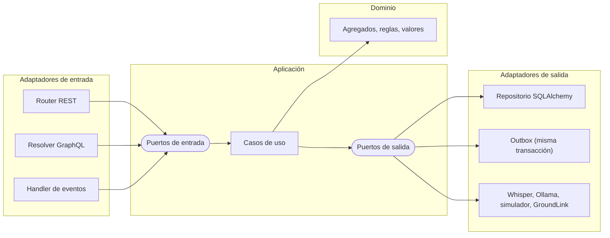

### 5.2 Estructura del repositorio

```text
src/spaceapp/
  main.py                    # composition root: elige adaptadores según el perfil
  platform/
    outbox/                  # OutboxEvent, UnitOfWork, relay, inbox
    profiles.py              # dev1, dev2, jurado
    config.py, logging.py, db.py
  modules/
    <modulo>/                # telemetry, monitoring, knowledge, assistant, facility,
      domain/                #   crew, engagement, groundlink
      application/           # casos de uso y handlers
      ports/                 # interfaces de entrada y salida
      adapters/
        inbound/             # rest.py, graphql.py, events.py
        outbound/            # sql.py, ollama.py, whisper.py, simulator.py ...
      contracts.py           # eventos públicos y DTO. Lo único que otros módulos importan
      facade.py              # consultas de solo lectura expuestas a otros módulos
  interfaces/
    graphql/schema.py        # une los resolvers de cada módulo
    ws/gateway.py            # módulo realtime
rules/catalog/*.json         # catálogo de reglas con fuente y estado
migrations/                  # un esquema de PostgreSQL por módulo
tests/{unit,contract,integration,e2e,architecture}
docker/                      # Dockerfile y compose
```

### 5.3 Reglas de dependencia (las revisa import-linter en CI)

1. `domain` no importa nada fuera de la biblioteca estándar y de su propio módulo.
2. `application` importa `domain` y `ports` del mismo módulo.
3. Un módulo solo importa de otro su `contracts` y su `facade`. Nunca `domain`, `adapters` ni modelos SQL.
4. Los adaptadores de entrada de un módulo no se llaman entre sí.
5. Solo `main.py` conoce a todos los adaptadores.
6. Un módulo escribe únicamente en su propio esquema. Entre módulos no hay claves foráneas.

### 5.4 Mapa de módulos: eventos y lecturas

Las flechas continuas son eventos de dominio por el outbox. Las discontinuas son lecturas síncronas de solo lectura por fachada.

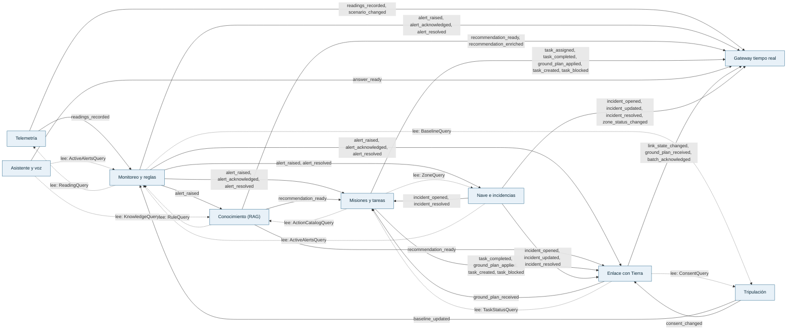

### 5.5 Módulos

| Módulo | Responsabilidad | Agregados | Puertos de entrada | Puertos de salida |
| --- | --- | --- | --- | --- |
| **Telemetría** (`telemetry`) | Recibe, valida y guarda lecturas del cuerpo, de cada zona de la nave (O₂, CO₂, N₂, humedad, temperatura, presión) y de la radiación. Agrega por minuto. Controla los escenarios simulados y etiqueta el origen de cada dato. | Sensor, ReadingBatch, ScenarioRun | IngestReadings; StartScenario / StopScenario; QueryReadings | ReadingRepository; SensorSource (simulador · replay RadLab · real); Clock |
| **Monitoreo y reglas** (`monitoring`) | Núcleo determinista. Calcula magnitudes derivadas (PIO₂), evalúa el catálogo de reglas por zona y con ventanas, detecta anomalías de tendencia, cruza cuerpo y ambiente, y gestiona el ciclo de vida de la alerta. El modelo de lenguaje nunca decide aquí. | Rule, Alert, AlertAck | EvaluateReadings; AcknowledgeAlert; QueryAlerts / Dashboard | AlertRepository; RuleCatalogSource (JSON/YAML versionado); ReadingQuery (de telemetry); BaselineQuery (de crew) |
| **Conocimiento (RAG)** (`knowledge`) | Guarda documentos y pasajes citables, el catálogo de acciones y la recomendación por alerta. Toda respuesta lleva documento, requisito y estado de evidencia. Si no hay pasaje que la respalde, lo dice. | Document, Chunk, Action, Recommendation | BuildRecommendation; SearchPassages; IngestDocument | KnowledgeSource (demo · rag_nasa); TextComposer (plantilla · Ollama); ChunkRepository (pgvector) |
| **Asistente y voz** (`assistant`) | Conversaciones por voz o texto. Transcribe, pide confirmación, consulta Conocimiento y responde con citas y en streaming. Una emergencia nunca depende de que el astronauta hable. | Conversation, Utterance | SubmitAudio; ConfirmUtterance; AskText | SpeechToText (Whisper · Alexa · ninguno); LlmGateway (Ollama · n8n · ninguno); ConversationRepository |
| **Tripulación** (`crew`) | Perfiles de tripulantes, línea base personal y consentimientos sobre qué se comparte con Tierra. | CrewMember, Baseline, Consent | RecordBaseline; SetConsent; QueryCrew | CrewRepository |
| **Nave e incidencias** (`facility`) | Hábitat y plano de zonas físicas (laboratorio, esclusa, dormitorios…). Abre tickets de incidencia con descripción, severidad y ubicación, automáticos desde alertas por zona o manuales de la tripulación, y mantiene el estado de color de cada zona. | Habitat, Zone, Incident, IncidentUpdate, IncidentType | ReportIncident; AcknowledgeIncident; ResolveIncident; QueryShip; QueryIncidentTypes | FacilityRepository; LayoutSource (JSON del plano); IncidentCatalogSource (JSON versionado) |
| **Misiones y tareas** (`engagement`) | Tareas diarias de la tripulación en tres tipos (salud, nave e incidentes) y con tres orígenes: plan de Tierra, sistema y tripulación. Mantiene plantillas con recurrencia, aplica los planes que llegan de Tierra de forma idempotente, deja a la tripulación crear, bloquear con motivo o borrar sus propias tareas, y registra si una medida funcionó. No gamifica la respuesta a una alerta crítica. | TaskTemplate, Task, Reminder, Achievement | ApplyGroundPlan; AssignTask; CreateCrewTask; CompleteTask; BlockTask; SnoozeReminder | TaskRepository; Scheduler |
| **Enlace con Tierra** (`groundlink`) | Enlace en las dos direcciones. Hacia Tierra: estado del enlace, cola de salida y lotes, filtrados por consentimiento. Desde Tierra: recibe planes de tareas versionados, los valida y los entrega a Misiones. En el despliegue de Tierra (o en la demo) aloja también el panel del centro de control con sus borradores de plan. Funciona igual si nunca hay enlace. | LinkState, OutboundBatch, OutboundItem, InboundPlan, GroundPlan, GroundTemplate | SetLinkState; SyncNow; EnqueueForGround; ReceiveGroundPlan; PublishGroundPlan | GroundLink (simulado · real); GroundLinkRepository; ConsentQuery (de crew) |
| **Gateway tiempo real** (`realtime`) | Adaptador de entrada WebSocket. No tiene tablas ni reglas: suscribe a eventos del bus, los traduce a mensajes por topic y permite reanudar desde un id del outbox. | — | Subscribe / Unsubscribe; Resume | EventSubscriber (bus); OutboxReplay |
| **Plataforma (bus y outbox)** (`platform`) | Kernel compartido: outbox transaccional, relay, inbox de idempotencia, unidad de trabajo, perfiles de ejecución, configuración y registro. | OutboxEvent, InboxProcessed | EventBus.publish; EventBus.subscribe | Postgres (LISTEN/NOTIFY); Clock; IdGenerator |

**Lecturas síncronas permitidas** (nunca escrituras):

| Quien lee | De quién | Fachada | Para qué |
| --- | --- | --- | --- |
| Monitoreo y reglas | Telemetría | `ReadingQuery` | Promedios en ventana (p. ej. ppCO₂ de 1 h) desde reading_rollup_1m |
| Monitoreo y reglas | Tripulación | `BaselineQuery` | Línea base personal para reglas relativas |
| Conocimiento (RAG) | Monitoreo y reglas | `RuleQuery` | Regla y action_key de una alerta |
| Asistente y voz | Conocimiento (RAG) | `KnowledgeQuery` | Pasajes citables para responder |
| Asistente y voz | Monitoreo y reglas | `ActiveAlertsQuery` | Contexto de alertas activas |
| Misiones y tareas | Conocimiento (RAG) | `ActionCatalogQuery` | Título y descripción de la acción |
| Enlace con Tierra | Tripulación | `ConsentQuery` | Qué categorías puede enviar |
| Nave e incidencias | Monitoreo y reglas | `ActiveAlertsQuery` | Recalcula el estado de cada zona al arrancar |
| Misiones y tareas | Nave e incidencias | `ZoneQuery` | Nombre y ubicación de la zona de una tarea |
| Enlace con Tierra | Misiones y tareas | `TaskStatusQuery` | Estado de tareas para el lote hacia Tierra, filtrado por consentimiento |

## 6. Bus de eventos con outbox

### 6.1 Cómo funciona

1. Un caso de uso cambia el estado **y** añade el evento al outbox dentro de la **misma transacción** (`UnitOfWork`). Se evita la doble escritura.
2. Al confirmar la transacción se ejecuta `pg_notify('outbox_new')`.
3. El **relay** (tarea `asyncio` en el mismo proceso) despierta por `LISTEN`, o a los 500 ms por sondeo, y toma pendientes con `FOR UPDATE SKIP LOCKED`, en orden de `id`.
4. Por cada evento llama a los handlers suscritos. Cada handler corre en su propia transacción e inserta `(consumer, event_id)` en `inbox_processed`. Si ya existe, lo omite.
5. Si todos los handlers terminan, el evento pasa a `done`. Si alguno falla, `attempts + 1` y `next_attempt_at` con espera exponencial (1, 2, 4 … 60 s). A los 8 intentos pasa a `dead`.
6. Garantía de entrega: **al menos una vez**. Los handlers son idempotentes gracias al inbox.

### 6.2 Sobre del evento

```json
{
  "event_id": "0b6f5c1e-…",
  "type": "monitoring.alert_raised",
  "version": 1,
  "occurred_at": "2026-11-14T20:41:07.512Z",
  "aggregate_type": "alert",
  "aggregate_id": "a3c1…",
  "partition_key": "habitat:hab-01",
  "correlation_id": "…",
  "causation_id": "…",
  "payload": { "rule_key": "env-pio2-low", "severity": "rojo", "evidence_state": "VERIFICADO" }
}
```

Nombres: `modulo.hecho_en_pasado`. Los payload son modelos Pydantic en `contracts.py`. Solo se permiten cambios aditivos dentro de una versión. Una ruptura crea `version: 2` y se publica en paralelo un tiempo.

### 6.3 Tabla del outbox

```sql
CREATE SCHEMA platform;

CREATE TABLE platform.outbox_event (
  id              bigserial PRIMARY KEY,
  event_id        uuid        NOT NULL UNIQUE,
  type            text        NOT NULL,
  aggregate_type  text        NOT NULL,
  aggregate_id    uuid        NOT NULL,
  partition_key   text        NOT NULL,
  payload         jsonb       NOT NULL,
  occurred_at     timestamptz NOT NULL DEFAULT now(),
  status          text        NOT NULL DEFAULT 'pending',  -- pending | done | dead
  attempts        int         NOT NULL DEFAULT 0,
  next_attempt_at timestamptz NOT NULL DEFAULT now(),
  last_error      text
);
CREATE INDEX outbox_pending_idx ON platform.outbox_event (next_attempt_at, id) WHERE status = 'pending';

CREATE TABLE platform.inbox_processed (
  consumer     text        NOT NULL,
  event_id     uuid        NOT NULL,
  processed_at timestamptz NOT NULL DEFAULT now(),
  PRIMARY KEY (consumer, event_id)
);
```

### 6.4 Decisiones de detalle

- **Zonas:** cada sensor pertenece a una zona de la nave. El evento `readings_recorded` y la alerta llevan `zone_id`. Así Monitoreo evalúa por zona y Nave e incidencias sabe dónde pintar.
- **Lecturas de sensores:** no se publica un evento por lectura. Se guarda el lote y se emite **un** `readings_recorded` por lote, con los últimos valores para reglas instantáneas. Las reglas con ventana consultan `ReadingQuery` sobre `reading_rollup_1m`.
- **Orden:** un solo worker garantiza orden por `id`. Si hiciera falta paralelizar, se reparte por `partition_key`.
- **Retención:** los eventos `done` se conservan 24 h. Sirven para el `resume` del WebSocket y para depuración. Después se borran.
- **Sin Kafka ni Redis:** hay que operar sin internet y con pocas piezas. El puerto `EventBus` permite reemplazar el transporte sin tocar los módulos.
- **Observabilidad:** `/ready` informa pendientes, muertos y retraso del más antiguo.

## 7. Modelo de datos (ER)

Cada módulo tiene su esquema de PostgreSQL. Las líneas continuas son claves foráneas dentro del módulo. Las discontinuas son **referencias blandas** a otro módulo: solo guardan el id, sin restricción.

### 7.1 Vista general entre módulos

```mermaid
erDiagram
  HABITAT ||..o{ CREW_MEMBER : "habitat_id"
  CREW_MEMBER ||--o{ BASELINE : "crew_member_id"
  CREW_MEMBER ||--o{ CONSENT : "crew_member_id"
  HABITAT ||--o{ ZONE : "habitat_id"
  ZONE ||--o{ INCIDENT : "zone_id"
  INCIDENT_TYPE ||--o{ INCIDENT : "type_id"
  ALERT |o..o{ INCIDENT : "source_alert_id"
  CREW_MEMBER |o..o{ INCIDENT : "reported_by"
  INCIDENT ||--o{ INCIDENT_UPDATE : "incident_id"
  CREW_MEMBER |o..o{ INCIDENT_UPDATE : "author_id"
  HABITAT ||..o{ SENSOR : "habitat_id"
  ZONE |o..o{ SENSOR : "zone_id"
  CREW_MEMBER |o..o{ SENSOR : "crew_member_id"
  SENSOR ||--o{ READING : "sensor_id"
  SENSOR ||--o{ READING_ROLLUP_1M : "sensor_id"
  HABITAT ||..o{ SCENARIO_RUN : "habitat_id"
  ZONE |o..o{ SCENARIO_RUN : "zone_id"
  RULE ||--o{ ALERT : "rule_id"
  HABITAT ||..o{ ALERT : "habitat_id"
  ZONE |o..o{ ALERT : "zone_id"
  CREW_MEMBER |o..o{ ALERT : "crew_member_id"
  ALERT ||--o{ ALERT_ACK : "alert_id"
  CREW_MEMBER ||..o{ ALERT_ACK : "crew_member_id"
  DOCUMENT ||--o{ CHUNK : "document_id"
  CHUNK |o--o{ ACTION : "source_chunk_id"
  ALERT ||..o{ RECOMMENDATION : "alert_id"
  RECOMMENDATION ||--o{ RECOMMENDATION_ACTION : "recommendation_id"
  ACTION ||--o{ RECOMMENDATION_ACTION : "action_id"
  CREW_MEMBER ||..o{ CONVERSATION : "crew_member_id"
  CONVERSATION ||--o{ UTTERANCE : "conversation_id"
  ZONE |o..o{ TASK_TEMPLATE : "zone_id"
  CREW_MEMBER |o..o{ TASK_TEMPLATE : "assignee_id"
  CREW_MEMBER |o..o{ TASK_TEMPLATE : "created_by"
  CREW_MEMBER ||..o{ TASK : "crew_member_id"
  TASK_TEMPLATE |o--o{ TASK : "template_id"
  ACTION |o..o{ TASK : "action_id"
  ALERT |o..o{ TASK : "source_alert_id"
  INCIDENT |o..o{ TASK : "incident_id"
  ZONE |o..o{ TASK : "zone_id"
  TASK ||--o{ REMINDER : "task_id"
  CREW_MEMBER ||..o{ CREW_ACHIEVEMENT : "crew_member_id"
  ACHIEVEMENT ||--o{ CREW_ACHIEVEMENT : "achievement_id"
  GROUND_PLAN ||--o{ GROUND_TEMPLATE : "plan_id"
  TASK_TEMPLATE |o..o{ GROUND_TEMPLATE : "target_template_id"
  OUTBOUND_BATCH |o--o{ OUTBOUND_ITEM : "batch_id"
  OUTBOX_EVENT ||..o{ OUTBOUND_ITEM : "source_event_id"
  OUTBOX_EVENT ||--o{ INBOX_PROCESSED : "event_id"
```

### 7.2 Esquema `crew` · Tripulación

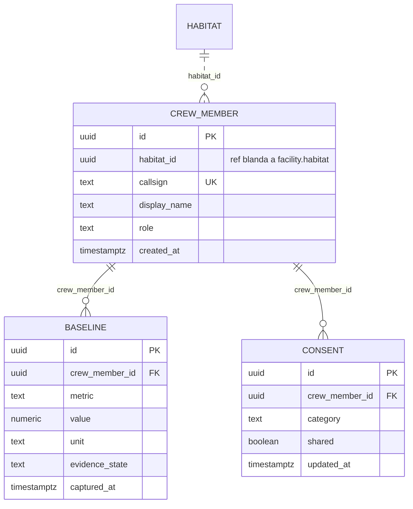

### 7.3 Esquema `facility` · Nave e incidencias

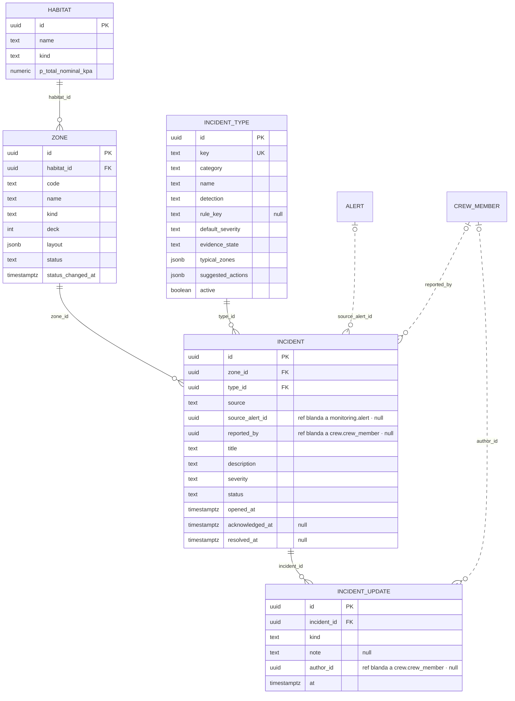

### 7.4 Esquema `telemetry` · Telemetría

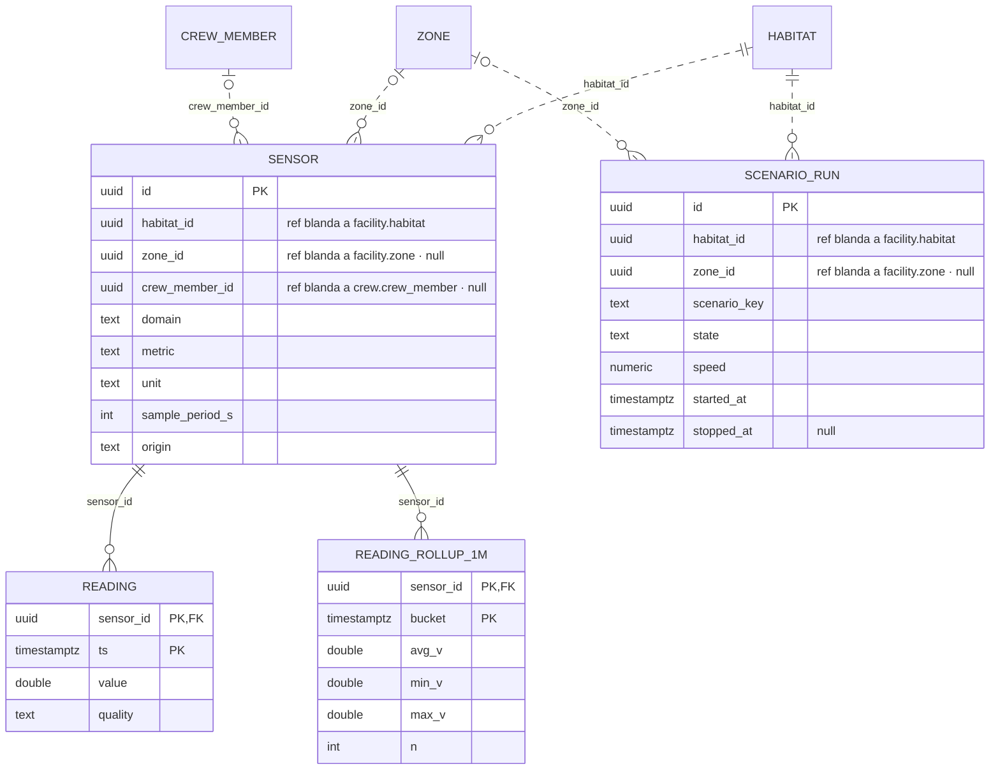

### 7.5 Esquema `monitoring` · Monitoreo y reglas

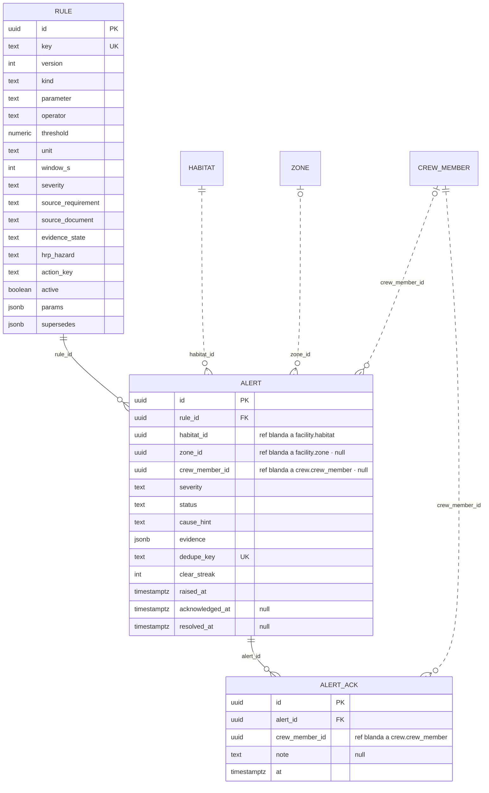

### 7.6 Esquema `knowledge` · Conocimiento (RAG)

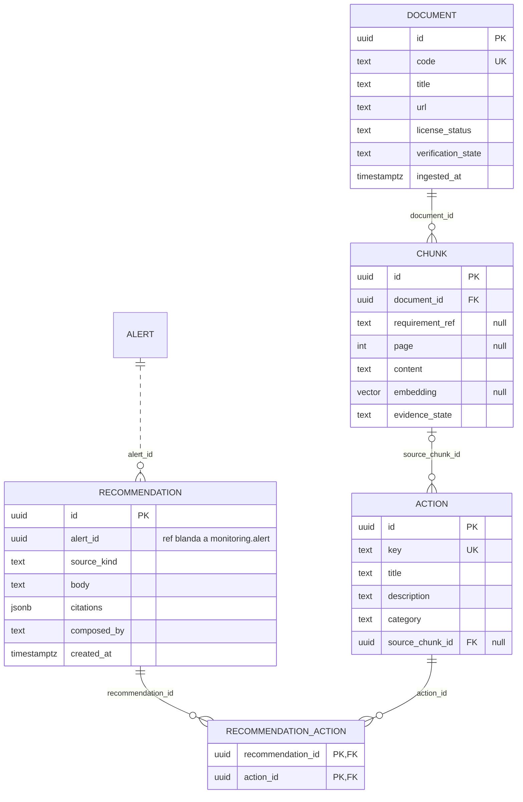

### 7.7 Esquema `assistant` · Asistente y voz

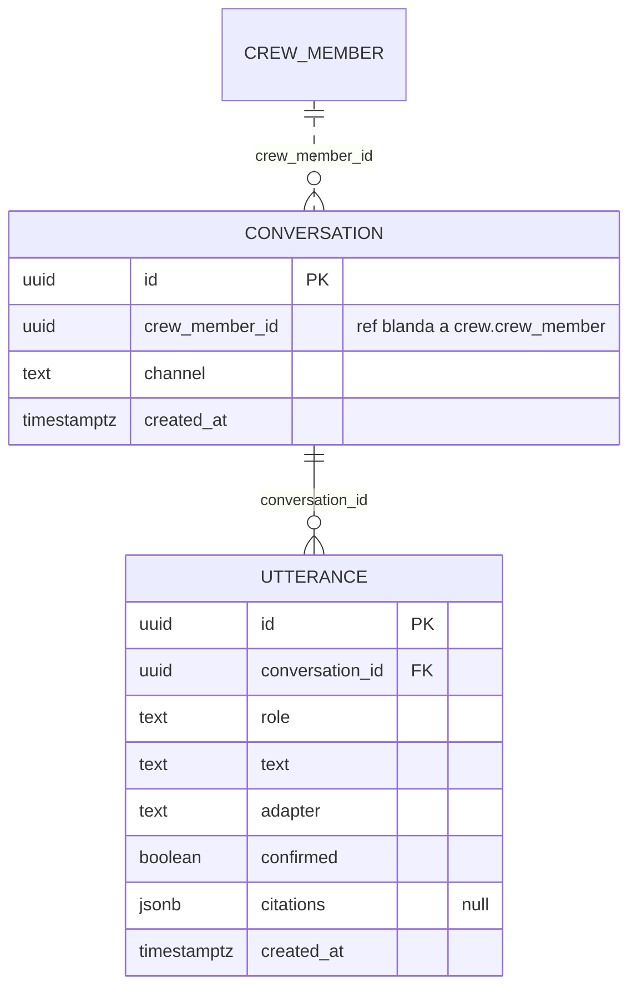

### 7.8 Esquema `engagement` · Misiones y tareas

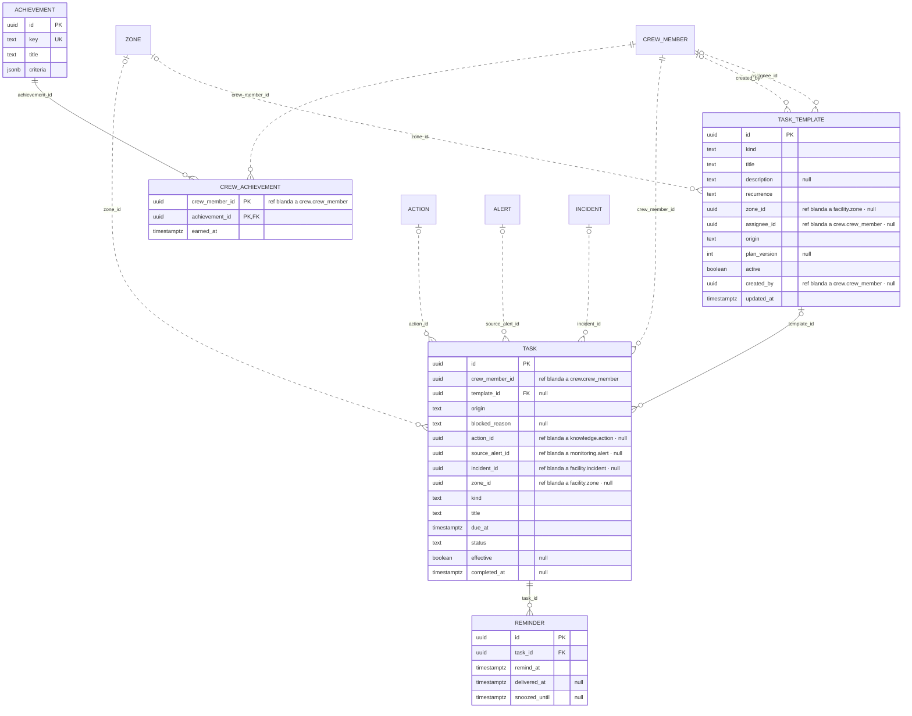

### 7.9 Esquema `groundlink` · Enlace con Tierra

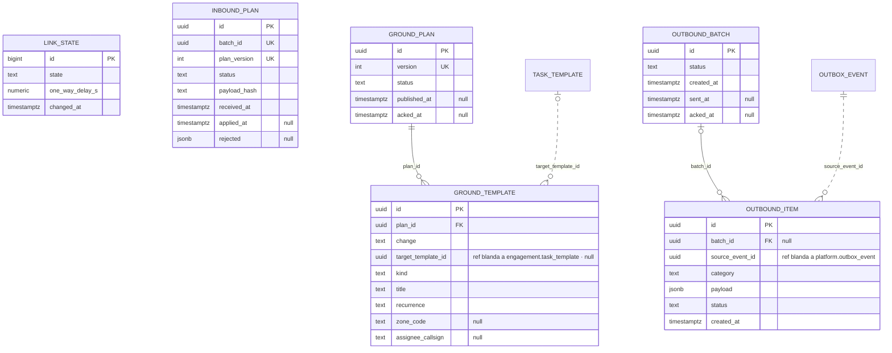

### 7.10 Esquema `platform` · Plataforma (bus y outbox)

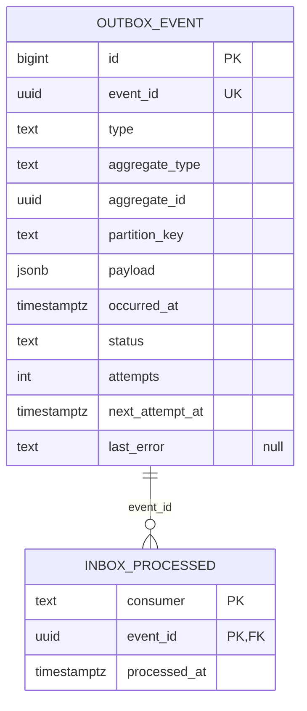

Notas del modelo:

- `reading` se **particiona por día** y lleva índice BRIN en `ts`. `reading_rollup_1m` se mantiene desde el handler de ingesta.
- `alert.dedupe_key` es único mientras la alerta esté activa (índice parcial). Evita tormentas de alertas iguales.
- `rule.evidence_state` y `sensor.origin` son obligatorios y viajan hasta la interfaz.
- `chunk.embedding` es opcional. Sin él, se busca por texto completo.
- `habitat` y `zone` viven en `facility`. El plano de cada zona (`zone.layout`) es JSON, así que cambiar de nave a base lunar es cambiar datos.
- `incident.source` es `ALERTA` o `MANUAL`. Un ticket automático guarda `source_alert_id` como referencia blanda.
- `task.kind` es `SALUD`, `NAVE` o `INCIDENTE`. Las tareas de incidente llevan `incident_id` y `zone_id`.
- `rule.kind` es `umbral` (límite de la norma o demostración) o `tendencia` (anomalía respecto a la historia reciente, siempre demostración).
- `rule.params` guarda los ajustes propios de una regla (ventanas y mínimos del detector de tendencia, cambio mínimo de presión) y `rule.supersedes` las reglas más leves que reemplaza cuando se cumple. Cada regla tiene una severidad fija: subir de Atención a Alerta es resolver la alerta leve y levantar la grave.
- `alert.clear_streak` cuenta las evaluaciones limpias seguidas. La alerta se resuelve al llegar a la histéresis (3 por defecto), salvo que otra regla más grave la reemplace.

## 8. Diagramas de secuencia

### 8.1 De la lectura a la alerta

Escenario: la ppCO₂ sube despacio y el astronauta reporta dolor de cabeza.

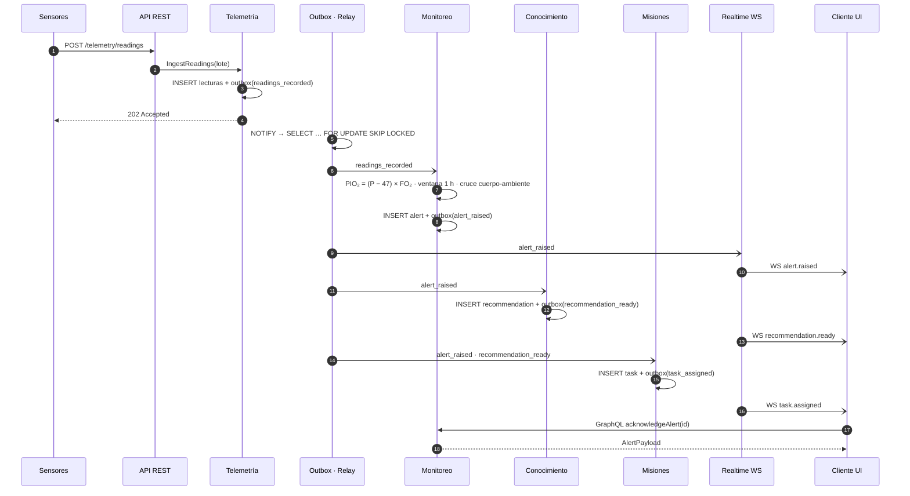

Qué pasa en cada paso:

1. El simulador (o un sensor real) envía un lote con marcas de tiempo. Cada lectura lleva origen SIMULATED y la interfaz lo muestra.
2. El router REST solo valida con Pydantic y llama al caso de uso. No hay reglas de dominio en el adaptador.
3. Una sola transacción: lecturas y evento. Si algo falla, no se guarda ninguna de las dos cosas. Así desaparece la doble escritura.
4. El sensor no espera al resto de la cadena.
5. El relay despierta por LISTEN/NOTIFY, o a los 500 ms por sondeo, y toma los pendientes en orden de id.
6. Antes de ejecutar el handler se consulta inbox_processed para ignorar duplicados.
7. El motor de reglas es puro y determinista. Calcula derivadas, evalúa el catálogo y propone causa probable. El modelo de lenguaje no participa.
8. Deduplica por (regla, hábitat) mientras la alerta siga activa, con histéresis para que no parpadee.
9. Realtime es un suscriptor más del bus.
10. Presupuesto de latencia propuesto: menos de 1 s desde la lectura hasta la pantalla. Falta medirlo.
11. Conocimiento busca la acción del catálogo y los pasajes citables de esa regla.
12. Texto de plantilla con citas. La alerta nunca espera al modelo de lenguaje.
13. La interfaz muestra qué hacer, con documento, requisito y estado de evidencia.
14. Misiones convierte la acción en una tarea con recordatorio.
15. Las alertas críticas no generan puntos ni rachas. Solo tareas.
16. Aparece la tarea en el detalle de la alerta.
17. El astronauta reconoce. Misma regla: transacción con outbox(alert_acknowledged).
18. La respuesta del mutation es el estado final de la alerta.

### 8.2 Consulta por voz con confirmación

Perfil dev1 o jurado: Whisper local, Ollama local, sin internet.

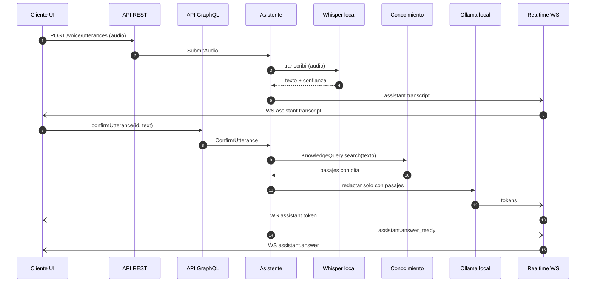

Qué pasa en cada paso:

1. Se mantiene pulsado para hablar. También existe entrada por texto escrito como alternativa.
2. El caso de uso guarda el audio y responde 202 de inmediato.
3. Puerto SpeechToText. En dev2 el adaptador es Alexa y la voz sale a la nube. Hay que decirlo.
4. Whisper puede fallar con términos médicos o ruido de cabina.
5. Se publica por outbox como el resto.
6. La interfaz muestra lo entendido, editable. No se actúa sin confirmar.
7. El astronauta confirma o corrige.
8. El resolver solo traduce a una llamada al caso de uso.
9. Lectura síncrona por fachada pública. Sin acceso a tablas de otro módulo.
10. Si no hay pasaje que respalde la respuesta, el asistente dice que no tiene esa información.
11. Con tiempo límite de 8 s. Si vence, se responde con los pasajes en texto plano.
12. El streaming sale por el gateway, no por el módulo.
13. Se ve la respuesta formarse.
14. Versión final con citas y estado de evidencia.
15. Las citas son enlaces al pasaje en Conocimiento.

### 8.3 Incidente en una zona de la nave

Escenario: el CO₂ del laboratorio sube. El plano pinta la zona y aparece el ticket con descripción, severidad y ubicación.

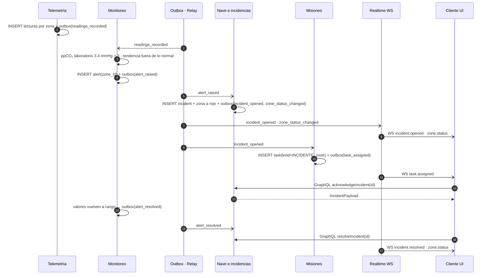

Qué pasa en cada paso:

1. Cada lectura lleva zone_id. Se mide de forma continua: O₂, CO₂, N₂, humedad, temperatura y presión.
2. Monitoreo evalúa el catálogo por zona, no solo para toda la cabina.
3. Dos tipos de regla: umbral (de la norma) y tendencia (demostración). Ambas deterministas.
4. Deduplica por (regla, zona) mientras siga activa.
5. Nave e incidencias se suscribe a las alertas con zona. No lee tablas de Monitoreo.
6. El ticket nace con descripción armada desde la regla, severidad, ubicación y alerta de origen. La zona cambia de estado en la misma transacción.
7. Realtime los traduce a mensajes por topic.
8. El plano marca la zona con su color y un icono, y el ticket aparece con su descripción.
9. Misiones crea las tareas del incidente.
10. Quedan en las tareas del día, junto a las de salud y las de mantenimiento.
11. El ticket muestra sus tareas con casilla.
12. La tripulación reconoce el ticket.
13. El estado pasa a reconocida. Se emite incident_updated.
14. Cuando la zona se normaliza, Monitoreo lo informa.
15. El ticket queda marcado como «valores normales, puede cerrarse». No se cierra solo.
16. La decisión de cerrar es de la tripulación.
17. La zona vuelve a verde si no hay otras alertas activas.

### 8.4 Plan de tareas desde Tierra

Opción B: el centro de control publica un plan versionado. La nave lo aplica y conserva el último si se corta el enlace. La tripulación también crea las suyas.

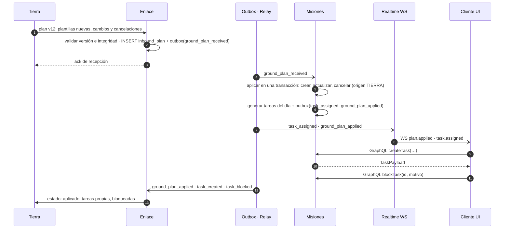

Qué pasa en cada paso:

1. Con la demora, llega cuando llega. El lote es idempotente por batch_id y plan_version.
2. Una versión menor o repetida se ignora. Una corrupta se rechaza con motivo.
3. Tierra sabe que llegó, todavía no que se aplicó.
4. Misiones es la dueña de las tareas. Enlace no escribe en sus tablas.
5. Lo ya completado hoy no se toca. Los cambios rigen para instancias futuras. Las tareas propias de la tripulación no se alteran.
6. Si algo se rechaza, se informa el motivo y el resto se aplica.
7. Realtime es un suscriptor más.
8. Aviso «Plan v12 aplicado» y las tareas con la marca Tierra.
9. La tripulación crea su propia tarea. Queda con origen TRIPULACION y no depende del enlace.
10. Se publica task_created por el outbox.
11. Una tarea de Tierra no se puede cumplir. No se borra: se informa con motivo.
12. Solo sube lo que permite el consentimiento de la categoría tareas.
13. Tierra ve el resultado al reconectar y puede publicar la versión siguiente.

### 8.5 Corte y reconexión con Tierra

El sistema funciona igual sin enlace. Al volver, sube solo lo que el astronauta autorizó.

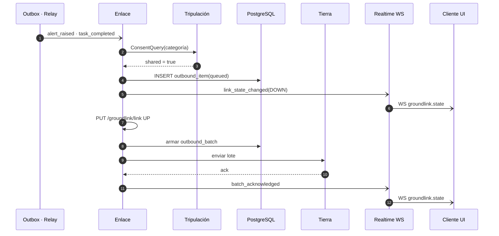

Qué pasa en cada paso:

1. El módulo de enlace se suscribe a los eventos que Tierra podría ver.
2. Lectura por fachada. Si la categoría no está compartida, el elemento queda withheld.
3. Las alertas críticas pueden tener consentimiento por defecto. Decisión abierta.
4. Con el enlace caído solo se encola. Nada falla.
5. La interfaz muestra el chip «Sin enlace · autónomo».
6. El astronauta ve cuántos elementos esperan.
7. En la demo se simula. En real lo informa el adaptador GroundLink.
8. Agrupa en orden de ocurrencia. Excluye lo withheld.
9. Puerto GroundLink. El adaptador simulado devuelve ack con retardo configurable.
10. Con la demora a Marte (3 a 22 min por trayecto, sin verificar) el ack tarda. Por eso los lotes son idempotentes.
11. Se marca acked.
12. La cola vuelve a cero.

### 8.6 Outbox: reintentos y eventos muertos

Qué pasa cuando un handler falla.

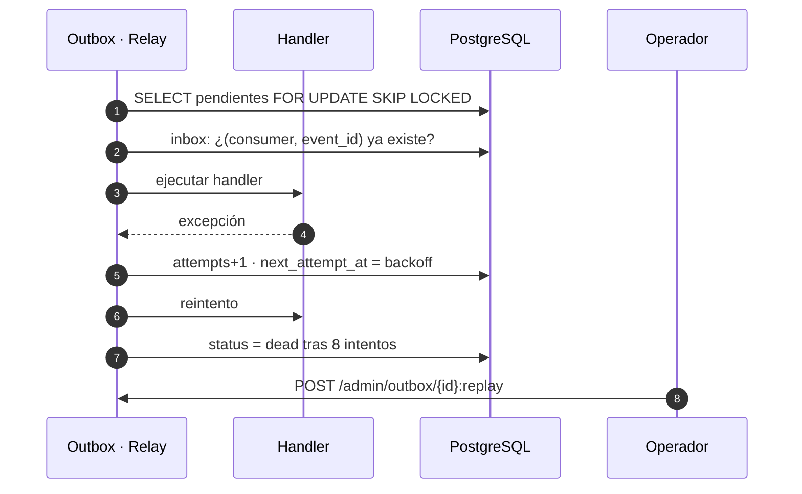

Qué pasa en cada paso:

1. Toma hasta 100 filas con status pending y next_attempt_at vencido.
2. Si existe, se omite. Esto vuelve seguro el reintento.
3. Cada handler corre en su propia transacción y escribe su fila en inbox_processed.
4. Un handler caído no bloquea a los demás consumidores del mismo evento.
5. Espera 1, 2, 4, 8 … segundos con tope de 60 s.
6. Los consumidores que ya terminaron se omiten por el inbox.
7. Se guarda last_error. /ready informa el retraso.
8. Un operador corrige la causa y reencola.

## 9. Diagrama de comunicación (escenario: CO₂ que sube)

Los números son el orden de los mensajes. Todo lo que sale del outbox pasa por el relay.

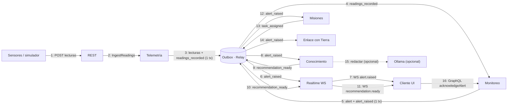

### 9.1 Escenario: incidente en una zona de la nave

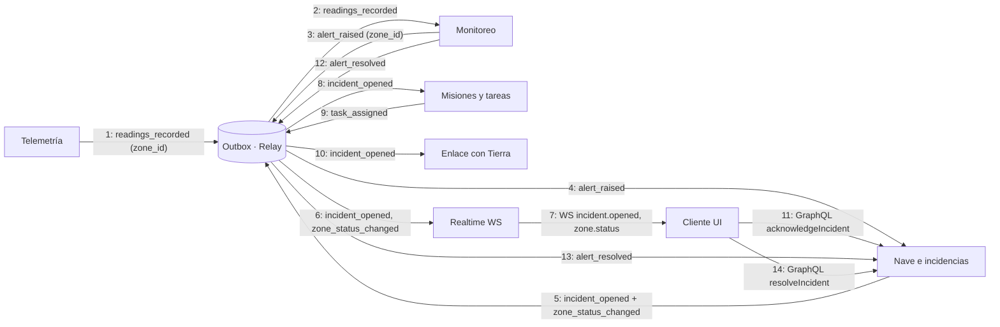

## 10. Canales y eventos de comunicación

**Cuándo usar cada canal**

| Canal | Úsalo para | No lo uses para |
| --- | --- | --- |
| REST | Entradas de máquina: lotes de sensores, audio, webhook de Alexa, control del simulador, salud y operación | Consultas de la interfaz |
| GraphQL | Todo lo que la interfaz pide o cambia: consultas con forma a medida y mutaciones con resultado tipado | Push del servidor. No hay suscripciones |
| WebSocket | Todo lo que el servidor empuja: ticks, alertas, recomendaciones, tareas, streaming del asistente, estado del enlace | Comandos. Las acciones del usuario van por GraphQL |
| Evento (outbox) | Comunicación entre módulos dentro del proceso | Datos de alta frecuencia, como una lectura individual |

### 10.1 REST

| ID | Método y ruta | Origen → destino | Qué hace | Payload | Respuesta |
| --- | --- | --- | --- | --- | --- |
| R1 | `POST /api/v1/telemetry/readings` | Sensores / Simulador → Telemetría | Lote de lecturas del cuerpo, la cabina o la radiación | sensor_id, zone_id, ts, value, quality (lote de hasta 500) | 202 Accepted. Idempotente por (sensor_id, ts) |
| R2 | `POST /api/v1/voice/utterances` | Cliente UI → Asistente y voz | Sube el audio del astronauta (multipart). La transcripción vuelve por WS | audio webm/wav, conversation_id | 202 + utterance_id |
| R3 | `POST /api/v1/alexa/webhook` | Alexa (solo dev2) → Asistente y voz | Solicitud del skill de Alexa. Solo en perfil dev2. No es autónomo | request JSON de Alexa | Solo con perfil dev2 |
| R4 | `POST /api/v1/sim/scenarios/{key}:start · :stop` | Cliente UI → Telemetría | Inicia o detiene un escenario simulado, opcionalmente en una zona (CO₂ lento, hipoxia, fuga de presión) | key, zone_id, speed | 200. Emite telemetry.scenario_changed |
| R5 | `PUT /api/v1/groundlink/link` | Cliente UI → Enlace con Tierra | Simula el corte o la vuelta del enlace con Tierra | state UP\|DOWN\|DEGRADED, delay_s | 200. Emite groundlink.link_state_changed |
| R6 | `GET /api/v1/rules/catalog.json` | Cliente UI → Monitoreo y reglas | Exporta el catálogo versionado con fuente y estado de evidencia | — | 200. Caché por versión |
| R7 | `GET /health · GET /ready` | Operación / dev → Plataforma (bus y outbox) | Salud del proceso, de PostgreSQL y del retraso del relay | — | 200 / 503 |
| R8 | `POST /api/v1/admin/outbox/{id}:replay` | Operación / dev → Plataforma (bus y outbox) | Reencola un evento en estado dead | id | 202 |
| R9 | `POST /api/v1/groundlink/inbound/plans` | Centro de control (Tierra) → Enlace con Tierra | Entrega un plan de tareas desde Tierra (plantillas nuevas, cambios y cancelaciones). En la demo lo envía el simulador de Tierra | batch_id, plan_version, items[change, template], hash | 202. Idempotente por batch_id y plan_version |

### 10.2 GraphQL (`POST /graphql`)

| ID | Operación | Módulo dueño | Qué hace | Devuelve | Notas |
| --- | --- | --- | --- | --- | --- |
| G1 | `Query dashboard(habitatId)` | Monitoreo y reglas | Instantánea: semáforo global, valores actuales, PIO₂ derivado, alertas activas | DashboardView | Lectura |
| G2 | `Query readings(sensorId, from, to, resolution)` | Telemetría | Series para las gráficas. Usa reading_rollup_1m | points[ts, avg, min, max] | Lectura |
| G3 | `Query alerts(filter, first, after)` | Monitoreo y reglas | Historial paginado por cursor | AlertConnection | Lectura |
| G4 | `Query alert(id)` | Monitoreo y reglas | Detalle: regla, evidencia, causa probable y recomendación con citas | Alert, Rule, Recommendation | Lectura |
| G5 | `Query rules(filter)` | Monitoreo y reglas | Catálogo con fuente, requisito y estado VERIFICADO, TB o DEMO | Rule[] | Lectura |
| G6 | `Query knowledgeSearch(query, k)` | Conocimiento (RAG) | Pasajes citables con documento, requisito y página | Passage[] | Lectura |
| G7 | `Query crewMember(id)` | Tripulación | Perfil, línea base y consentimientos | CrewMember | Lectura |
| G8 | `Query tasks(crewMemberId, kind, status) · achievements` | Misiones y tareas | Tareas del día por tipo (SALUD, NAVE, INCIDENTE), racha y logros | Task[], Achievement[] | Lectura |
| G9 | `Query conversation(id)` | Asistente y voz | Historial con citas | Utterance[] | Lectura |
| G10 | `Query groundLinkStatus` | Enlace con Tierra | Estado del enlace, cola y última sincronización | GroundLinkStatus | Lectura |
| G11 | `Query outboxStats` | Plataforma (bus y outbox) | Pendientes, muertos y retraso (solo perfiles dev) | OutboxStats | Lectura |
| G20 | `Query ship(habitatId)` | Nave e incidencias | Plano: zonas con su estado de color, incidencias abiertas y última lectura por zona | Zone[], Incident[], ZoneReading | Lectura |
| G21 | `Query incidents(filter, first, after)` | Nave e incidencias | Tickets paginados por zona, severidad o estado | IncidentConnection | Lectura |
| G22 | `Query incident(id)` | Nave e incidencias | Ticket completo: descripción, severidad, ubicación, historial, tareas y alerta de origen | Incident, IncidentUpdate[], Task[] | Lectura |
| G23 | `Query zoneReadings(zoneId, metrics, from, to, resolution)` | Telemetría | Series de O₂, CO₂, N₂, humedad, temperatura y presión de una zona para las gráficas | series[metric, points] | Lectura. Usa reading_rollup_1m |
| G27 | `Query groundPlan` | Misiones y tareas | Versión del plan de Tierra aplicada, cuándo llegó y qué cambios esperan | GroundPlanView | Lectura |
| G28 | `Query incidentTypes(category)` | Nave e incidencias | Catálogo de tipos de incidencia agrupado por categoría, con severidad y acciones sugeridas | IncidentType[] | Lectura. Caché por versión del catálogo |
| G12 | `Mutation acknowledgeAlert(id, note)` | Monitoreo y reglas | El astronauta reconoce la alerta | AlertPayload \| AlertError | Transacción + outbox. Idempotente |
| G13 | `Mutation completeTask(id, effective)` | Misiones y tareas | Completa una medida y registra si funcionó | TaskPayload | Transacción + outbox |
| G14 | `Mutation snoozeReminder(id, minutes)` | Misiones y tareas | Pospone un recordatorio | ReminderPayload | Transacción |
| G15 | `Mutation setConsent(category, shared)` | Tripulación | Decide qué categoría de datos se comparte con Tierra | ConsentPayload | Transacción + outbox |
| G16 | `Mutation recordBaseline(metric, value)` | Tripulación | Registra o actualiza la línea base personal | BaselinePayload | Transacción + outbox |
| G17 | `Mutation confirmUtterance(id, text)` | Asistente y voz | Confirma o corrige la transcripción antes de actuar | UtterancePayload | Transacción. Dispara la respuesta |
| G18 | `Mutation askAssistant(text, conversationId)` | Asistente y voz | Pregunta por texto, alternativa al micrófono | UtterancePayload. La respuesta llega por WS | Respuesta asíncrona |
| G24 | `Mutation reportIncident(typeKey, zoneId, title, description, severity)` | Nave e incidencias | La tripulación abre un ticket manual eligiendo categoría y tipo | IncidentPayload \| IncidentError | Transacción + outbox |
| G29 | `Mutation createTask(kind, title, zoneId, dueAt, recurrence)` | Misiones y tareas | La tripulación crea una tarea propia (origen TRIPULACION) | TaskPayload | Transacción + outbox |
| G30 | `Mutation updateTask(id, …) · deleteTask(id)` | Misiones y tareas | Edita o borra una tarea propia. Las de Tierra devuelven un error tipado | TaskPayload \| TaskError | Solo origen TRIPULACION |
| G31 | `Mutation blockTask(id, reason)` | Misiones y tareas | Informa que una tarea no se puede cumplir, con motivo. No la borra | TaskPayload | Transacción + outbox |
| G32 | `Query groundTasks(filter) · rol ground` | Enlace con Tierra | Panel de Tierra: estado de cada plantilla (enviada, recibida, aplicada, completada, bloqueada) y tareas propias compartidas | GroundTaskView[] | Solo lo que el consentimiento permite |
| G33 | `Mutation saveGroundTemplate(planId, template) · rol ground` | Enlace con Tierra | Crea o edita una plantilla en el borrador del plan | GroundTemplatePayload | Transacción |
| G34 | `Mutation cancelGroundTemplate(planId, templateId) · rol ground` | Enlace con Tierra | Marca una plantilla para cancelar en el borrador | GroundTemplatePayload | Transacción |
| G35 | `Mutation publishGroundPlan(planId) · rol ground` | Enlace con Tierra | Publica el plan con la siguiente versión y lo envía por el enlace. Espera confirmación | GroundPlanPayload | Idempotente por plan y versión |
| G25 | `Mutation acknowledgeIncident(id, note)` | Nave e incidencias | Reconoce el ticket y deja una nota | IncidentPayload | Transacción + outbox. Idempotente |
| G26 | `Mutation resolveIncident(id, note)` | Nave e incidencias | Cierra el ticket. La zona vuelve a su estado según las alertas activas | IncidentPayload | Transacción + outbox |
| G19 | `Mutation syncGroundLinkNow` | Enlace con Tierra | Fuerza el envío de la cola cuando hay enlace | GroundLinkStatus | Idempotente por lote |

### 10.3 WebSocket (`/ws`)

Mensaje del servidor: `{ "seq": 18342, "topic": "alerts", "type": "alert.raised", "at": "…", "data": { … } }`. `seq` es el `id` del outbox cuando el mensaje nace de un evento. En los ticks es `null`.

Presión inversa: cola por cliente de 500 mensajes. Si se llena, se descartan primero los `telemetry.tick`. Las alertas no se descartan.

| ID | Mensaje | Dirección | Qué hace | Payload | Entrega |
| --- | --- | --- | --- | --- | --- |
| W1 | `telemetry.tick` | Servidor → Cliente | Valores actuales por zona y sensor, agregados a 1 Hz | zone_id, metric, value, ts, state | Se coalesce o descarta bajo presión |
| W2 | `alert.raised · alert.updated · alert.resolved` | Servidor → Cliente | Ciclo de vida de la alerta | alert_id, severity, rule_key, evidence_state | Nunca se descarta. Con resume |
| W3 | `recommendation.ready · recommendation.enriched` | Servidor → Cliente | Primero la versión determinista, después el texto del LLM | alert_id, actions[], citations[], composed_by | Con resume |
| W4 | `task.assigned · reminder.due` | Servidor → Cliente | Misiones y recordatorios | task_id, due_at | Con resume |
| W5 | `assistant.transcript` | Servidor → Cliente | Transcripción pendiente de confirmar | utterance_id, text, confidence | Con resume |
| W6 | `assistant.token · assistant.answer` | Servidor → Cliente | Respuesta en streaming y versión final con citas | utterance_id, delta \| text, citations[] | Los tokens pueden perderse. La respuesta final no |
| W7 | `groundlink.state` | Servidor → Cliente | Cambios del enlace con Tierra | state, queued, last_sync | Con resume |
| W12 | `incident.opened · incident.updated · incident.resolved` | Servidor → Cliente | Tickets de incidencia con zona, severidad y descripción | incident_id, zone_id, severity, title, status | Nunca se descarta. Con resume |
| W13 | `zone.status` | Servidor → Cliente | Color y estado de una zona del plano | zone_id, status, open_incidents | Con resume |
| W14 | `plan.received · plan.applied` | Servidor → Cliente | Llegó o se aplicó un plan de tareas de Tierra | plan_version, applied, rejected[] | Con resume |
| W8 | `scenario.changed` | Servidor → Cliente | Escenario simulado activo | key, state, speed | Con resume |
| W9 | `subscribe · unsubscribe` | Cliente UI → Servidor | Elige topics (habitat, crew, alerts, assistant) | topics[] | Responde subscribed |
| W10 | `resume` | Cliente UI → Servidor | Reanuda tras una caída. El servidor reenvía desde ese id del outbox | after_outbox_id | Reenvío desde outbox_event (retención 24 h) |
| W11 | `ping · pong` | Cliente UI → Servidor | Latido cada 15 s | ts | — |

### 10.4 Eventos de dominio

| ID | Evento | Emisor | Receptores | Cuándo | Payload | Garantías |
| --- | --- | --- | --- | --- | --- | --- |
| E1 | `telemetry.readings_recorded` | Telemetría | Monitoreo y reglas, Gateway tiempo real | Se guardó un lote de lecturas | batch_id, habitat_id, ts_from, ts_to, latest[sensor_id, metric, value] | Outbox, at-least-once. Partición habitat_id |
| E2 | `telemetry.scenario_changed` | Telemetría | Gateway tiempo real | Cambió el escenario simulado | key, state, speed | Outbox |
| E3 | `monitoring.alert_raised` | Monitoreo y reglas | Conocimiento (RAG), Misiones y tareas, Gateway tiempo real, Enlace con Tierra, Nave e incidencias | Una regla se disparó, con la zona afectada si la lectura es de una zona | alert_id, zone_id, rule_key, severity, evidence, cause_hint | Outbox. Idempotencia por alert_id |
| E4 | `monitoring.alert_acknowledged` | Monitoreo y reglas | Misiones y tareas, Gateway tiempo real, Enlace con Tierra | La tripulación reconoció la alerta | alert_id, crew_member_id, at | Outbox |
| E5 | `monitoring.alert_resolved` | Monitoreo y reglas | Misiones y tareas, Gateway tiempo real, Enlace con Tierra, Nave e incidencias | Los valores volvieron a rango | alert_id, resolved_at, duration_s | Outbox |
| E6 | `knowledge.recommendation_ready` | Conocimiento (RAG) | Misiones y tareas, Gateway tiempo real, Enlace con Tierra | Recomendación determinista con citas lista | alert_id, recommendation_id, action_keys[], citations[] | Outbox. No espera al LLM |
| E7 | `knowledge.recommendation_enriched` | Conocimiento (RAG) | Gateway tiempo real | El LLM redactó la explicación (opcional) | recommendation_id, text | Outbox. Puede no ocurrir |
| E8 | `engagement.task_assigned` | Misiones y tareas | Gateway tiempo real | Se creó una misión de salud | task_id, crew_member_id, action_key, due_at | Outbox |
| E9 | `engagement.task_completed` | Misiones y tareas | Gateway tiempo real, Enlace con Tierra | Se completó una medida | task_id, action_key, effective | Outbox |
| E10 | `assistant.answer_ready` | Asistente y voz | Gateway tiempo real | La respuesta final está lista | utterance_id, text, citations[] | Outbox |
| E11 | `crew.baseline_updated` | Tripulación | Monitoreo y reglas | Cambió la línea base de un tripulante | crew_member_id, metric, value | Outbox |
| E12 | `crew.consent_changed` | Tripulación | Enlace con Tierra | Cambió qué categoría se comparte | crew_member_id, category, shared | Outbox |
| E13 | `groundlink.link_state_changed` | Enlace con Tierra | Gateway tiempo real | El enlace subió o bajó | state, since, queued | Outbox |
| E15 | `facility.incident_opened` | Nave e incidencias | Misiones y tareas, Gateway tiempo real, Enlace con Tierra | Se abrió un ticket, automático o manual | incident_id, zone_id, severity, title, description, source | Outbox. Idempotencia por incident_id |
| E16 | `facility.incident_updated` | Nave e incidencias | Gateway tiempo real, Enlace con Tierra | Cambió la severidad o el estado del ticket | incident_id, severity, status, note | Outbox |
| E17 | `facility.incident_resolved` | Nave e incidencias | Misiones y tareas, Gateway tiempo real, Enlace con Tierra | Se cerró el ticket | incident_id, zone_id, resolved_at | Outbox |
| E18 | `facility.zone_status_changed` | Nave e incidencias | Gateway tiempo real | Cambió el color de una zona del plano | zone_id, status, open_incidents | Outbox |
| E19 | `groundlink.ground_plan_received` | Enlace con Tierra | Misiones y tareas, Gateway tiempo real | Llegó un plan de Tierra válido y nuevo | batch_id, plan_version, changes[NEW\|UPDATE\|CANCEL, template] | Outbox. Idempotencia por plan_version |
| E20 | `engagement.ground_plan_applied` | Misiones y tareas | Enlace con Tierra, Gateway tiempo real | El plan se aplicó, completo o con rechazos | plan_version, applied[], rejected[reason] | Outbox. Es la confirmación que sube a Tierra |
| E21 | `engagement.task_created` | Misiones y tareas | Gateway tiempo real, Enlace con Tierra | La tripulación creó una tarea propia | task_id, kind, title, zone_id, origin | Outbox. Sube a Tierra solo si el consentimiento de tareas lo permite |
| E22 | `engagement.task_blocked` | Misiones y tareas | Gateway tiempo real, Enlace con Tierra | Una tarea no se puede cumplir | task_id, origin, reason | Outbox |
| E14 | `groundlink.batch_acknowledged` | Enlace con Tierra | Gateway tiempo real | Tierra confirmó un lote | batch_id, items, acked_at | Outbox |

### 10.5 Matriz emisor × receptor

| Emisor \ Receptor | TEL | MON | KNW | AST | CRW | FAC | ENG | GRL | RT |
| --- | --- | --- | --- | --- | --- | --- | --- | --- | --- |
| TEL · Telemetría |  | readings_recorded |  |  |  |  |  |  | readings_recorded, scenario_changed |
| MON · Monitoreo y reglas |  |  | alert_raised |  |  | alert_raised, alert_resolved | alert_acknowledged, alert_raised, alert_resolved | alert_acknowledged, alert_raised, alert_resolved | alert_acknowledged, alert_raised, alert_resolved |
| KNW · Conocimiento (RAG) |  |  |  |  |  |  | recommendation_ready | recommendation_ready | recommendation_enriched, recommendation_ready |
| AST · Asistente y voz |  |  |  |  |  |  |  |  | answer_ready |
| CRW · Tripulación |  | baseline_updated |  |  |  |  |  | consent_changed |  |
| FAC · Nave e incidencias |  |  |  |  |  |  | incident_opened, incident_resolved | incident_opened, incident_resolved, incident_updated | incident_opened, incident_resolved, incident_updated, zone_status_changed |
| ENG · Misiones y tareas |  |  |  |  |  |  |  | ground_plan_applied, task_blocked, task_completed, task_created | ground_plan_applied, task_assigned, task_blocked, task_completed, task_created |
| GRL · Enlace con Tierra |  |  |  |  |  |  | ground_plan_received |  | batch_acknowledged, ground_plan_received, link_state_changed |
| RT · Gateway tiempo real |  |  |  |  |  |  |  |  |  |

## 11. Esbozo del contrato GraphQL

```graphql
enum EvidenceState { VERIFICADO TB DEMO NO_VERIFICADO }
enum DataOrigin { SIMULATED REPLAY REAL }
enum CauseHint { AMBIENTE CUERPO INDETERMINADO }

type Rule {
  key: String!  parameter: String!  operator: String!  threshold: Float!  unit: String!
  windowSeconds: Int  severity: Severity!
  sourceRequirement: String!  sourceDocument: String!
  evidenceState: EvidenceState!  hrpHazard: String!
}
type Citation { documentCode: String!  requirementRef: String  page: Int  excerpt: String!  evidenceState: EvidenceState! }
type Recommendation { actions: [Action!]!  body: String!  citations: [Citation!]!  composedBy: String! }
type Alert {
  id: ID!  rule: Rule!  severity: Severity!  status: AlertStatus!  causeHint: CauseHint!
  evidence: JSON!  raisedAt: DateTime!  recommendation: Recommendation  tasks: [Task!]!
}

type Query {
  dashboard(habitatId: ID!): DashboardView!
  readings(sensorId: ID!, from: DateTime!, to: DateTime!, resolution: Resolution = MINUTE): [ReadingPoint!]!
  alerts(filter: AlertFilter, first: Int = 20, after: String): AlertConnection!
  alert(id: ID!): Alert
  knowledgeSearch(query: String!, k: Int = 5): [Citation!]!
  groundLinkStatus: GroundLinkStatus!
}

union AcknowledgeAlertResult = AlertAcknowledged | AlertNotFound | AlertAlreadyResolved
type Mutation {
  acknowledgeAlert(id: ID!, note: String): AcknowledgeAlertResult!
  completeTask(id: ID!, effective: Boolean): TaskPayload!
  setConsent(category: String!, shared: Boolean!): ConsentPayload!
  confirmUtterance(id: ID!, text: String!): UtterancePayload!
}
```

Reglas: errores esperados como tipos en una `union`, no como excepciones. Paginación por cursor. DataLoaders contra N+1. Límite de profundidad y de costo de consulta.

## 12. Perfiles de ejecución

La variable `SPACEAPP_PROFILE` elige los adaptadores en `main.py`. El nombre y el valor por defecto `jurado` son una **propuesta**, no una decisión tuya todavía.

| Puerto | dev1 | dev2 | jurado |
| --- | --- | --- | --- |
| Voz de entrada (SpeechToText) | Whisper local | Alexa (nube, solo demo) | Whisper local |
| Fuente de sensores (SensorSource) | Simulador | Simulador | Simulador |
| Conocimiento (KnowledgeSource) | Demo + RAG | Demo + RAG | RAG; cae a demo si falta un pasaje |
| Redacción (TextComposer) | Ollama | Ollama | Ollama; cae a plantilla si tarda más de 8 s |
| Enlace (GroundLink) | Simulado | Simulado | Simulado |

## 13. Experiencia de usuario

### 13.1 Usuarios

| Usuario | Contexto | Qué necesita |
| --- | --- | --- |
| Astronauta (principal) | Cabina, a veces con guantes, ruido y poco tiempo. Pantalla fija o tableta | Entender su estado de un vistazo, actuar en una alerta y preguntar sin teclear |
| Centro de control (secundario) | En Tierra, con enlace intermitente y demora | Ver lo que la tripulación autorizó, en orden y sin duplicados |
| Jurado y equipo | Revisan código y ejecutan la imagen | Arrancar sin configurar nada y poder forzar escenarios |

### 13.2 Principios de experiencia

1. **Acciones antes que explicación** en una alerta crítica. Primero qué hacer, después por qué.
2. **El color nunca va solo.** Cada estado lleva forma, icono y texto: ● Normal, ▲ Atención, ■ Crítico.
3. **Toda cifra muestra su origen**: documento, requisito y estado (`VERIFICADO`, `TB`, `DEMO`). Los datos del cuerpo llevan la marca «simulado».
4. **Banner permanente:** «Prototipo de apoyo a la decisión. No es un dispositivo médico».
5. **El enlace con Tierra siempre visible**, también cuando todo funciona sin él.
6. **Nada se ejecuta por voz sin confirmar** lo transcrito. Siempre hay entrada por texto.
7. **Gamificación sobria:** rutinas y hábitos sí, alertas críticas nunca. No se premia ignorar ni acelerar una alerta.
8. **Objetivos táctiles de 48 px o más**, contraste AA y modo oscuro por defecto para la cabina.

### 13.3 Pantallas

| Pantalla | Contenido | Datos y canales |
| --- | --- | --- |
| Panel de cabina | Semáforo global, tarjetas de cabina y radiación, cuerpo humano con indicadores por órgano, gráficas dinámicas, chip de enlace, selector de entorno (nave, estación, rover, base) | `dashboard` y `readings` por GraphQL. `telemetry.tick` por WS |
| Detalle de alerta | Acciones, regla, valores medidos, causa probable (aire o cuerpo), fuente y estado, cuándo escalar a CMO o a Tierra | `alert(id)`. `alert.*` y `recommendation.*` por WS |
| Asistente | Hablar o escribir, transcripción editable, respuesta con citas, modo local o nube | REST audio. `confirmUtterance`. `assistant.*` por WS |
| Tareas del día | Tres tipos: salud, nave (mantenimiento) e incidentes. Recordatorios, racha, logros y «¿funcionó la medida?» | `tasks(kind)`, `completeTask`. `task.assigned` por WS |
| Nueva tarea | Formulario corto: tipo (salud o nave), título, zona y fecha. Disponible en las tareas del día | `createTask`. Se publica `task_created` |
| Centro de control (Tierra) | Plantillas del plan, borrador de la versión siguiente, publicar, estado por tarea (enviada, recibida, aplicada, completada, bloqueada) y control del enlace (ver 13.11) | Rol `ground`: `groundTasks`, `saveGroundTemplate`, `publishGroundPlan` |
| Panel de la nave | Plano de zonas con color e icono de severidad, tickets, gráficas de gases y clima por zona (ver 13.7) | `ship`, `incidents`, `zoneReadings`. `incident.*`, `zone.status` y `telemetry.tick` por WS |
| Tendencias y línea base | Comparación con la línea base personal, sueño de varios días | `readings`, `crewMember` |
| Enlace y privacidad | Estado del enlace, cola, consentimiento por categoría, vista previa del lote | `groundLinkStatus`, `setConsent`. `groundlink.state` por WS |
| Escenarios (modo demo) | Elegir escenario y velocidad, ver el perfil activo | REST `sim/scenarios` |

### 13.4 Recorrido

| Etapa | Qué necesita | Qué ve | Qué ocurre en el sistema | Cómo sabemos que funciona |
| --- | --- | --- | --- | --- |
| Rutina | Saber de un vistazo que todo está bien y qué hacer hoy. | Semáforo global en verde, tres tarjetas (cabina, cuerpo, radiación), gráficas de la última hora y las misiones del día. | telemetry.readings_recorded cada pocos segundos. WS telemetry.tick a 1 Hz. task.assigned por la mañana. | El astronauta responde en menos de 5 s si hay algo que atender. |
| Pre-alerta | Enterarse temprano, sin alarma sonora, y entender la causa probable. | Tarjeta en ámbar con icono y texto «Atención». Línea de tendencia con el umbral dibujado. Aviso discreto con enlace al detalle. | monitoring.alert_raised (amarilla) → knowledge.recommendation_ready → engagement.task_assigned. | La causa probable (aire o cuerpo) aparece en menos de 2 s con su fuente. |
| Alerta crítica | Actuar rápido. La pantalla dice qué hacer antes de explicar por qué. | Panel de alerta a pantalla completa: acciones primero, regla, valores, fuente y estado de evidencia, cuándo escalar a CMO o a Tierra. Sonido y vibración. | alert_raised → recommendation_ready (plantilla) → recommendation_enriched (LLM, si llega). Todo por el mismo outbox. | La alerta llega a pantalla en menos de 1 s y no depende de voz ni de LLM. |
| Incidente en la nave | Saber dónde está el problema, qué tan grave es y quién lo atiende. | Plano de la nave con la zona coloreada y un icono de severidad. Ticket con descripción, severidad y ubicación. Gráficas de gases y clima de esa zona, medidas de forma continua. | monitoring.alert_raised (con zona) → facility.incident_opened → engagement.task_assigned. Realtime: incident.opened y zone.status. | El ticket y el color de la zona aparecen en menos de 1 s. Cada ticket tiene al menos una tarea asignada. |
| Plan desde Tierra | Recibir las tareas que Tierra programó y poder crear las propias. | Tareas con su origen (Tierra, sistema o tripulación), aviso «Plan v12 aplicado», botón para crear tarea y «No puedo cumplirla» con motivo. | groundlink.ground_plan_received → engagement aplica plantillas → engagement.ground_plan_applied (confirmación a Tierra). | El plan se aplica completo o con rechazos explicados. Sin enlace, sigue el último plan recibido. |
| Consulta al asistente | Preguntar sin teclear y confiar en la respuesta. | Botón de hablar, texto transcrito editable, respuesta en streaming con citas y etiqueta del modo (local o nube). | POST audio → assistant.transcript → confirmUtterance → KnowledgeQuery → assistant.answer. | Cero acciones tomadas sin confirmación. «No tengo esa información» cuando no hay pasaje. |
| Sin enlace con Tierra | Seguir trabajando y decidir qué se comparte cuando vuelva el enlace. | Chip «Sin enlace · autónomo», cola de elementos pendientes, interruptores de consentimiento por categoría y vista previa del lote. | outbound_item queued/withheld → link_state_changed(UP) → batch → batch_acknowledged. | Nada se sube sin consentimiento. La cola no se pierde si se reinicia el equipo. |

### 13.5 Estados y errores

- **Sin datos aún:** esqueleto con la frase «Esperando lecturas del simulador», no un panel vacío.
- **WebSocket caído:** barra «Reconectando… mostrando el último dato de hace N s». Al volver se envía `resume`.
- **Modelo lento o ausente:** la recomendación de plantilla ya está en pantalla. El texto enriquecido aparece cuando llega, sin saltos.
- **Transcripción dudosa:** el texto queda resaltado para corregir antes de enviar.
- **Sin pasaje que respalde la respuesta:** «No tengo esa información en las fuentes cargadas». Nunca se inventa un protocolo.

### 13.6 Cuerpo humano en el panel

Una silueta con seis indicadores: cabeza (ánimo y cefalea), pulmones (SpO₂), corazón (frecuencia cardíaca), sangre y órganos (radiación), huesos y músculo (línea base) y temperatura. Cada indicador usa el mismo semáforo con icono, y al tocarlo muestra el valor, el peligro del programa de investigación humana de NASA con el que se relaciona (radiación, microgravedad, aislamiento, entorno cerrado) y su estado de evidencia. Los valores del cuerpo son de demostración y llevan la etiqueta.

### 13.7 Panel de la nave

- **Plano:** vista esquemática de la nave con las zonas físicas (puente, laboratorio, enfermería, esclusa, soporte vital, ingeniería, almacén, gimnasio, cocina y dormitorios). Las zonas son datos en `zone.layout`.
- **Color por estado:** verde normal, ámbar atención, rojo alerta, magenta crítico. Cada estado lleva un icono y el crítico además un trazado rayado, para no depender solo del color.
- **Ticket de incidencia:** identificador, **descripción**, **severidad**, **ubicación** (zona y cubierta), origen (alerta automática o reporte manual), historial y tareas asociadas. El ticket aparece en una lista y como marca sobre su zona en el plano.
- **Atmósfera por zona:** al elegir una zona se ven gráficas de O₂ (PIO₂), CO₂ (ppCO₂), N₂, humedad, temperatura y presión, con las bandas de severidad dibujadas. Se miden de forma continua (1 Hz en la demo).
- **Alertas:** por umbral (norma, `TB` o `DEMO`) y por **anomalía de tendencia** (cambio fuera de lo normal respecto a la historia reciente, `DEMO`). Solo severidad Alerta o mayor abre ticket automático. La tendencia genera un aviso de atención.
- **Cierre:** al normalizarse los valores, el ticket se marca «valores normales, puede cerrarse». La tripulación decide cerrarlo.
- **Reporte manual:** cualquier tripulante puede abrir un ticket eligiendo zona, severidad y descripción.

### 13.8 Tareas diarias de la tripulación

Cada tarea tiene un **tipo** (salud, nave o incidente) y un **origen** (Tierra, sistema o tripulación). El origen se muestra siempre en la tarjeta.

| Tipo | Origen | Ejemplos (demostración) |
| --- | --- | --- |
| Salud | Rutina de salud y recomendaciones de alertas | Ejercicio de resistencia, registrar ánimo, medir presión arterial, revisar ventilación tras una alerta de CO₂ |
| Nave | Mantenimiento diario por zona | Inspeccionar sellos de la esclusa, revisar el cartucho de CO₂ del soporte vital, verificar filtros del laboratorio, revisar el botiquín |
| Incidente | Se crean al abrirse un ticket | Acciones sugeridas para la regla que se disparó, o «evaluar y atender» en un reporte manual |

Cada tarea tiene recordatorio. Las de incidente se enlazan con su ticket y se completan al cerrarlo. Todas registran si la medida funcionó. Solo las rutinas de salud cuentan para racha y logros.

### 13.9 Catálogo de tipos de incidencia

Los tickets se clasifican por **categoría** y **tipo**. El catálogo es un dato versionado (`incident_type`). Cada tipo define su detección (`AUTO` con una regla, o `MANUAL`), severidad por defecto, zonas típicas, acciones sugeridas y estado de evidencia. Es una **propuesta**: solo los marcados `VERIFICADO` salen de la norma y el resto es `DEMO`.

El formulario de reporte manual pide primero la categoría, luego el tipo, y propone severidad, zona y acciones. Los tickets automáticos heredan el tipo de la regla que se disparó.

**Atmósfera y soporte vital** (14)

| Tipo | Detección | Regla | Severidad por defecto | Evidencia | Zonas típicas | Acciones sugeridas |
| --- | --- | --- | --- | --- | --- | --- |
| `co2_high` CO₂ alto | AUTO | `env-co2-1h` | Alerta | VERIFICADO | Cualquiera | Revisar ventilación y filtros de CO₂; Medir CO₂ en zonas locales |
| `hypoxia` Hipoxia (PIO₂ baja) | AUTO | `env-pio2` | Crítico | VERIFICADO | Soporte vital, Cualquiera | Revisar suministro de O₂ y presión; Reducir el esfuerzo físico |
| `hyperoxia` Hiperoxia (PIO₂ alta) | AUTO | `env-pio2` | Alerta | VERIFICADO | Soporte vital, Cualquiera | Revisar el aporte de O₂; Bajar la presión parcial de O₂ |
| `pressure_leak` Fuga de presión o despresurización rápida | AUTO | `env-dpdt` | Crítico | VERIFICADO | Esclusa, Ingeniería y propulsión, Cualquiera | Verificar integridad de escotillas y sellos; Aislar la zona |
| `pressure_range` Presión total fuera de rango | AUTO | `env-ptotal` | Alerta | VERIFICADO | Cualquiera | Verificar sensores y estanqueidad |
| `diluent_low` Diluyente (N₂) bajo | AUTO | `env-n2` | Alerta | VERIFICADO | Cualquiera | Verificar la composición de la atmósfera |
| `humidity` Humedad fuera de rango | AUTO | `env-rh` | Atención | DEMO | Cualquiera | Revisar el condensador y la ventilación |
| `temperature` Temperatura fuera de rango | AUTO | `env-t` | Atención | DEMO | Cualquiera | Revisar el lazo térmico y la ventilación |
| `combustion_gases` Gases de combustión o contaminantes (CO, HCN, HCl, HF) | AUTO | `env-combustion` | Crítico | DEMO | Cocina y comedor, Ingeniería y propulsión, Laboratorio | Ventilar y aislar la zona; Avisar al oficial médico (CMO) |
| `air_contaminant` Metano u otro contaminante del aire | MANUAL | — | Alerta | DEMO | Laboratorio, Soporte vital | Ventilar la zona; Consultar la lista de límites de contaminantes (SMAC, pendiente) |
| `filter_failure` Falla de filtro o cartucho de CO₂ | MANUAL | — | Atención | DEMO | Soporte vital | Cambiar el cartucho y registrar horas de uso |
| `ventilation_failure` Falla de ventilación | MANUAL | — | Alerta | DEMO | Cualquiera | Revisar ventiladores y ductos |
| `condenser_failure` Falla del condensador o del reciclaje de agua | MANUAL | — | Atención | DEMO | Soporte vital | Inspeccionar el condensador |
| `co2_pocket` Bolsa local de CO₂ que el sensor fijo no ve | MANUAL | — | Atención | TB | Dormitorios, Cualquiera | Medir CO₂ en la zona con un sensor portátil; Mejorar la circulación de aire |

**Fuego y humo** (3)

| Tipo | Detección | Regla | Severidad por defecto | Evidencia | Zonas típicas | Acciones sugeridas |
| --- | --- | --- | --- | --- | --- | --- |
| `smoke_fire` Humo o incendio | AUTO | `env-smoke` | Crítico | DEMO | Cocina y comedor, Ingeniería y propulsión, Almacén | Activar el procedimiento de incendio; Aislar la zona |
| `burning_smell` Olor a quemado o sobrecalentamiento | MANUAL | — | Alerta | DEMO | Cualquiera | Desconectar el equipo sospechoso; Inspeccionar la zona |
| `suppression_failure` Falla del sistema de extinción | MANUAL | — | Alerta | DEMO | Cualquiera | Revisar los extintores y el sistema |

**Agua y alimentos** (4)

| Tipo | Detección | Regla | Severidad por defecto | Evidencia | Zonas típicas | Acciones sugeridas |
| --- | --- | --- | --- | --- | --- | --- |
| `water_low` Agua potable bajo el mínimo (2.5 L por tripulante al día) | AUTO | `water-budget` | Alerta | TB | Cocina y comedor, Almacén | Revisar el inventario y el reciclaje |
| `water_contaminated` Contaminación del agua | MANUAL | — | Alerta | DEMO | Cocina y comedor, Soporte vital | Dejar de consumir y tomar muestra |
| `water_leak` Fuga de agua o condensación | MANUAL | — | Alerta | DEMO | Cualquiera | Localizar y contener la fuga |
| `food_shortage` Alimento insuficiente o dañado | MANUAL | — | Atención | DEMO | Cocina y comedor, Almacén | Revisar el inventario y ajustar el menú |

**Energía y térmico** (4)

| Tipo | Detección | Regla | Severidad por defecto | Evidencia | Zonas típicas | Acciones sugeridas |
| --- | --- | --- | --- | --- | --- | --- |
| `electrical_fault` Falla eléctrica o sobrecarga | AUTO | `power-bus` | Alerta | DEMO | Ingeniería y propulsión | Revisar el bus de energía |
| `power_low` Energía o batería baja | AUTO | `power-bus` | Alerta | DEMO | Ingeniería y propulsión | Reducir cargas no esenciales |
| `short_circuit` Cortocircuito o arco eléctrico | MANUAL | — | Crítico | DEMO | Cualquiera | Cortar la alimentación del circuito |
| `thermal_loop_failure` Falla del lazo térmico o de radiadores | AUTO | `therm-loop` | Alerta | DEMO | Ingeniería y propulsión | Revisar el lazo y los radiadores |

**Estructura y mecánica** (6)

| Tipo | Detección | Regla | Severidad por defecto | Evidencia | Zonas típicas | Acciones sugeridas |
| --- | --- | --- | --- | --- | --- | --- |
| `debris_impact` Impacto de micrometeoroide o desechos | MANUAL | — | Crítico | DEMO | Cualquiera | Inspeccionar el casco y la presión |
| `hull_damage` Fuga o daño en el casco | MANUAL | — | Crítico | DEMO | Cualquiera | Aislar el módulo y verificar la presión |
| `hatch_failure` Falla de escotilla o de sello | MANUAL | — | Alerta | DEMO | Esclusa, Cualquiera | Inspeccionar el sello |
| `airlock_failure` Falla de la esclusa | MANUAL | — | Alerta | DEMO | Esclusa | Suspender actividades extravehiculares |
| `noise_limit` Ruido sobre el límite | AUTO | `env-noise` | Atención | VERIFICADO | Dormitorios, Ingeniería y propulsión | Reducir la fuente de ruido |
| `vibration_sleep` Vibración sobre 0.01 g RMS durante el sueño | AUTO | `env-vibration` | Atención | VERIFICADO | Dormitorios | Identificar y amortiguar la fuente |

**Propulsión, navegación y control** (4)

| Tipo | Detección | Regla | Severidad por defecto | Evidencia | Zonas típicas | Acciones sugeridas |
| --- | --- | --- | --- | --- | --- | --- |
| `thruster_failure` Falla de propulsor o de combustible | MANUAL | — | Crítico | DEMO | Ingeniería y propulsión | Evaluar con el centro de control |
| `trajectory_deviation` Desvío de trayectoria | AUTO | `traj` | Alerta | DEMO | Puente de control | Recalcular y corregir |
| `attitude_loss` Pérdida de orientación | AUTO | `attitude` | Crítico | DEMO | Puente de control | Recuperar la orientación |
| `control_failure` Falla de un sistema de control | MANUAL | — | Alerta | DEMO | Puente de control | Pasar a control de respaldo |

**Comunicaciones y datos** (5)

| Tipo | Detección | Regla | Severidad por defecto | Evidencia | Zonas típicas | Acciones sugeridas |
| --- | --- | --- | --- | --- | --- | --- |
| `link_loss` Pérdida o degradación del enlace con Tierra | AUTO | `link-state` | Atención | DEMO | Puente de control | Continuar en modo autónomo; Reintentar el enlace |
| `sensor_down` Sensor caído o con lecturas imposibles | AUTO | `sensor-health` | Atención | DEMO | Cualquiera | Revisar o reemplazar el sensor |
| `sensor_uncalibrated` Sensor sin calibrar | AUTO | `sensor-health` | Atención | DEMO | Cualquiera | Calibrar el sensor |
| `system_failure` Falla del propio sistema (eventos muertos, retraso del outbox) | AUTO | `outbox-health` | Alerta | DEMO | Puente de control | Revisar /ready y reencolar eventos |
| `onboard_software` Falla de software a bordo | MANUAL | — | Alerta | DEMO | Puente de control | Reiniciar el servicio afectado |

**Radiación** (4)

| Tipo | Detección | Regla | Severidad por defecto | Evidencia | Zonas típicas | Acciones sugeridas |
| --- | --- | --- | --- | --- | --- | --- |
| `spe_event` Evento de partículas solares | AUTO | `rad-spe` | Crítico | VERIFICADO | Cualquiera | Ir al refugio de radiación; Activar monitoreo personal |
| `gcr_daily` Dosis diaria de rayos cósmicos sobre 1.3 mSv/día en espacio libre | AUTO | `rad-gcr-day` | Alerta | VERIFICADO | Cualquiera | Revisar el blindaje y el plan de actividades |
| `dose_limit` Dosis acumulada hacia el límite por órgano o de carrera | AUTO | `rad-dose` | Alerta | VERIFICADO | Cualquiera | Reducir la exposición del tripulante |
| `dosimeter_failure` Falla del dosímetro | AUTO | `sensor-health` | Atención | DEMO | Cualquiera | Reemplazar el dosímetro |

**Salud de la tripulación** (8)

| Tipo | Detección | Regla | Severidad por defecto | Evidencia | Zonas típicas | Acciones sugeridas |
| --- | --- | --- | --- | --- | --- | --- |
| `injury` Lesión o accidente | MANUAL | — | Alerta | DEMO | Cualquiera | Atender y avisar al oficial médico (CMO) |
| `illness_fever` Enfermedad, fiebre o infección | MANUAL | — | Alerta | DEMO | Enfermería, Dormitorios | Medir temperatura y avisar al CMO |
| `space_motion_sickness` Mareo espacial | MANUAL | — | Atención | TB | Cualquiera | Reposo y seguimiento (dura unos 3 días en promedio) |
| `med_reaction` Reacción a un medicamento o fármaco poco efectivo | MANUAL | — | Atención | DEMO | Enfermería | Registrar la reacción y consultar al CMO |
| `deconditioning` Pérdida de capacidad aeróbica, fuerza o densidad ósea bajo los criterios | AUTO | `body-baseline` | Alerta | VERIFICADO | Gimnasio | Revisar el plan de ejercicio |
| `fatigue_sleep` Fatiga o privación de sueño | AUTO | `body-sleep` | Atención | DEMO | Dormitorios | Revisar el horario y el entorno de sueño |
| `behavioral` Salud conductual: aislamiento, estrés o conflicto | MANUAL | — | Alerta | DEMO | Dormitorios, Cocina y comedor | Conversación de apoyo y aviso al CMO |
| `med_kit_depleted` Botiquín agotado o equipo médico averiado | MANUAL | — | Atención | DEMO | Enfermería | Revisar el inventario del botiquín |

**Actividades extravehiculares (EVA)** (2)

| Tipo | Detección | Regla | Severidad por defecto | Evidencia | Zonas típicas | Acciones sugeridas |
| --- | --- | --- | --- | --- | --- | --- |
| `suit_failure` Falla de traje o de su consumo de oxígeno | MANUAL | — | Crítico | DEMO | Esclusa | Regresar a la esclusa |
| `eva_return_delay` Retraso en el regreso o problema en la esclusa | MANUAL | — | Alerta | DEMO | Esclusa | Coordinar el regreso |

**Carga, equipo y ciencia** (4)

| Tipo | Detección | Regla | Severidad por defecto | Evidencia | Zonas típicas | Acciones sugeridas |
| --- | --- | --- | --- | --- | --- | --- |
| `instrument_failure` Falla de un instrumento o experimento | MANUAL | — | Atención | DEMO | Laboratorio | Diagnosticar el instrumento |
| `chemical_spill` Derrame o fuga química | MANUAL | — | Crítico | DEMO | Laboratorio | Contener y ventilar la zona |
| `bio_contamination` Contaminación biológica | MANUAL | — | Alerta | DEMO | Laboratorio | Aislar y descontaminar |
| `loose_cargo` Carga mal sujeta o herramienta perdida | MANUAL | — | Atención | DEMO | Almacén | Asegurar la carga y registrar el inventario |

**Habitabilidad y procedimientos** (3)

| Tipo | Detección | Regla | Severidad por defecto | Evidencia | Zonas típicas | Acciones sugeridas |
| --- | --- | --- | --- | --- | --- | --- |
| `lighting_circadian` Iluminación o ritmo circadiano alterado | MANUAL | — | Atención | DEMO | Dormitorios | Ajustar la iluminación |
| `procedure_error` Error de procedimiento o tarea omitida | MANUAL | — | Atención | DEMO | Cualquiera | Revisar el procedimiento y repetir el paso |
| `security_breach` Acceso no autorizado o fallo de seguridad informática | MANUAL | — | Alerta | DEMO | Puente de control | Aislar el sistema y avisar al centro de control |

Total: 61 tipos en 12 categorías. 28 se detectan por regla (AUTO) y 33 son reportes manuales (MANUAL).

### 13.10 Prototipo interactivo

El artefacto incluye un simulador con las reglas de PIO₂ y ppCO₂ del catálogo, las pantallas clave como maqueta navegable, el panel de la nave con simulación continua por zona y el cuerpo humano con indicadores. Sirve para acordar el comportamiento antes de programar.

### 13.11 Tareas: plan desde Tierra y tareas propias

**Decisión:** el centro de control puede programar tareas (opción B) y la tripulación puede crear las suyas. La nave no depende del enlace en ningún momento.

**Orígenes**

| Origen | Quién lo crea | Qué puede hacer la tripulación |
| --- | --- | --- |
| `TIERRA` | Panel del centro de control, dentro de un plan versionado | Completar, posponer, anotar y **bloquear con motivo**. No puede borrarla ni editarla |
| `SISTEMA` | Recomendaciones de alertas, tickets y catálogo local de rutinas | Completar, posponer y registrar si funcionó |
| `TRIPULACION` | La propia tripulación | Crear, editar, completar y **borrar** |

**Modelo**

- `task_template` guarda la plantilla (tipo, recurrencia, zona, a quién se asigna, origen y `plan_version`). `task` es una instancia con `template_id`, `origin` y `blocked_reason`.
- En el módulo de enlace, `inbound_plan` registra cada plan recibido (versión, hash, estado, rechazos). `ground_plan` y `ground_template` son el borrador y la versión publicada del lado de Tierra.
- Los planes cruzan como un lote: `groundlink.ground_plan_received` entra, `engagement.ground_plan_applied` sale como confirmación (secuencia 8.4).

**Reglas de conflicto**

| Situación | Regla |
| --- | --- |
| Llega el plan v12 y la v11 ya se aplicó | Se aplica en una transacción. Lo ya completado hoy no se toca. Los cambios rigen desde la siguiente instancia |
| Llega una versión menor o repetida | Se ignora. La respuesta es idempotente |
| Llega un plan corrupto (hash inválido) | Se rechaza completo con motivo. Se conserva el plan anterior |
| Un ítem del plan no se puede aplicar (zona inexistente, asignado inexistente) | Se rechaza solo ese ítem, con motivo, y se aplica el resto |
| Tierra cancela una tarea que la tripulación ya completó | Se conserva como completada. La cancelación afecta solo a instancias futuras |
| La tripulación no puede cumplir una tarea de Tierra | Se bloquea con motivo. No se borra. Se informa a Tierra cuando haya enlace |
| Tierra y la tripulación tienen una tarea con el mismo título | Conviven. Cada una conserva su origen |
| Se corta el enlace | Se usa el último plan aplicado. Las tareas propias siguen creándose |
| Una alerta crítica genera tareas de incidente | Son locales y siempre prevalecen. Tierra no puede borrarlas |
| Las tareas propias | No suben a Tierra salvo que el consentimiento de la categoría «tareas» lo permita |

**Panel del centro de control**

- Lista de plantillas activas con su estado en la nave (pendiente de envío, recibida, aplicada, completada hoy, bloqueada con motivo).
- Borrador de la versión siguiente: añadir una plantilla, marcar una para cancelar.
- Publicar: asigna la versión siguiente y envía por el enlace. Si no hay enlace queda en cola.
- Control del enlace con retardo configurable, para ensayar cortes y llegadas tardías.
- Para el MVP es la misma SPA con rol `ground`, conectada por el adaptador GroundLink simulado. Un despliegue aparte en Tierra queda fuera de alcance.

**Integridad:** cada lote lleva un hash. Una firma con clave previa a la misión queda como mejora (ver preguntas abiertas).

## 14. Estrategia de pruebas

| Nivel | Qué prueba | Herramienta |
| --- | --- | --- |
| Unitarias de dominio | Motor de reglas con los seis vectores del documento de contexto, PIO₂, ventanas, deduplicación | pytest, hypothesis |
| Contrato | Cada evento valida contra su modelo Pydantic y versión | pytest |
| Integración | Outbox con PostgreSQL real: atomicidad, duplicados, caída del relay, backoff, `dead`, orden | testcontainers |
| Arquitectura | Reglas de dependencia entre módulos | import-linter en CI |
| Extremo a extremo | Escenario de CO₂ → alerta por WS en menos de 1 s → reconocer por GraphQL | pytest + cliente WS |
| Extremo a extremo (nave) | Escenario por zona → ticket con zona y severidad → zona pintada → normalización → cierre | pytest + cliente WS |
| Plan desde Tierra | Plan v12 con corte de enlace y llegada tardía: idempotencia, versión menor ignorada, ítem rechazado sin bloquear el resto, lo completado no se pierde | pytest, testcontainers |
| Catálogo de incidencias | Cada tipo AUTO apunta a una regla existente. Las claves son únicas | pytest |
| Anomalías | La detección de tendencia no dispara con ruido normal y sí con una deriva sostenida | pytest, hypothesis |
| Sin conexión | Contenedor sin red: perfil `jurado` funciona completo | Docker, prueba manual en otra máquina |

## 15. Plan por fases

La sección 16 reparte estas fases entre dos desarrolladores. P0 es el producto mínimo defendible. P1 y P2 se recortan sin romper nada, porque cada puerto tiene un adaptador nulo.

| Fase | Nombre | Prioridad | Total | Dev A | Dev B | Entregables |
| --- | --- | --- | --- | --- | --- | --- |
| F0 | Cimientos | P0 | 2 h | 1 h | 1 h | Repositorio, uv, ruff, mypy, pytest; docker compose: app + PostgreSQL con pgvector; Composition root y perfiles dev1, dev2, jurado; import-linter con los contratos entre módulos |
| F1 | Bus de eventos con outbox | P0 | 3 h | 3 h | 0 h | Tabla outbox_event e inbox_processed (Alembic); UnitOfWork que escribe estado y evento en una transacción; Relay con LISTEN/NOTIFY, SKIP LOCKED, backoff y dead; Pruebas con PostgreSQL real: duplicado, caída y orden |
| F2 | Monitoreo y catálogo de reglas | P0 | 4 h | 4 h | 0 h | Catálogo JSON con fuente y estado de evidencia; PIO₂, ventanas móviles y evaluación por zona como funciones puras; Detector de anomalías de tendencia (demostración); Pruebas con los seis vectores del documento de contexto; Ciclo de vida de la alerta con deduplicación por regla y zona |
| F3 | Telemetría y simulador por zona | P0 | 3 h | 3 h | 0 h | Ingesta REST por lotes e idempotencia; Sensores por zona: O₂, CO₂, N₂, humedad, temperatura y presión; Escenarios por zona: CO₂ lento, fuga de presión, humedad, fallo de O₂; Rollup por minuto |
| F4 | Nave, zonas e incidencias (backend) | P0 | 5 h | 5 h | 0 h | Plano en JSON por hábitat y tablas habitat, zone, incident; Catálogo de tipos de incidencia (12 categorías) como datos versionados; Handler de alert_raised que abre el ticket con tipo, descripción, severidad y ubicación; Estado de color de cada zona y evento zone_status_changed; GraphQL ship, incidents, incidentTypes y mutaciones de ticket |
| F5 | GraphQL y WebSocket | P0 | 4 h | 4 h | 0 h | Strawberry: dashboard, alertas, series, mutaciones; Gateway /ws con topics, resume y presión inversa; Prueba de extremo a extremo: escenario → alerta por WS |
| F6 | Interfaz de cabina | P0 | 6 h | 0 h | 6 h | Panel con semáforo, gráficas y cuerpo humano con indicadores; Panel de alerta con acciones, fuente y estado; Banner permanente de datos simulados y de «no es dispositivo médico» |
| F7 | Panel de la nave | P0 | 7 h | 0 h | 7 h | Plano por zonas con color e icono de severidad; Tickets con descripción, severidad y ubicación; Reporte manual por categoría y tipo, con severidad y acciones por defecto; Gráficas continuas de O₂, CO₂, N₂, humedad, temperatura y presión por zona; Alertas por umbral y por anomalía de tendencia |
| F8 | Conocimiento con datos de demostración | P0 | 3 h | 0 h | 3 h | Catálogo de acciones y recomendaciones con cita; Adaptador demo etiquetado como ficticio |
| F9 | Entrega para el jurado | P0 | 3 h | 1.5 h | 1.5 h | Dockerfile y compose, perfil jurado por defecto; Prueba en otra computadora sin internet; README con el comando exacto |
| F10 | Tareas: plantillas, origen y tareas propias | P1 | 4 h | 2.5 h | 1.5 h | Plantillas con recurrencia y tareas de salud, nave e incidente; La tripulación crea, edita y borra sus tareas, y bloquea las de Tierra con motivo; Recordatorios, rachas y logros sin gamificar alertas críticas; Registro de si la medida funcionó |
| F11 | Plan desde Tierra y panel del centro de control | P1 | 6 h | 4 h | 2 h | Tablas ground_plan, ground_template e inbound_plan; Recepción idempotente y versionada del plan en GroundLink; Aplicación en Misiones con reglas de conflicto y confirmación a Tierra; Panel de Tierra: borrador, publicar, estado por tarea; Prueba con corte de enlace y llegada tardía |
| F12 | RAG sobre PDFs de NASA | P1 | 4 h | 0 h | 4 h | Ingesta con documento, requisito y página por fragmento; Búsqueda vectorial y por texto completo; Confirmar licencia antes de empaquetar los PDFs |
| F13 | Asistente: texto y Ollama | P1 | 3 h | 0 h | 3 h | Entrada por texto, respuesta con citas; Redacción con tiempo límite y caída a plantilla |
| F14 | Voz con Whisper | P1 | 3 h | 0 h | 3 h | Transcripción local con confirmación; Pruebas con ruido y términos médicos |
| F15 | Enlace hacia Tierra y consentimiento | P2 | 3 h | 3 h | 0 h | Cola, lotes, consentimiento por categoría; Vista previa de lo que se subirá |
| F16 | Alexa como respaldo | P2 | 2 h | 0 h | 2 h | Skill de desarrollo y túnel público; Solo si Whisper se traba |

El corte P0 suma 40 h de una persona. Con todo el plan son 65 h. Repartido entre dos desarrolladores, el P0 son 21.5 h para A y 18.5 h para B, y el plan completo 31.0 h para A y 34.0 h para B (ver sección 16).

## 16. Reparto entre dos desarrolladores

El plan se divide para que dos personas trabajen **a la vez** sin esperarse. El corte sigue la arquitectura: cada módulo tiene un solo dueño, la interfaz queda con uno de los dos y **todo el RAG queda en manos de un solo desarrollador (B)**.

### 16.1 Cómo se reparte

- **Dev A · núcleo y tiempo real:** plataforma (outbox y relay), telemetría y simulador, monitoreo y reglas, nave e incidencias, tripulación, misiones y tareas, enlace con Tierra y el gateway GraphQL y WebSocket.
- **Dev B · interfaz, conocimiento y RAG:** toda la SPA (panel de cabina, panel de la nave, tareas, asistente, panel de Tierra) y los módulos `knowledge` y `assistant` con Ollama, Whisper y Alexa.
- **Fase 0 y entrega:** son conjuntas. Se hacen entre los dos y fijan los contratos.
- **Detalle por desarrollador:** [`tareas-dev-a.md`](tareas-dev-a.md) y [`tareas-dev-b.md`](tareas-dev-b.md).

### 16.2 Dueño de cada módulo

| Módulo | Dueño | Agregados |
| --- | --- | --- |
| Telemetría (`telemetry`) | Dev A | Sensor, ReadingBatch, ScenarioRun |
| Monitoreo y reglas (`monitoring`) | Dev A | Rule, Alert, AlertAck |
| Conocimiento (RAG) (`knowledge`) | Dev B | Document, Chunk, Action, Recommendation |
| Asistente y voz (`assistant`) | Dev B | Conversation, Utterance |
| Tripulación (`crew`) | Dev A | CrewMember, Baseline, Consent |
| Nave e incidencias (`facility`) | Dev A | Habitat, Zone, Incident, IncidentUpdate, IncidentType |
| Misiones y tareas (`engagement`) | Dev A | TaskTemplate, Task, Reminder, Achievement |
| Enlace con Tierra (`groundlink`) | Dev A | LinkState, OutboundBatch, OutboundItem, InboundPlan, GroundPlan, GroundTemplate |
| Gateway tiempo real (`realtime`) | Dev A | — |
| Plataforma (bus y outbox) (`platform`) | Dev A | OutboxEvent, InboxProcessed |
| Interfaz (SPA React) | Dev B | Panel de cabina, panel de la nave, tareas, asistente, panel de Tierra |

`crew` es un módulo pequeño (línea base y consentimientos) y se queda con A, porque sus eventos los consumen Monitoreo y el enlace.

### 16.3 Horas por fase

Las horas son de una persona. Las fases F10 y F11 se parten: A hace el backend y B la interfaz.

| Fase | Nombre | Prioridad | Dev A | Dev B | RAG |
| --- | --- | --- | --- | --- | --- |
| F0 | Cimientos | P0 | 1 h | 1 h |  |
| F1 | Bus de eventos con outbox | P0 | 3 h | — |  |
| F2 | Monitoreo y catálogo de reglas | P0 | 4 h | — |  |
| F3 | Telemetría y simulador por zona | P0 | 3 h | — |  |
| F4 | Nave, zonas e incidencias (backend) | P0 | 5 h | — |  |
| F5 | GraphQL y WebSocket | P0 | 4 h | — |  |
| F6 | Interfaz de cabina | P0 | — | 6 h |  |
| F7 | Panel de la nave | P0 | — | 7 h |  |
| F8 | Conocimiento con datos de demostración | P0 | — | 3 h | RAG |
| F9 | Entrega para el jurado | P0 | 1,5 h | 1,5 h |  |
| F10 | Tareas: plantillas, origen y tareas propias | P1 | 2,5 h | 1,5 h |  |
| F11 | Plan desde Tierra y panel del centro de control | P1 | 4 h | 2 h |  |
| F12 | RAG sobre PDFs de NASA | P1 | — | 4 h | RAG |
| F13 | Asistente: texto y Ollama | P1 | — | 3 h | RAG |
| F14 | Voz con Whisper | P1 | — | 3 h | RAG |
| F15 | Enlace hacia Tierra y consentimiento | P2 | 3 h | — |  |
| F16 | Alexa como respaldo | P2 | — | 2 h | RAG |

**Total:** Dev A 31 h, Dev B 34 h.

### 16.4 Línea de tiempo

Las horas son de trabajo por persona, no de reloj. Los bloques rojos son el RAG.

```mermaid
gantt
  title Línea de tiempo por desarrollador (D01 es el día 1 de trabajo. Las horas son por persona, no de reloj)
  dateFormat YYYY-MM-DD HH:mm
  axisFormat D%d %Hh
  todayMarker off
  section Dev A · núcleo y tiempo real
  F0 Cimientos :af0, 2026-01-01 00:00, 60m
  F1 Bus de eventos con outbox :af1, 2026-01-01 01:00, 180m
  F2 Monitoreo y catálogo de reglas :af2, 2026-01-01 04:00, 240m
  F3 Telemetría y simulador por zona :af3, 2026-01-01 08:00, 180m
  F4 Nave, zonas e incidencias (backend) :af4, 2026-01-01 11:00, 300m
  F5 GraphQL y WebSocket :af5, 2026-01-01 16:00, 240m
  F9 Entrega para el jurado :af9, 2026-01-01 21:00, 90m
  F10 Tareas plantillas, origen y tareas propias :af10, 2026-01-01 22:30, 150m
  F11 Plan desde Tierra y panel del centro de control :af11, 2026-01-02 01:00, 240m
  F15 Enlace hacia Tierra y consentimiento :af15, 2026-01-02 05:00, 180m
  section Dev B · interfaz, conocimiento y RAG
  F0 Cimientos :bf0, 2026-01-01 00:00, 60m
  F6 Interfaz de cabina :bf6, 2026-01-01 01:00, 360m
  F7 Panel de la nave :bf7, 2026-01-01 07:00, 420m
  F8 Conocimiento con datos de demostración :crit, bf8, 2026-01-01 14:00, 180m
  F12 RAG sobre PDFs de NASA :crit, bf12, 2026-01-01 17:00, 240m
  F9 Entrega para el jurado :bf9, 2026-01-01 21:00, 90m
  F13 Asistente texto y Ollama :crit, bf13, 2026-01-01 22:30, 180m
  F14 Voz con Whisper :crit, bf14, 2026-01-02 01:30, 180m
  F10 Tareas plantillas, origen y tareas propias :bf10, 2026-01-02 04:30, 90m
  F11 Plan desde Tierra y panel del centro de control :bf11, 2026-01-02 06:00, 120m
  F16 Alexa como respaldo :crit, bf16, 2026-01-02 08:00, 120m
  section Hitos de integración
  I0 Contratos congelados :milestone, i0, 2026-01-01 01:00, 0d
  I1 Outbox real :milestone, i1, 2026-01-01 04:00, 0d
  I2 Lecturas y simulador en vivo :milestone, i2, 2026-01-01 11:00, 0d
  I3 Incidencias en vivo :milestone, i3, 2026-01-01 16:00, 0d
  I4 Alerta con recomendación citada :milestone, i4, 2026-01-01 17:00, 0d
  I5 GraphQL y WebSocket completos :milestone, i5, 2026-01-01 20:00, 0d
  I6 Entrega para el jurado :milestone, i6, 2026-01-01 22:30, 0d
  I7 P1 completo :milestone, i7, 2026-01-02 08:00, 0d
```

**Cola de trabajo de Dev A**

| Horas | Fase | Nombre | Prioridad | Esfuerzo | RAG | Se apoya en (hasta que A termine) |
| --- | --- | --- | --- | --- | --- | --- |
| 0 a 1 | F0 | Cimientos | P0 | 1 h |  | — |
| 1 a 4 | F1 | Bus de eventos con outbox | P0 | 3 h |  | — |
| 4 a 8 | F2 | Monitoreo y catálogo de reglas | P0 | 4 h |  | — |
| 8 a 11 | F3 | Telemetría y simulador por zona | P0 | 3 h |  | — |
| 11 a 16 | F4 | Nave, zonas e incidencias (backend) | P0 | 5 h |  | — |
| 16 a 20 | F5 | GraphQL y WebSocket | P0 | 4 h |  | — |
| 21 a 22,5 | F9 | Entrega para el jurado | P0 | 1,5 h |  | — |
| 22,5 a 25 | F10 | Tareas: plantillas, origen y tareas propias | P1 | 2,5 h |  | Esquema GraphQL de tareas ya congelado. B construye la interfaz sobre mocks hasta que A termine el backend |
| 25 a 29 | F11 | Plan desde Tierra y panel del centro de control | P1 | 4 h |  | El panel de Tierra usa el esquema congelado y un GroundLink simulado en memoria |
| 29 a 32 | F15 | Enlace hacia Tierra y consentimiento | P2 | 3 h |  | — |

**Cola de trabajo de Dev B**

| Horas | Fase | Nombre | Prioridad | Esfuerzo | RAG | Se apoya en (hasta que A termine) |
| --- | --- | --- | --- | --- | --- | --- |
| 0 a 1 | F0 | Cimientos | P0 | 1 h |  | — |
| 1 a 7 | F6 | Interfaz de cabina | P0 | 6 h |  | Servidor simulado de GraphQL generado desde el esquema (MSW) y reproducción de mensajes WS grabados del simulador del artefacto |
| 7 a 14 | F7 | Panel de la nave | P0 | 7 h |  | Los mismos mocks. Plano y tickets con datos fijos hasta que A termine F4 |
| 14 a 17 | F8 | Conocimiento con datos de demostración | P0 | 3 h | RAG | Eventos alert_raised de ejemplo en un bus en memoria. Fachada RuleQuery falsa |
| 17 a 21 | F12 | RAG sobre PDFs de NASA | P1 | 4 h | RAG | Independiente de A. Consume solo KnowledgeSource y sus propios fragmentos |
| 21 a 22,5 | F9 | Entrega para el jurado | P0 | 1,5 h |  | — |
| 22,5 a 25,5 | F13 | Asistente: texto y Ollama | P1 | 3 h | RAG | — |
| 25,5 a 28,5 | F14 | Voz con Whisper | P1 | 3 h | RAG | — |
| 28,5 a 30 | F10 | Tareas: plantillas, origen y tareas propias | P1 | 1,5 h |  | Esquema GraphQL de tareas ya congelado. B construye la interfaz sobre mocks hasta que A termine el backend |
| 30 a 32 | F11 | Plan desde Tierra y panel del centro de control | P1 | 2 h |  | El panel de Tierra usa el esquema congelado y un GroundLink simulado en memoria |
| 32 a 34 | F16 | Alexa como respaldo | P2 | 2 h | RAG | — |

- **A tiene 1 h de holgura** antes de la entrega (espera a B). Sirve para pruebas de integración y para ayudar con los contratos.
- **B tiene el RAG completo (F12) dentro del tiempo antes de la entrega.** F12 está marcada P1 en el plan, pero cabe en la holgura de B sin retrasar el hito de entrega. Subirla a P0 es una decisión pendiente.

### 16.5 Hitos de integración

Cada hito es una pausa corta: se cambian los mocks por lo real y se corre una prueba de extremo a extremo.

| Hito | Cuándo (h) | Qué se desbloquea | Detalle |
| --- | --- | --- | --- |
| I0 | 1 | Contratos congelados | Eventos en contracts.py, esquema GraphQL, mensajes WS y OpenAPI quedan acordados. A entrega el bus en memoria y el repositorio base. |
| I1 | 4 | Outbox real | B cambia el bus en memoria por el outbox real. Los handlers de Conocimiento ya corren sobre el relay. |
| I2 | 11 | Lecturas y simulador en vivo | El simulador emite lecturas por zona. B conecta los ticks WS al panel de cabina. |
| I3 | 16 | Incidencias en vivo | Tickets, zonas y catálogo de tipos disponibles. B conecta el panel de la nave. |
| I4 | 17 | Alerta con recomendación citada | Conocimiento recibe alert_raised real y publica recommendation_ready. Se ve en el panel de alerta. |
| I5 | 20 | GraphQL y WebSocket completos | B retira todos los mocks. Primera prueba de extremo a extremo: escenario → alerta → pantalla. |
| I6 | 22,5 | Entrega para el jurado | Imagen de Docker probada sin internet en otra computadora. Fin del corte P0. |
| I7 | 32 | P1 completo | Plan desde Tierra de punta a punta, con corte de enlace y llegada tardía. |

### 16.6 Contratos entre los dos desarrolladores

**Eventos que cruzan de un desarrollador al otro**

| Evento | Emisor | Receptores del otro desarrollador | Payload |
| --- | --- | --- | --- |
| `monitoring.alert_raised` | Dev A · Monitoreo y reglas | Conocimiento (RAG) (Dev B) | alert_id, zone_id, rule_key, severity, evidence, cause_hint |
| `knowledge.recommendation_ready` | Dev B · Conocimiento (RAG) | Misiones y tareas (Dev A), Gateway tiempo real (Dev A), Enlace con Tierra (Dev A) | alert_id, recommendation_id, action_keys[], citations[] |
| `knowledge.recommendation_enriched` | Dev B · Conocimiento (RAG) | Gateway tiempo real (Dev A) | recommendation_id, text |
| `assistant.answer_ready` | Dev B · Asistente y voz | Gateway tiempo real (Dev A) | utterance_id, text, citations[] |

**Lecturas síncronas entre desarrolladores**

| Quien lee | De quién | Fachada | Para qué |
| --- | --- | --- | --- |
| Conocimiento (RAG) (Dev B) | Monitoreo y reglas (Dev A) | `RuleQuery` | Regla y action_key de una alerta |
| Asistente y voz (Dev B) | Monitoreo y reglas (Dev A) | `ActiveAlertsQuery` | Contexto de alertas activas |
| Misiones y tareas (Dev A) | Conocimiento (RAG) (Dev B) | `ActionCatalogQuery` | Título y descripción de la acción |

**Interfaz de B hacia el núcleo de A:** 26 operaciones GraphQL, 14 mensajes WebSocket y 3 rutas REST. Se congelan en I0 como esquema y se consumen con tipos generados.

### 16.7 Cómo trabajar sin bloquearse

1. **Contratos primero.** Antes de escribir lógica, ambos congelan los eventos (`contracts.py`), el esquema GraphQL, los mensajes WebSocket y el OpenAPI. Un cambio de contrato exige revisión del otro.
2. **Cada módulo tiene un solo dueño.** `CODEOWNERS` por carpeta. Un desarrollador no edita módulos del otro: abre una solicitud sobre el contrato.
3. **Bus en memoria para no esperar.** A entrega en F0 un `InMemoryEventBus` con la misma interfaz que el outbox. B desarrolla Conocimiento sobre él y lo cambia en I1.
4. **Mocks generados del contrato.** B usa un servidor GraphQL simulado generado del esquema y reproduce mensajes WS grabados. Se retiran en I4.
5. **Migraciones por módulo.** Cada módulo tiene su carpeta de Alembic y su esquema. No hay migraciones compartidas que choquen.
6. **Ramas cortas y CI estricta.** Trunk-based con ramas de menos de 2 h. CI: ruff, mypy, import-linter y pruebas de contrato. Nada se integra en rojo.
7. **Sincronización en los hitos.** Cada hito I0 a I7 es una pausa corta: se cambian mocks por lo real y se corre la prueba de extremo a extremo.

### 16.8 El RAG en una sola mano

Todo el RAG es de **Dev B** y suma 15 h (fases F8, F12, F13, F14 y F16). Incluye:

- Módulo `knowledge`: documentos, fragmentos con cita, catálogo de acciones, recomendaciones, ingesta y búsqueda
- Módulo `assistant`: conversaciones, preguntas por texto y por voz, respuestas con cita y en streaming
- Adaptadores locales: Ollama (redacción), Whisper (voz), Alexa (respaldo, solo demo)
- Resolvers GraphQL de Conocimiento y Asistente, y la ruta REST de audio
- La interfaz del asistente y el buscador de pasajes en la SPA

**Por qué en una sola persona:** el RAG tiene muchas decisiones encadenadas (fragmentación, búsqueda, política de respuesta, redacción con Ollama, voz). Si las toman dos personas, se pierde coherencia en las citas y en el «no tengo esa información».

**Qué necesita de A (solo tres puntos):**

1. El evento `monitoring.alert_raised` y la fachada `RuleQuery`.
2. El bus de eventos. Mientras tanto usa el bus en memoria.
3. El gateway, para registrar sus resolvers GraphQL y publicar `recommendation_ready` y `answer_ready` hacia WebSocket.

**Qué entrega a A:** el evento `knowledge.recommendation_ready` y la fachada `ActionCatalogQuery`, que usa Misiones.

**Si B se atrasa:** el adaptador demo de Conocimiento sigue funcionando, así que el resto del sistema no se detiene. Las decisiones abiertas del RAG siguen pendientes (solo pasajes con cita o también redacción con Ollama, y si n8n sigue o se descarta).

### 16.9 Riesgos del reparto

| Riesgo del reparto | Probabilidad | Mitigación |
| --- | --- | --- |
| B se bloquea esperando la API de A | Alta | Esquema y mensajes congelados en I0, mocks generados y grabaciones del simulador. B no depende de A hasta I2. |
| Un cambio de A rompe la interfaz de B sin avisar | Media | Generación de tipos desde el esquema en CI. Si el contrato cambia, el build de B falla de inmediato. |
| Ritmos distintos | Media | B tiene holgura (F12, RAG) antes del hito de entrega. Si A se atrasa, B toma F15 o parte de F11. Si B se atrasa, el adaptador demo de Conocimiento cubre. |
| Conflictos de merge | Baja | Dueño único por módulo, migraciones por módulo y ramas cortas. |
| Conocimiento necesita eventos reales muy pronto | Media | Eventos de ejemplo en el bus en memoria. El evento real llega en I5. |
| Dependencias pesadas del RAG (Ollama, Whisper) entorpecen el contenedor | Media | Quedan aisladas en la capa de B del compose y detrás de puertos con adaptador nulo. |
| Si una persona falta, la otra no conoce su parte | Media | README corto por módulo y pruebas de contrato como documentación viva. |

## 17. Riesgos

| Riesgo | Probabilidad | Mitigación |
| --- | --- | --- |
| Demasiadas piezas para 48 h (outbox, GraphQL, WS, RAG, voz, Docker) | Alta | Corte P0 claro. Cada puerto tiene un adaptador nulo que deja el sistema funcionando. |
| El relay se vuelve un cuello de botella o pierde orden | Media | Un solo worker con orden por id al inicio. Partición por habitat_id si hiciera falta. Pruebas de orden y duplicado. |
| Latencia de alerta mayor a 1 s por el sondeo | Media | LISTEN/NOTIFY para despertar al relay. Sondeo de 500 ms solo como red de seguridad. Medir antes del demo. |
| Ollama lento sin GPU en el equipo del jurado | Alta | La recomendación determinista sale primero. El LLM es opcional, con límite de 8 s y caída a plantilla. |
| Presentar valores DEMO como si fueran de NASA | Media | Campo evidence_state obligatorio en reglas, recomendaciones y citas. Etiqueta visible en la interfaz. |
| Mezcla de límites entre módulos por prisa | Media | import-linter en CI. Esquemas por módulo sin claves foráneas entre ellos. |
| Redistribuir PDFs sin confirmar licencia | Media | Empaquetar solo los verificados. El resto se indexa localmente y se documenta. |
| Micrófono dentro de Docker | Media | Entrada por texto como alternativa funcional. Probar en otra máquina. |
| El plano de la nave y las tareas de mantenimiento son datos inventados | Media | Plano y tareas en JSON por hábitat, etiquetados DEMO. Cambiar de nave a base lunar es cambiar datos, no código. |
| Falsas anomalías de tendencia que cansan a la tripulación | Media | Umbral mínimo de cambio por métrica, mínimo de historial y ticket solo para severidad Alerta o mayor. La tendencia solo genera aviso de atención. |
| Conflictos entre el plan de Tierra y las tareas locales cuando no hay enlace | Alta | Planes versionados e idempotentes. Tierra nunca borra lo ya completado ni las tareas propias. Lo que no se puede cumplir se bloquea con motivo en vez de borrarse. Se conserva el último plan. |
| Un plan de Tierra corrupto, repetido o fuera de orden | Media | Hash de integridad, versión creciente y aplicación atómica. Versión menor o repetida se ignora. Rechazos se informan con motivo. |
| Catálogo de tipos de incidencia demasiado largo para elegir rápido en una emergencia | Media | Categoría primero, tipos recientes y comunes arriba, y reporte rápido con «otro» y texto libre. |
| Dos canales de tiempo real (WS y suscripciones GraphQL) duplican trabajo | Baja | Decisión: solo WebSocket para push. GraphQL queda para consultas y mutaciones. |

## 18. Preguntas abiertas y supuestos

No decidí estos puntos. Dejé un supuesto conservador y lo marqué.

1. **Nombre de la variable de perfil y valor por defecto.** Se propone SPACEAPP_PROFILE con jurado por defecto. Falta tu confirmación.
2. **Framework de la interfaz.** No lo indicaste. El plan asume una SPA con React y Vite. Cambiarlo no afecta al backend.
3. **Autenticación.** Se asume selección de perfil local con token de sesión, sin cuentas externas. Falta confirmar.
4. **Qué se comparte con Tierra por defecto.** Pendiente. Se propone compartir alertas críticas con consentimiento por defecto y pedir permiso para el resto.
5. **n8n.** Se deja como adaptador opcional de LlmGateway. Si no aporta, se llama a Ollama directo y se ahorra una pieza.
6. **Presupuesto de oxígeno de la misión.** Sin consumo por tripulante confirmado. Queda fuera del MVP.
7. **Plano y tareas de mantenimiento.** El plano de zonas y las tareas diarias de nave son un ejemplo propuesto (10 zonas, 4 tareas). Hay que validarlo con el escenario real de la demo.
8. **Severidad de los tickets.** Se usa el mismo semáforo que las alertas: Atención, Alerta y Crítico. Solo Alerta o mayor abre ticket automático.
9. **Autenticidad del plan de Tierra.** Se propone un hash de integridad. Una firma criptográfica con clave previa a la misión queda como mejora. Falta decidir el alcance.
10. **Qué tareas puede ver Tierra.** Se propone una categoría de consentimiento «tareas» activa por defecto, que cubre el estado de las tareas de Tierra y las tareas propias. La tripulación puede desactivarla.
11. **Alcance del panel del centro de control.** Se propone la misma SPA con rol ground, conectada por el GroundLink simulado, con retardo y corte configurables. Un despliegue aparte en Tierra queda fuera del MVP.
12. **Catálogo de tipos de incidencia.** Es una propuesta mía de 12 categorías y 61 tipos. Solo los marcados VERIFICADO salen de la norma. Falta validar cuáles entran en la demo.
13. **Escenario de la demo.** Tránsito a Marte, base lunar o ISS. Cambia solo los datos de hábitat y escenarios.
14. **Tamaño y roles del equipo.** No se conocen. Las horas del plan son por una persona.

## 19. Siguiente paso

Esperando tu confirmación del plan. Puedes responder «sí», «modifica: …» o elegir otro orden de fases. Con el «sí» empieza la **Fase 0 conjunta**: repositorio, contratos y bus en memoria. Después Dev A sigue con F1 (outbox) y Dev B con F6 (interfaz de cabina) sobre mocks.
