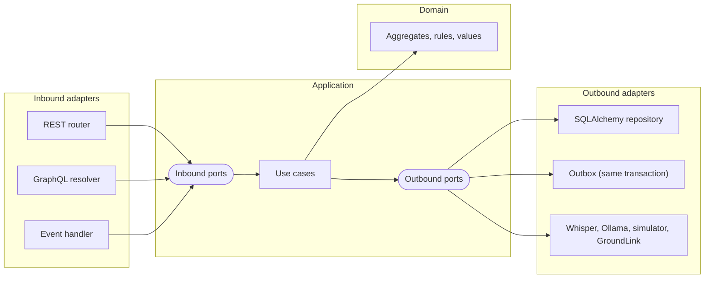
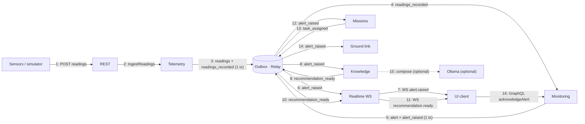
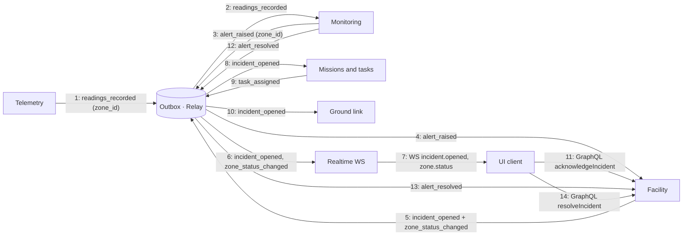

# Architecture plan: health monitor for astronauts

> NASA Space Apps 2026 · challenge *Create Health Monitoring Software for Astronauts on Space Missions*
> Status: **proposal, pending confirmation**. No code has been written.
> Date: November 14, 2026. Source context: [`spaceapps-health-monitor-context.md`](spaceapps-health-monitor-context.md).
> Visual, interactive artifact for working with this plan: {{ARTIFACT_URL}}

This document defines how the system is built. It does not repeat the medical thresholds or the sources: those live in the context document and are loaded as a rule catalog with its evidence state (`VERIFIED`, `TB`, `DEMO`).

## 1. What will be built

**Architecture requirements you asked for**

- Hexagonal architecture (ports and adapters), organized as a **modular monolith**.
- **Event bus with a transactional outbox**.
- Python with **FastAPI**, **PostgreSQL**, **GraphQL** and **WebSockets**.
- Diagrams: ER with its relations, sequence and communication between modules. Communication table per channel. A `.md` document and a visual artifact with interactive elements. User experience plan.
- **Daily crew tasks** of three kinds: health, ship (maintenance) and incidents wherever they are.
- **Ship panel:** floor plan with the physical zones. When an incident occurs, the **ticket** appears with description, severity and location, and the zone is marked with a color. Right there, charts show the CO₂, nitrogen, oxygen, humidity and other levels, measured continuously, with alerts on anomalies.
- A **human body** in the crew panel, with per-organ indicators.

**Constraints that come from the project context**

- It must work **without internet and without a ground link** (local voice, model and knowledge base).
- The **rules engine is deterministic**. The language model explains, it never decides an alert.
- It is a decision-support prototype, **not a medical device**. Every figure without a verified source is labeled `DEMO`.
- Oxygen is evaluated as partial pressure (`PIO₂ = (P_total − 47 mmHg) × FO₂`), not as a percentage.
- Reproducible delivery in Docker, with the profiles `dev1`, `dev2` and `jury`.

## 2. Principles

{{PRINCIPLES}}

## 3. Architecture decisions

{{ADRS}}

## 4. Stack

| Layer | Choice | Reason |
| --- | --- | --- |
| Language and API | Python 3.12, FastAPI, Uvicorn | Requested. Native ASGI for HTTP, GraphQL and WebSocket in one process |
| GraphQL | Strawberry mounted on FastAPI, with DataLoaders | Typing with dataclasses and good ASGI integration |
| Realtime | Starlette WebSocket, a single `/ws` endpoint | A single push channel. No GraphQL subscriptions |
| Database | PostgreSQL 16, SQLAlchemy 2.0 async, asyncpg, Alembic | Requested. `LISTEN/NOTIFY` and `SKIP LOCKED` for the outbox |
| Vectors | pgvector | A single database. Falls back to full-text search |
| Validation | Pydantic v2 | Event contracts and DTOs |
| Voice and language (local) | Whisper (faster-whisper), Ollama. n8n optional | From the context document |
| Tests | pytest, pytest-asyncio, testcontainers, hypothesis | Real PostgreSQL for the outbox |
| Quality | ruff, mypy, import-linter | Enforces the boundaries between modules |
| Packaging | Docker and Docker Compose | Image for the jury |
| Interface | SPA with React, Vite and TypeScript. urql GraphQL client. Floor plan and body in SVG, charts with uPlot | **Assumption**: you did not specify a frontend. It does not affect the backend |

## 5. Architecture

### 5.1 Anatomy of a module

Each module is a small hexagon. The domain imports nothing from FastAPI, SQLAlchemy, Strawberry or other modules.



### 5.2 Repository structure

```text
src/spaceapp/
  main.py                    # composition root: picks adapters according to the profile
  platform/
    outbox/                  # OutboxEvent, UnitOfWork, relay, inbox
    profiles.py              # dev1, dev2, jury
    config.py, logging.py, db.py
  modules/
    <module>/                # telemetry, monitoring, knowledge, assistant, facility,
      domain/                #   crew, engagement, groundlink
      application/           # use cases and handlers
      ports/                 # inbound and outbound interfaces
      adapters/
        inbound/             # rest.py, graphql.py, events.py
        outbound/            # sql.py, ollama.py, whisper.py, simulator.py ...
      contracts.py           # public events and DTOs. The only thing other modules import
      facade.py              # read-only queries exposed to other modules
  interfaces/
    graphql/schema.py        # joins each module's resolvers
    ws/gateway.py            # realtime module
rules/catalog/*.json         # rule catalog with source and state
migrations/                  # one PostgreSQL schema per module
tests/{unit,contract,integration,e2e,architecture}
docker/                      # Dockerfile and compose
```

### 5.3 Dependency rules (checked by import-linter in CI)

1. `domain` imports nothing outside the standard library and its own module.
2. `application` imports `domain` and `ports` of the same module.
3. A module only imports another's `contracts` and `facade`. Never `domain`, `adapters` or SQL models.
4. The inbound adapters of one module do not call each other.
5. Only `main.py` knows all the adapters.
6. A module writes only to its own schema. There are no foreign keys between modules.

### 5.4 Module map: events and reads

Solid arrows are domain events through the outbox. Dashed arrows are read-only synchronous reads through a facade.

{{MODULE_MAP}}

### 5.5 Modules

{{MODULES}}

**Allowed synchronous reads** (never writes):

{{SYNC}}

## 6. Event bus with outbox

### 6.1 How it works

1. A use case changes the state **and** adds the event to the outbox within the **same transaction** (`UnitOfWork`). The dual write is avoided.
2. When the transaction commits, `pg_notify('outbox_new')` runs.
3. The **relay** (an `asyncio` task in the same process) wakes up on `LISTEN`, or after 500 ms by polling, and takes pending rows with `FOR UPDATE SKIP LOCKED`, in `id` order.
4. For each event it calls the subscribed handlers. Each handler runs in its own transaction and inserts `(consumer, event_id)` into `inbox_processed`. If it already exists, it is skipped.
5. If all handlers finish, the event becomes `done`. If any fails, `attempts + 1` and `next_attempt_at` with exponential wait (1, 2, 4 … 60 s). After 8 attempts it becomes `dead`.
6. Delivery guarantee: **at least once**. Handlers are idempotent thanks to the inbox.

### 6.2 Event envelope

```json
{
  "event_id": "0b6f5c1e-…",
  "type": "monitoring.alert_raised",
  "version": 1,
  "occurred_at": "2026-11-14T20:41:07.512Z",
  "aggregate_type": "alert",
  "aggregate_id": "a3c1…",
  "partition_key": "habitat:hab-01",
  "correlation_id": "…",
  "causation_id": "…",
  "payload": { "rule_key": "env-pio2-low", "severity": "CRITICAL", "evidence_state": "VERIFIED" }
}
```

Names: `module.past_tense_fact`. Payloads are Pydantic models in `contracts.py`. Only additive changes are allowed within a version. A breaking change creates `version: 2` and both are published in parallel for a while.

### 6.3 Outbox table

```sql
CREATE SCHEMA platform;

CREATE TABLE platform.outbox_event (
  id              bigserial PRIMARY KEY,
  event_id        uuid        NOT NULL UNIQUE,
  type            text        NOT NULL,
  aggregate_type  text        NOT NULL,
  aggregate_id    uuid        NOT NULL,
  partition_key   text        NOT NULL,
  payload         jsonb       NOT NULL,
  occurred_at     timestamptz NOT NULL DEFAULT now(),
  status          text        NOT NULL DEFAULT 'pending',  -- pending | done | dead
  attempts        int         NOT NULL DEFAULT 0,
  next_attempt_at timestamptz NOT NULL DEFAULT now(),
  last_error      text
);
CREATE INDEX outbox_pending_idx ON platform.outbox_event (next_attempt_at, id) WHERE status = 'pending';

CREATE TABLE platform.inbox_processed (
  consumer     text        NOT NULL,
  event_id     uuid        NOT NULL,
  processed_at timestamptz NOT NULL DEFAULT now(),
  PRIMARY KEY (consumer, event_id)
);
```

### 6.4 Detail decisions

- **Zones:** every sensor belongs to a ship zone. The `readings_recorded` event and the alert carry `zone_id`. That way Monitoring evaluates per zone and Facility knows where to paint.
- **Sensor readings:** no event is published per reading. The batch is stored and **one** `readings_recorded` is emitted per batch, with the latest values for instantaneous rules. Windowed rules query `ReadingQuery` over `reading_rollup_1m`.
- **Order:** a single worker guarantees order by `id`. If parallelizing is needed, it is split by `partition_key`.
- **Retention:** `done` events are kept for 24 h. They serve the WebSocket `resume` and debugging. After that they are deleted.
- **No Kafka or Redis:** the system must run without internet and with few pieces. The `EventBus` port allows replacing the transport without touching the modules.
- **Observability:** `/ready` reports pending, dead and the lag of the oldest.

## 7. Data model (ER)

Each module has its own PostgreSQL schema. Solid lines are foreign keys inside the module. Dashed lines are **soft references** to another module: they only store the id, with no constraint.

### 7.1 Overview across modules

{{ER_OVERVIEW}}

{{ER_ALL}}

Model notes:

- `reading` is **partitioned by day** and has a BRIN index on `ts`. `reading_rollup_1m` is maintained from the ingestion handler.
- `alert.dedupe_key` is unique while the alert is active (partial index). It prevents storms of identical alerts.
- `rule.evidence_state` and `sensor.origin` are mandatory and travel all the way to the interface.
- `chunk.embedding` is optional. Without it, search is full-text.
- `habitat` and `zone` live in `facility`. Each zone's floor plan (`zone.layout`) is JSON, so switching from a ship to a lunar base means changing data.
- `incident.source` is `ALERT` or `MANUAL`. An automatic ticket stores `source_alert_id` as a soft reference.
- `task.kind` is `HEALTH`, `SHIP` or `INCIDENT`. Incident tasks carry `incident_id` and `zone_id`.
- `rule.kind` is `threshold` (standard limit or demo) or `trend` (anomaly against recent history, always demo).
- `rule.params` stores a rule's own settings (windows and minimums of the trend detector, minimum pressure change) and `rule.supersedes` the milder rules it replaces when it fires. Each rule has a fixed severity: going from Attention to Alert means resolving the mild alert and raising the serious one.
- `alert.clear_streak` counts consecutive clean evaluations. The alert resolves when it reaches the hysteresis (3 by default), unless another, more serious rule replaces it.

## 8. Sequence diagrams

{{SEQS}}

## 9. Communication diagram (scenario: rising CO₂)

The numbers are the order of the messages. Everything that leaves the outbox goes through the relay.



### 9.1 Scenario: incident in a ship zone



## 10. Communication channels and events

**When to use each channel**

| Channel | Use it for | Do not use it for |
| --- | --- | --- |
| REST | Machine inputs: sensor batches, audio, Alexa webhook, simulator control, health and operations | Interface queries |
| GraphQL | Everything the interface asks for or changes: queries with a tailored shape and mutations with a typed result | Server push. There are no subscriptions |
| WebSocket | Everything the server pushes: ticks, alerts, recommendations, tasks, assistant streaming, link state | Commands. User actions go through GraphQL |
| Event (outbox) | Communication between modules inside the process | High-frequency data, such as an individual reading |

### 10.1 REST

{{REST}}

### 10.2 GraphQL (`POST /graphql`)

{{GQL}}

### 10.3 WebSocket (`/ws`)

Server message: `{ "seq": 18342, "topic": "alerts", "type": "alert.raised", "at": "…", "data": { … } }`. `seq` is the outbox `id` when the message comes from an event. On ticks it is `null`.

Backpressure: a per-client queue of 500 messages. If it fills up, `telemetry.tick` messages are dropped first. Alerts are never dropped.

{{WS}}

### 10.4 Domain events

{{EVT}}

### 10.5 Emitter × receiver matrix

{{MATRIX}}

## 11. GraphQL contract sketch

```graphql
enum EvidenceState { VERIFIED TB DEMO UNVERIFIED }
enum DataOrigin { SIMULATED REPLAY REAL }
enum CauseHint { ENVIRONMENT BODY INDETERMINATE }

type Rule {
  key: String!  parameter: String!  operator: String!  threshold: Float!  unit: String!
  windowSeconds: Int  severity: Severity!
  sourceRequirement: String!  sourceDocument: String!
  evidenceState: EvidenceState!  hrpHazard: String!
}
type Citation { documentCode: String!  requirementRef: String  page: Int  excerpt: String!  evidenceState: EvidenceState! }
type Recommendation { actions: [Action!]!  body: String!  citations: [Citation!]!  composedBy: String! }
type Alert {
  id: ID!  rule: Rule!  severity: Severity!  status: AlertStatus!  causeHint: CauseHint!
  evidence: JSON!  raisedAt: DateTime!  recommendation: Recommendation  tasks: [Task!]!
}

type Query {
  dashboard(habitatId: ID!): DashboardView!
  readings(sensorId: ID!, from: DateTime!, to: DateTime!, resolution: Resolution = MINUTE): [ReadingPoint!]!
  alerts(filter: AlertFilter, first: Int = 20, after: String): AlertConnection!
  alert(id: ID!): Alert
  knowledgeSearch(query: String!, k: Int = 5): [Citation!]!
  groundLinkStatus: GroundLinkStatus!
}

union AcknowledgeAlertResult = AlertAcknowledged | AlertNotFound | AlertAlreadyResolved
type Mutation {
  acknowledgeAlert(id: ID!, note: String): AcknowledgeAlertResult!
  completeTask(id: ID!, effective: Boolean): TaskPayload!
  setConsent(category: String!, shared: Boolean!): ConsentPayload!
  confirmUtterance(id: ID!, text: String!): UtterancePayload!
}
```

Rules: expected errors as types in a `union`, not as exceptions. Cursor pagination. DataLoaders against N+1. Query depth and cost limits.

## 12. Execution profiles

The `SPACEAPP_PROFILE` variable chooses the adapters in `main.py`. The name and the `jury` default are a **proposal**, not a decision of yours yet.

{{PROFILES}}

## 13. User experience

### 13.1 Users

| User | Context | What they need |
| --- | --- | --- |
| Astronaut (primary) | Cabin, sometimes wearing gloves, with noise and little time. Fixed screen or tablet | Understand their state at a glance, act on an alert and ask without typing |
| Mission control (secondary) | On Ground, with an intermittent link and delay | See what the crew authorized, in order and without duplicates |
| Jury and team | Review the code and run the image | Start without configuring anything and be able to force scenarios |

### 13.2 Experience principles

1. **Actions before explanation** on a critical alert. First what to do, then why.
2. **Color never stands alone.** Every state carries a shape, an icon and text: ● Normal, ▲ Attention, ■ Critical.
3. **Every figure shows its origin**: document, requirement and state (`VERIFIED`, `TB`, `DEMO`). Body data carries the "simulated" mark.
4. **Permanent banner:** "Decision-support prototype. Not a medical device."
5. **The ground link is always visible**, even when everything works without it.
6. **Nothing runs by voice without confirming** the transcript. There is always text input.
7. **Sober gamification:** routines and habits yes, critical alerts never. Ignoring or rushing an alert is never rewarded.
8. **Touch targets of 48 px or more**, AA contrast and dark mode by default for the cabin.

### 13.3 Screens

| Screen | Content | Data and channels |
| --- | --- | --- |
| Cabin panel | Global status light, cabin and radiation cards, human body with per-organ indicators, dynamic charts, link chip, environment selector (ship, station, rover, base) | `dashboard` and `readings` over GraphQL. `telemetry.tick` over WS |
| Alert detail | Actions, rule, measured values, probable cause (air or body), source and state, when to escalate to the CMO or to Ground | `alert(id)`. `alert.*` and `recommendation.*` over WS |
| Assistant | Speak or type, editable transcript, answer with citations, local or cloud mode | REST audio. `confirmUtterance`. `assistant.*` over WS |
| Tasks of the day | Three kinds: health, ship (maintenance) and incidents. Reminders, streak, achievements and "did the measure work?" | `tasks(kind)`, `completeTask`. `task.assigned` over WS |
| New task | Short form: kind (health or ship), title, zone and date. Available in the tasks of the day | `createTask`. `task_created` is published |
| Mission control (Ground) | Plan templates, draft of the next version, publish, status per task (sent, received, applied, completed, blocked) and link control (see 13.11) | `ground` role: `groundTasks`, `saveGroundTemplate`, `publishGroundPlan` |
| Ship panel | Zone floor plan with color and severity icon, tickets, gas and climate charts per zone (see 13.7) | `ship`, `incidents`, `zoneReadings`. `incident.*`, `zone.status` and `telemetry.tick` over WS |
| Trends and baseline | Comparison with the personal baseline, multi-day sleep | `readings`, `crewMember` |
| Link and privacy | Link state, queue, consent per category, batch preview | `groundLinkStatus`, `setConsent`. `groundlink.state` over WS |
| Scenarios (demo mode) | Choose scenario and speed, see the active profile | REST `sim/scenarios` |

### 13.4 Journey

{{JOURNEY}}

### 13.5 States and errors

- **No data yet:** skeleton with the phrase "Waiting for simulator readings", not an empty panel.
- **WebSocket down:** bar "Reconnecting… showing the last data from N s ago". When it returns, `resume` is sent.
- **Slow or absent model:** the template recommendation is already on screen. The enriched text appears when it arrives, without jumps.
- **Doubtful transcript:** the text is highlighted for correction before sending.
- **No passage supports the answer:** "I do not have that information in the loaded sources." A protocol is never made up.

### 13.6 Human body in the panel

A silhouette with six indicators: head (mood and headache), lungs (SpO₂), heart (heart rate), blood and organs (radiation), bones and muscle (baseline) and temperature. Each indicator uses the same status light with an icon, and when tapped it shows the value, the NASA human research program hazard it relates to (radiation, microgravity, isolation, closed environment) and its evidence state. Body values are demo data and carry the label.

### 13.7 Ship panel

- **Floor plan:** schematic view of the ship with the physical zones (bridge, laboratory, infirmary, airlock, life support, engineering, storage, gym, galley and crew quarters). Zones are data in `zone.layout`.
- **Color by status:** green normal, amber attention, red alert, magenta critical. Each status carries an icon and critical also a hatched pattern, so it does not depend on color alone.
- **Incident ticket:** identifier, **description**, **severity**, **location** (zone and deck), origin (automatic alert or manual report), history and associated tasks. The ticket appears in a list and as a mark over its zone on the floor plan.
- **Atmosphere per zone:** choosing a zone shows charts of O₂ (PIO₂), CO₂ (ppCO₂), N₂, humidity, temperature and pressure, with the severity bands drawn. They are measured continuously (1 Hz in the demo).
- **Alerts:** by threshold (standard, `TB` or `DEMO`) and by **trend anomaly** (a change outside normal relative to recent history, `DEMO`). Only severity Alert or higher opens an automatic ticket. A trend generates an attention notice.
- **Closing:** when values normalize, the ticket is marked "values normal, can be closed". The crew decides to close it.
- **Manual report:** any crew member can open a ticket by choosing zone, severity and description.

### 13.8 Daily crew tasks

Each task has a **kind** (health, ship or incident) and an **origin** (Ground, system or crew). The origin is always shown on the card.

| Kind | Origin | Examples (demo) |
| --- | --- | --- |
| Health | Health routine and alert recommendations | Endurance exercise, log mood, measure blood pressure, check ventilation after a CO₂ alert |
| Ship | Daily maintenance per zone | Inspect airlock seals, check the life support CO₂ cartridge, verify laboratory filters, check the medical kit |
| Incident | Created when a ticket opens | Suggested actions for the rule that fired, or "assess and attend" on a manual report |

Every task has a reminder. Incident tasks are linked to their ticket and are completed when it closes. All of them record whether the measure worked. Only health routines count toward the streak and achievements.

### 13.9 Incident type catalog

Tickets are classified by **category** and **type**. The catalog is versioned data (`incident_type`). Each type defines its detection (`AUTO` with a rule, or `MANUAL`), default severity, typical zones, suggested actions and evidence state. It is a **proposal**: only those marked `VERIFIED` come from the standard and the rest is `DEMO`.

The manual report form asks first for the category, then the type, and proposes severity, zone and actions. Automatic tickets inherit the type of the rule that fired.

{{ITYPES}}

### 13.10 Interactive prototype

The artifact includes a simulator with the PIO₂ and ppCO₂ rules from the catalog, the key screens as a navigable mock-up, the ship panel with continuous per-zone simulation and the human body with indicators. It serves to agree on the behavior before programming.

### 13.11 Tasks: plan from Ground and own tasks

**Decision:** mission control can schedule tasks (option B) and the crew can create their own. The ship does not depend on the link at any time.

**Origins**

| Origin | Who creates it | What the crew can do |
| --- | --- | --- |
| `GROUND` | Mission control panel, inside a versioned plan | Complete, snooze, annotate and **block with a reason**. They cannot delete or edit it |
| `SYSTEM` | Alert recommendations, tickets and the local routine catalog | Complete, snooze and record whether it worked |
| `CREW` | The crew themselves | Create, edit, complete and **delete** |

**Model**

- `task_template` stores the template (kind, recurrence, zone, who it is assigned to, origin and `plan_version`). `task` is an instance with `template_id`, `origin` and `blocked_reason`.
- In the link module, `inbound_plan` records each received plan (version, hash, status, rejections). `ground_plan` and `ground_template` are the draft and the published version on the Ground side.
- Plans cross as a batch: `groundlink.ground_plan_received` comes in, `engagement.ground_plan_applied` goes out as the confirmation (sequence 8.4).

**Conflict rules**

| Situation | Rule |
| --- | --- |
| Plan v12 arrives and v11 was already applied | Applied in one transaction. What was already completed today is not touched. Changes apply from the next instance |
| A lower or repeated version arrives | Ignored. The response is idempotent |
| A corrupt plan arrives (invalid hash) | Rejected entirely with a reason. The previous plan is kept |
| One plan item cannot be applied (nonexistent zone, nonexistent assignee) | Only that item is rejected, with a reason, and the rest is applied |
| Ground cancels a task the crew already completed | Kept as completed. The cancellation only affects future instances |
| The crew cannot do a Ground task | Blocked with a reason. Not deleted. Ground is informed when there is a link |
| Ground and the crew have a task with the same title | They coexist. Each keeps its origin |
| The link drops | The last applied plan is used. Own tasks keep being created |
| A critical alert generates incident tasks | They are local and always prevail. Ground cannot delete them |
| Own tasks | They do not go up to Ground unless the consent for the "tasks" category allows it |

**Mission control panel**

- List of active templates with their status on the ship (pending send, received, applied, completed today, blocked with a reason).
- Draft of the next version: add a template, mark one for cancellation.
- Publish: assigns the next version and sends it over the link. If there is no link it stays queued.
- Link control with configurable delay, to rehearse cuts and late arrivals.
- For the MVP it is the same SPA with the `ground` role, connected through the simulated GroundLink adapter. A separate deployment on Ground is out of scope.

**Integrity:** every batch carries a hash. A signature with a pre-mission key remains as an improvement (see open questions).

## 14. Testing strategy

| Level | What it tests | Tool |
| --- | --- | --- |
| Domain unit | Rules engine with the six vectors from the context document, PIO₂, windows, deduplication | pytest, hypothesis |
| Contract | Each event validates against its Pydantic model and version | pytest |
| Integration | Outbox with real PostgreSQL: atomicity, duplicates, relay crash, backoff, `dead`, order | testcontainers |
| Architecture | Dependency rules between modules | import-linter in CI |
| End to end | CO₂ scenario → alert over WS in under 1 s → acknowledge via GraphQL | pytest + WS client |
| End to end (ship) | Per-zone scenario → ticket with zone and severity → zone painted → normalization → closing | pytest + WS client |
| Plan from Ground | Plan v12 with link cut and late arrival: idempotency, lower version ignored, item rejected without blocking the rest, completed work not lost | pytest, testcontainers |
| Incident catalog | Every AUTO type points to an existing rule. Keys are unique | pytest |
| Anomalies | Trend detection does not fire on normal noise and does fire on a sustained drift | pytest, hypothesis |
| Offline | Container without network: the `jury` profile works completely | Docker, manual test on another machine |

## 15. Plan by phase

Section 16 splits these phases between two developers. P0 is the minimum defensible product. P1 and P2 can be cut without breaking anything, because every port has a null adapter.

{{ROADMAP}}

## 16. Split between two developers

The plan is divided so that two people work **at the same time** without waiting for each other. The cut follows the architecture: each module has a single owner, the interface stays with one of the two and **all of the RAG stays in the hands of a single developer (B)**.

### 16.1 How it is split

- **Dev A · core and realtime:** platform (outbox and relay), telemetry and simulator, monitoring and rules, facility, crew, missions and tasks, ground link and the GraphQL and WebSocket gateway.
- **Dev B · interface, knowledge and RAG:** the whole SPA (cabin panel, ship panel, tasks, assistant, Ground panel) and the `knowledge` and `assistant` modules with Ollama, Whisper and Alexa.
- **Phase 0 and delivery:** these are joint. The two do them together and fix the contracts.
- **Detail per developer:** [`tasks-dev-a.md`](tasks-dev-a.md) and [`tasks-dev-b.md`](tasks-dev-b.md).

### 16.2 Owner of each module

{{OWNERS}}

`crew` is a small module (baseline and consents) and stays with A, because its events are consumed by Monitoring and the link.

### 16.3 Hours per phase

Hours are per person. Phases F10 and F11 are split: A does the backend and B the interface.

{{ALLOC}}

### 16.4 Timeline

Hours are working hours per person, not wall-clock. The red blocks are the RAG.

{{GANTT}}

**Dev A work queue**

{{LANE_A}}

**Dev B work queue**

{{LANE_B}}

- **A has 1 h of slack** before delivery (waiting for B). It is used for integration tests and to help with the contracts.
- **B has the complete RAG (F12) within the time before delivery.** F12 is marked P1 in the plan, but it fits in B's slack without delaying the delivery milestone. Raising it to P0 is a pending decision.

### 16.5 Integration milestones

Each milestone is a short pause: mocks are swapped for the real thing and an end-to-end test is run.

{{MILESTONES}}

### 16.6 Contracts between the two developers

{{CROSS}}

### 16.7 How to work without blocking each other

{{SPLIT_RULES}}

### 16.8 The RAG in one pair of hands

All of the RAG belongs to **Dev B** and adds up to {{RAG_HOURS}} (phases F8, F12, F13, F14 and F16). It includes:

{{RAG_SCOPE}}

**Why in a single person:** the RAG has many chained decisions (chunking, search, answer policy, composition with Ollama, voice). If two people make them, coherence is lost in the citations and in the "I do not have that information".

**What it needs from A (only three points):**

1. The `monitoring.alert_raised` event and the `RuleQuery` facade.
2. The event bus. Meanwhile it uses the in-memory bus.
3. The gateway, to register its GraphQL resolvers and publish `recommendation_ready` and `answer_ready` toward WebSocket.

**What it delivers to A:** the `knowledge.recommendation_ready` event and the `ActionCatalogQuery` facade, which Missions uses.

**If B falls behind:** the Knowledge demo adapter keeps working, so the rest of the system does not stop. The open RAG decisions are still pending (citable passages only or also composition with Ollama, and whether n8n stays or is dropped).

### 16.9 Split risks

{{SPLIT_RISKS}}

## 17. Risks

{{RISKS}}

## 18. Open questions and assumptions

I did not decide these points. I left a conservative assumption and marked it.

{{OPEN}}

## 19. Next step

Waiting for your confirmation of the plan. You can answer "yes", "change: …" or choose another phase order. With the "yes", the **joint Phase 0** starts: repository, contracts and in-memory bus. After that Dev A continues with F1 (outbox) and Dev B with F6 (cabin interface) on mocks.
