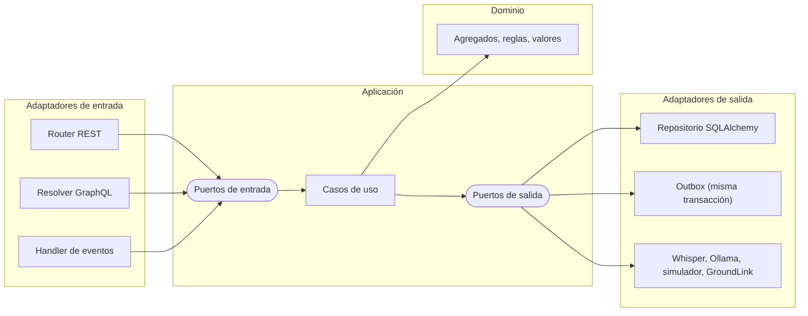
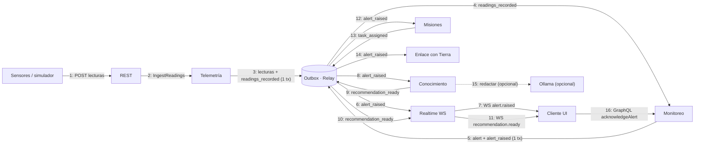
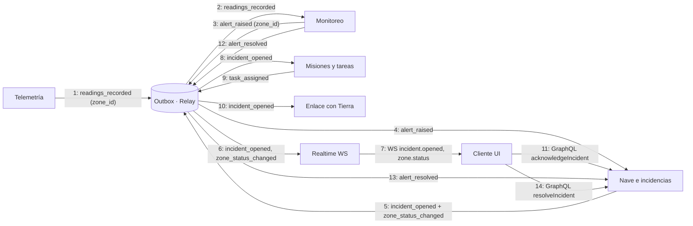

# Plan de arquitectura: monitor de salud para astronautas

> NASA Space Apps 2026 · reto *Create Health Monitoring Software for Astronauts on Space Missions*
> Estado: **propuesta, pendiente de confirmación**. No se ha escrito código.
> Fecha: 14 de noviembre de 2026. Contexto de origen: [`spaceapps-health-monitor-context.md`](spaceapps-health-monitor-context.md).
> Artefacto visual e interactivo para trabajar con este plan: {{ARTIFACT_URL}}

Este documento define cómo se construye el sistema. No repite los umbrales médicos ni las fuentes: esos viven en el documento de contexto y se cargan como catálogo de reglas con su estado de evidencia (`VERIFICADO`, `TB`, `DEMO`).

## 1. Qué se va a construir

**Requisitos de arquitectura que pediste**

- Arquitectura hexagonal (puertos y adaptadores), organizada como **monolito modular**.
- **Bus de eventos con outbox** transaccional.
- Python con **FastAPI**, **PostgreSQL**, **GraphQL** y **WebSockets**.
- Diagramas: ER con sus relaciones, secuencia y comunicación entre módulos. Tabla de comunicaciones por canal. Documento `.md` y artefacto visual con elementos interactivos. Plan de experiencia de usuario.
- **Tareas diarias de la tripulación** de tres tipos: salud, nave (mantenimiento) e incidentes del lugar donde estén.
- **Panel de la nave:** plano con las zonas físicas. Ante una incidencia aparece el **ticket** con descripción, severidad y ubicación, y la zona se marca con un color. Ahí mismo se ven, en gráficas, los niveles de CO₂, nitrógeno, oxígeno, humedad y demás, medidos de forma continua, con alertas ante anomalías.
- Un **cuerpo humano** en el panel de la tripulación, con indicadores por órgano.

**Restricciones que vienen del contexto del proyecto**

- Debe funcionar **sin internet y sin enlace con Tierra** (voz, modelo y base de conocimiento locales).
- El **motor de reglas es determinista**. El modelo de lenguaje explica, nunca decide una alerta.
- Es un prototipo de apoyo a la decisión, **no un dispositivo médico**. Toda cifra sin fuente verificada se rotula `DEMO`.
- El oxígeno se evalúa como presión parcial (`PIO₂ = (P_total − 47 mmHg) × FO₂`), no como porcentaje.
- Entrega reproducible en Docker, con los perfiles `dev1`, `dev2` y `jurado`.

## 2. Principios

{{PRINCIPLES}}

## 3. Decisiones de arquitectura

{{ADRS}}

## 4. Stack

| Capa | Elección | Motivo |
| --- | --- | --- |
| Lenguaje y API | Python 3.12, FastAPI, Uvicorn | Pedido. ASGI nativo para HTTP, GraphQL y WebSocket en un proceso |
| GraphQL | Strawberry montado en FastAPI, con DataLoaders | Tipado con dataclasses y buena integración ASGI |
| Tiempo real | WebSocket de Starlette, un endpoint `/ws` | Un solo canal de push. Sin suscripciones GraphQL |
| Base de datos | PostgreSQL 16, SQLAlchemy 2.0 async, asyncpg, Alembic | Pedido. `LISTEN/NOTIFY` y `SKIP LOCKED` para el outbox |
| Vectores | pgvector | Una sola base. Cae a búsqueda de texto completo |
| Validación | Pydantic v2 | Contratos de eventos y DTO |
| Voz y lenguaje (local) | Whisper (faster-whisper), Ollama. n8n opcional | Del documento de contexto |
| Pruebas | pytest, pytest-asyncio, testcontainers, hypothesis | PostgreSQL real para el outbox |
| Calidad | ruff, mypy, import-linter | Hace cumplir los límites entre módulos |
| Empaquetado | Docker y Docker Compose | Imagen para el jurado |
| Interfaz | SPA con React, Vite y TypeScript. Cliente GraphQL urql. Plano y cuerpo en SVG, gráficas con uPlot | **Supuesto**: no indicaste frontend. No afecta al backend |

## 5. Arquitectura

### 5.1 Anatomía de un módulo

Cada módulo es un hexágono pequeño. El dominio no importa nada de FastAPI, SQLAlchemy, Strawberry ni de otros módulos.



### 5.2 Estructura del repositorio

```text
src/spaceapp/
  main.py                    # composition root: elige adaptadores según el perfil
  platform/
    outbox/                  # OutboxEvent, UnitOfWork, relay, inbox
    profiles.py              # dev1, dev2, jurado
    config.py, logging.py, db.py
  modules/
    <modulo>/                # telemetry, monitoring, knowledge, assistant, facility,
      domain/                #   crew, engagement, groundlink
      application/           # casos de uso y handlers
      ports/                 # interfaces de entrada y salida
      adapters/
        inbound/             # rest.py, graphql.py, events.py
        outbound/            # sql.py, ollama.py, whisper.py, simulator.py ...
      contracts.py           # eventos públicos y DTO. Lo único que otros módulos importan
      facade.py              # consultas de solo lectura expuestas a otros módulos
  interfaces/
    graphql/schema.py        # une los resolvers de cada módulo
    ws/gateway.py            # módulo realtime
rules/catalog/*.json         # catálogo de reglas con fuente y estado
migrations/                  # un esquema de PostgreSQL por módulo
tests/{unit,contract,integration,e2e,architecture}
docker/                      # Dockerfile y compose
```

### 5.3 Reglas de dependencia (las revisa import-linter en CI)

1. `domain` no importa nada fuera de la biblioteca estándar y de su propio módulo.
2. `application` importa `domain` y `ports` del mismo módulo.
3. Un módulo solo importa de otro su `contracts` y su `facade`. Nunca `domain`, `adapters` ni modelos SQL.
4. Los adaptadores de entrada de un módulo no se llaman entre sí.
5. Solo `main.py` conoce a todos los adaptadores.
6. Un módulo escribe únicamente en su propio esquema. Entre módulos no hay claves foráneas.

### 5.4 Mapa de módulos: eventos y lecturas

Las flechas continuas son eventos de dominio por el outbox. Las discontinuas son lecturas síncronas de solo lectura por fachada.

{{MODULE_MAP}}

### 5.5 Módulos

{{MODULES}}

**Lecturas síncronas permitidas** (nunca escrituras):

{{SYNC}}

## 6. Bus de eventos con outbox

### 6.1 Cómo funciona

1. Un caso de uso cambia el estado **y** añade el evento al outbox dentro de la **misma transacción** (`UnitOfWork`). Se evita la doble escritura.
2. Al confirmar la transacción se ejecuta `pg_notify('outbox_new')`.
3. El **relay** (tarea `asyncio` en el mismo proceso) despierta por `LISTEN`, o a los 500 ms por sondeo, y toma pendientes con `FOR UPDATE SKIP LOCKED`, en orden de `id`.
4. Por cada evento llama a los handlers suscritos. Cada handler corre en su propia transacción e inserta `(consumer, event_id)` en `inbox_processed`. Si ya existe, lo omite.
5. Si todos los handlers terminan, el evento pasa a `done`. Si alguno falla, `attempts + 1` y `next_attempt_at` con espera exponencial (1, 2, 4 … 60 s). A los 8 intentos pasa a `dead`.
6. Garantía de entrega: **al menos una vez**. Los handlers son idempotentes gracias al inbox.

### 6.2 Sobre del evento

```json
{
  "event_id": "0b6f5c1e-…",
  "type": "monitoring.alert_raised",
  "version": 1,
  "occurred_at": "2026-11-14T20:41:07.512Z",
  "aggregate_type": "alert",
  "aggregate_id": "a3c1…",
  "partition_key": "habitat:hab-01",
  "correlation_id": "…",
  "causation_id": "…",
  "payload": { "rule_key": "env-pio2-low", "severity": "rojo", "evidence_state": "VERIFICADO" }
}
```

Nombres: `modulo.hecho_en_pasado`. Los payload son modelos Pydantic en `contracts.py`. Solo se permiten cambios aditivos dentro de una versión. Una ruptura crea `version: 2` y se publica en paralelo un tiempo.

### 6.3 Tabla del outbox

```sql
CREATE SCHEMA platform;

CREATE TABLE platform.outbox_event (
  id              bigserial PRIMARY KEY,
  event_id        uuid        NOT NULL UNIQUE,
  type            text        NOT NULL,
  aggregate_type  text        NOT NULL,
  aggregate_id    uuid        NOT NULL,
  partition_key   text        NOT NULL,
  payload         jsonb       NOT NULL,
  occurred_at     timestamptz NOT NULL DEFAULT now(),
  status          text        NOT NULL DEFAULT 'pending',  -- pending | done | dead
  attempts        int         NOT NULL DEFAULT 0,
  next_attempt_at timestamptz NOT NULL DEFAULT now(),
  last_error      text
);
CREATE INDEX outbox_pending_idx ON platform.outbox_event (next_attempt_at, id) WHERE status = 'pending';

CREATE TABLE platform.inbox_processed (
  consumer     text        NOT NULL,
  event_id     uuid        NOT NULL,
  processed_at timestamptz NOT NULL DEFAULT now(),
  PRIMARY KEY (consumer, event_id)
);
```

### 6.4 Decisiones de detalle

- **Zonas:** cada sensor pertenece a una zona de la nave. El evento `readings_recorded` y la alerta llevan `zone_id`. Así Monitoreo evalúa por zona y Nave e incidencias sabe dónde pintar.
- **Lecturas de sensores:** no se publica un evento por lectura. Se guarda el lote y se emite **un** `readings_recorded` por lote, con los últimos valores para reglas instantáneas. Las reglas con ventana consultan `ReadingQuery` sobre `reading_rollup_1m`.
- **Orden:** un solo worker garantiza orden por `id`. Si hiciera falta paralelizar, se reparte por `partition_key`.
- **Retención:** los eventos `done` se conservan 24 h. Sirven para el `resume` del WebSocket y para depuración. Después se borran.
- **Sin Kafka ni Redis:** hay que operar sin internet y con pocas piezas. El puerto `EventBus` permite reemplazar el transporte sin tocar los módulos.
- **Observabilidad:** `/ready` informa pendientes, muertos y retraso del más antiguo.

## 7. Modelo de datos (ER)

Cada módulo tiene su esquema de PostgreSQL. Las líneas continuas son claves foráneas dentro del módulo. Las discontinuas son **referencias blandas** a otro módulo: solo guardan el id, sin restricción.

### 7.1 Vista general entre módulos

{{ER_OVERVIEW}}

{{ER_ALL}}

Notas del modelo:

- `reading` se **particiona por día** y lleva índice BRIN en `ts`. `reading_rollup_1m` se mantiene desde el handler de ingesta.
- `alert.dedupe_key` es único mientras la alerta esté activa (índice parcial). Evita tormentas de alertas iguales.
- `rule.evidence_state` y `sensor.origin` son obligatorios y viajan hasta la interfaz.
- `chunk.embedding` es opcional. Sin él, se busca por texto completo.
- `habitat` y `zone` viven en `facility`. El plano de cada zona (`zone.layout`) es JSON, así que cambiar de nave a base lunar es cambiar datos.
- `incident.source` es `ALERTA` o `MANUAL`. Un ticket automático guarda `source_alert_id` como referencia blanda.
- `task.kind` es `SALUD`, `NAVE` o `INCIDENTE`. Las tareas de incidente llevan `incident_id` y `zone_id`.
- `rule.kind` es `umbral` (límite de la norma o demostración) o `tendencia` (anomalía respecto a la historia reciente, siempre demostración).
- `rule.params` guarda los ajustes propios de una regla (ventanas y mínimos del detector de tendencia, cambio mínimo de presión) y `rule.supersedes` las reglas más leves que reemplaza cuando se cumple. Cada regla tiene una severidad fija: subir de Atención a Alerta es resolver la alerta leve y levantar la grave.
- `alert.clear_streak` cuenta las evaluaciones limpias seguidas. La alerta se resuelve al llegar a la histéresis (3 por defecto), salvo que otra regla más grave la reemplace.

## 8. Diagramas de secuencia

{{SEQS}}

## 9. Diagrama de comunicación (escenario: CO₂ que sube)

Los números son el orden de los mensajes. Todo lo que sale del outbox pasa por el relay.



### 9.1 Escenario: incidente en una zona de la nave



## 10. Canales y eventos de comunicación

**Cuándo usar cada canal**

| Canal | Úsalo para | No lo uses para |
| --- | --- | --- |
| REST | Entradas de máquina: lotes de sensores, audio, webhook de Alexa, control del simulador, salud y operación | Consultas de la interfaz |
| GraphQL | Todo lo que la interfaz pide o cambia: consultas con forma a medida y mutaciones con resultado tipado | Push del servidor. No hay suscripciones |
| WebSocket | Todo lo que el servidor empuja: ticks, alertas, recomendaciones, tareas, streaming del asistente, estado del enlace | Comandos. Las acciones del usuario van por GraphQL |
| Evento (outbox) | Comunicación entre módulos dentro del proceso | Datos de alta frecuencia, como una lectura individual |

### 10.1 REST

{{REST}}

### 10.2 GraphQL (`POST /graphql`)

{{GQL}}

### 10.3 WebSocket (`/ws`)

Mensaje del servidor: `{ "seq": 18342, "topic": "alerts", "type": "alert.raised", "at": "…", "data": { … } }`. `seq` es el `id` del outbox cuando el mensaje nace de un evento. En los ticks es `null`.

Presión inversa: cola por cliente de 500 mensajes. Si se llena, se descartan primero los `telemetry.tick`. Las alertas no se descartan.

{{WS}}

### 10.4 Eventos de dominio

{{EVT}}

### 10.5 Matriz emisor × receptor

{{MATRIX}}

## 11. Esbozo del contrato GraphQL

```graphql
enum EvidenceState { VERIFICADO TB DEMO NO_VERIFICADO }
enum DataOrigin { SIMULATED REPLAY REAL }
enum CauseHint { AMBIENTE CUERPO INDETERMINADO }

type Rule {
  key: String!  parameter: String!  operator: String!  threshold: Float!  unit: String!
  windowSeconds: Int  severity: Severity!
  sourceRequirement: String!  sourceDocument: String!
  evidenceState: EvidenceState!  hrpHazard: String!
}
type Citation { documentCode: String!  requirementRef: String  page: Int  excerpt: String!  evidenceState: EvidenceState! }
type Recommendation { actions: [Action!]!  body: String!  citations: [Citation!]!  composedBy: String! }
type Alert {
  id: ID!  rule: Rule!  severity: Severity!  status: AlertStatus!  causeHint: CauseHint!
  evidence: JSON!  raisedAt: DateTime!  recommendation: Recommendation  tasks: [Task!]!
}

type Query {
  dashboard(habitatId: ID!): DashboardView!
  readings(sensorId: ID!, from: DateTime!, to: DateTime!, resolution: Resolution = MINUTE): [ReadingPoint!]!
  alerts(filter: AlertFilter, first: Int = 20, after: String): AlertConnection!
  alert(id: ID!): Alert
  knowledgeSearch(query: String!, k: Int = 5): [Citation!]!
  groundLinkStatus: GroundLinkStatus!
}

union AcknowledgeAlertResult = AlertAcknowledged | AlertNotFound | AlertAlreadyResolved
type Mutation {
  acknowledgeAlert(id: ID!, note: String): AcknowledgeAlertResult!
  completeTask(id: ID!, effective: Boolean): TaskPayload!
  setConsent(category: String!, shared: Boolean!): ConsentPayload!
  confirmUtterance(id: ID!, text: String!): UtterancePayload!
}
```

Reglas: errores esperados como tipos en una `union`, no como excepciones. Paginación por cursor. DataLoaders contra N+1. Límite de profundidad y de costo de consulta.

## 12. Perfiles de ejecución

La variable `SPACEAPP_PROFILE` elige los adaptadores en `main.py`. El nombre y el valor por defecto `jurado` son una **propuesta**, no una decisión tuya todavía.

{{PROFILES}}

## 13. Experiencia de usuario

### 13.1 Usuarios

| Usuario | Contexto | Qué necesita |
| --- | --- | --- |
| Astronauta (principal) | Cabina, a veces con guantes, ruido y poco tiempo. Pantalla fija o tableta | Entender su estado de un vistazo, actuar en una alerta y preguntar sin teclear |
| Centro de control (secundario) | En Tierra, con enlace intermitente y demora | Ver lo que la tripulación autorizó, en orden y sin duplicados |
| Jurado y equipo | Revisan código y ejecutan la imagen | Arrancar sin configurar nada y poder forzar escenarios |

### 13.2 Principios de experiencia

1. **Acciones antes que explicación** en una alerta crítica. Primero qué hacer, después por qué.
2. **El color nunca va solo.** Cada estado lleva forma, icono y texto: ● Normal, ▲ Atención, ■ Crítico.
3. **Toda cifra muestra su origen**: documento, requisito y estado (`VERIFICADO`, `TB`, `DEMO`). Los datos del cuerpo llevan la marca «simulado».
4. **Banner permanente:** «Prototipo de apoyo a la decisión. No es un dispositivo médico».
5. **El enlace con Tierra siempre visible**, también cuando todo funciona sin él.
6. **Nada se ejecuta por voz sin confirmar** lo transcrito. Siempre hay entrada por texto.
7. **Gamificación sobria:** rutinas y hábitos sí, alertas críticas nunca. No se premia ignorar ni acelerar una alerta.
8. **Objetivos táctiles de 48 px o más**, contraste AA y modo oscuro por defecto para la cabina.

### 13.3 Pantallas

| Pantalla | Contenido | Datos y canales |
| --- | --- | --- |
| Panel de cabina | Semáforo global, tarjetas de cabina y radiación, cuerpo humano con indicadores por órgano, gráficas dinámicas, chip de enlace, selector de entorno (nave, estación, rover, base) | `dashboard` y `readings` por GraphQL. `telemetry.tick` por WS |
| Detalle de alerta | Acciones, regla, valores medidos, causa probable (aire o cuerpo), fuente y estado, cuándo escalar a CMO o a Tierra | `alert(id)`. `alert.*` y `recommendation.*` por WS |
| Asistente | Hablar o escribir, transcripción editable, respuesta con citas, modo local o nube | REST audio. `confirmUtterance`. `assistant.*` por WS |
| Tareas del día | Tres tipos: salud, nave (mantenimiento) e incidentes. Recordatorios, racha, logros y «¿funcionó la medida?» | `tasks(kind)`, `completeTask`. `task.assigned` por WS |
| Nueva tarea | Formulario corto: tipo (salud o nave), título, zona y fecha. Disponible en las tareas del día | `createTask`. Se publica `task_created` |
| Centro de control (Tierra) | Plantillas del plan, borrador de la versión siguiente, publicar, estado por tarea (enviada, recibida, aplicada, completada, bloqueada) y control del enlace (ver 13.11) | Rol `ground`: `groundTasks`, `saveGroundTemplate`, `publishGroundPlan` |
| Panel de la nave | Plano de zonas con color e icono de severidad, tickets, gráficas de gases y clima por zona (ver 13.7) | `ship`, `incidents`, `zoneReadings`. `incident.*`, `zone.status` y `telemetry.tick` por WS |
| Tendencias y línea base | Comparación con la línea base personal, sueño de varios días | `readings`, `crewMember` |
| Enlace y privacidad | Estado del enlace, cola, consentimiento por categoría, vista previa del lote | `groundLinkStatus`, `setConsent`. `groundlink.state` por WS |
| Escenarios (modo demo) | Elegir escenario y velocidad, ver el perfil activo | REST `sim/scenarios` |

### 13.4 Recorrido

{{JOURNEY}}

### 13.5 Estados y errores

- **Sin datos aún:** esqueleto con la frase «Esperando lecturas del simulador», no un panel vacío.
- **WebSocket caído:** barra «Reconectando… mostrando el último dato de hace N s». Al volver se envía `resume`.
- **Modelo lento o ausente:** la recomendación de plantilla ya está en pantalla. El texto enriquecido aparece cuando llega, sin saltos.
- **Transcripción dudosa:** el texto queda resaltado para corregir antes de enviar.
- **Sin pasaje que respalde la respuesta:** «No tengo esa información en las fuentes cargadas». Nunca se inventa un protocolo.

### 13.6 Cuerpo humano en el panel

Una silueta con seis indicadores: cabeza (ánimo y cefalea), pulmones (SpO₂), corazón (frecuencia cardíaca), sangre y órganos (radiación), huesos y músculo (línea base) y temperatura. Cada indicador usa el mismo semáforo con icono, y al tocarlo muestra el valor, el peligro del programa de investigación humana de NASA con el que se relaciona (radiación, microgravedad, aislamiento, entorno cerrado) y su estado de evidencia. Los valores del cuerpo son de demostración y llevan la etiqueta.

### 13.7 Panel de la nave

- **Plano:** vista esquemática de la nave con las zonas físicas (puente, laboratorio, enfermería, esclusa, soporte vital, ingeniería, almacén, gimnasio, cocina y dormitorios). Las zonas son datos en `zone.layout`.
- **Color por estado:** verde normal, ámbar atención, rojo alerta, magenta crítico. Cada estado lleva un icono y el crítico además un trazado rayado, para no depender solo del color.
- **Ticket de incidencia:** identificador, **descripción**, **severidad**, **ubicación** (zona y cubierta), origen (alerta automática o reporte manual), historial y tareas asociadas. El ticket aparece en una lista y como marca sobre su zona en el plano.
- **Atmósfera por zona:** al elegir una zona se ven gráficas de O₂ (PIO₂), CO₂ (ppCO₂), N₂, humedad, temperatura y presión, con las bandas de severidad dibujadas. Se miden de forma continua (1 Hz en la demo).
- **Alertas:** por umbral (norma, `TB` o `DEMO`) y por **anomalía de tendencia** (cambio fuera de lo normal respecto a la historia reciente, `DEMO`). Solo severidad Alerta o mayor abre ticket automático. La tendencia genera un aviso de atención.
- **Cierre:** al normalizarse los valores, el ticket se marca «valores normales, puede cerrarse». La tripulación decide cerrarlo.
- **Reporte manual:** cualquier tripulante puede abrir un ticket eligiendo zona, severidad y descripción.

### 13.8 Tareas diarias de la tripulación

Cada tarea tiene un **tipo** (salud, nave o incidente) y un **origen** (Tierra, sistema o tripulación). El origen se muestra siempre en la tarjeta.

| Tipo | Origen | Ejemplos (demostración) |
| --- | --- | --- |
| Salud | Rutina de salud y recomendaciones de alertas | Ejercicio de resistencia, registrar ánimo, medir presión arterial, revisar ventilación tras una alerta de CO₂ |
| Nave | Mantenimiento diario por zona | Inspeccionar sellos de la esclusa, revisar el cartucho de CO₂ del soporte vital, verificar filtros del laboratorio, revisar el botiquín |
| Incidente | Se crean al abrirse un ticket | Acciones sugeridas para la regla que se disparó, o «evaluar y atender» en un reporte manual |

Cada tarea tiene recordatorio. Las de incidente se enlazan con su ticket y se completan al cerrarlo. Todas registran si la medida funcionó. Solo las rutinas de salud cuentan para racha y logros.

### 13.9 Catálogo de tipos de incidencia

Los tickets se clasifican por **categoría** y **tipo**. El catálogo es un dato versionado (`incident_type`). Cada tipo define su detección (`AUTO` con una regla, o `MANUAL`), severidad por defecto, zonas típicas, acciones sugeridas y estado de evidencia. Es una **propuesta**: solo los marcados `VERIFICADO` salen de la norma y el resto es `DEMO`.

El formulario de reporte manual pide primero la categoría, luego el tipo, y propone severidad, zona y acciones. Los tickets automáticos heredan el tipo de la regla que se disparó.

{{ITYPES}}

### 13.10 Prototipo interactivo

El artefacto incluye un simulador con las reglas de PIO₂ y ppCO₂ del catálogo, las pantallas clave como maqueta navegable, el panel de la nave con simulación continua por zona y el cuerpo humano con indicadores. Sirve para acordar el comportamiento antes de programar.

### 13.11 Tareas: plan desde Tierra y tareas propias

**Decisión:** el centro de control puede programar tareas (opción B) y la tripulación puede crear las suyas. La nave no depende del enlace en ningún momento.

**Orígenes**

| Origen | Quién lo crea | Qué puede hacer la tripulación |
| --- | --- | --- |
| `TIERRA` | Panel del centro de control, dentro de un plan versionado | Completar, posponer, anotar y **bloquear con motivo**. No puede borrarla ni editarla |
| `SISTEMA` | Recomendaciones de alertas, tickets y catálogo local de rutinas | Completar, posponer y registrar si funcionó |
| `TRIPULACION` | La propia tripulación | Crear, editar, completar y **borrar** |

**Modelo**

- `task_template` guarda la plantilla (tipo, recurrencia, zona, a quién se asigna, origen y `plan_version`). `task` es una instancia con `template_id`, `origin` y `blocked_reason`.
- En el módulo de enlace, `inbound_plan` registra cada plan recibido (versión, hash, estado, rechazos). `ground_plan` y `ground_template` son el borrador y la versión publicada del lado de Tierra.
- Los planes cruzan como un lote: `groundlink.ground_plan_received` entra, `engagement.ground_plan_applied` sale como confirmación (secuencia 8.4).

**Reglas de conflicto**

| Situación | Regla |
| --- | --- |
| Llega el plan v12 y la v11 ya se aplicó | Se aplica en una transacción. Lo ya completado hoy no se toca. Los cambios rigen desde la siguiente instancia |
| Llega una versión menor o repetida | Se ignora. La respuesta es idempotente |
| Llega un plan corrupto (hash inválido) | Se rechaza completo con motivo. Se conserva el plan anterior |
| Un ítem del plan no se puede aplicar (zona inexistente, asignado inexistente) | Se rechaza solo ese ítem, con motivo, y se aplica el resto |
| Tierra cancela una tarea que la tripulación ya completó | Se conserva como completada. La cancelación afecta solo a instancias futuras |
| La tripulación no puede cumplir una tarea de Tierra | Se bloquea con motivo. No se borra. Se informa a Tierra cuando haya enlace |
| Tierra y la tripulación tienen una tarea con el mismo título | Conviven. Cada una conserva su origen |
| Se corta el enlace | Se usa el último plan aplicado. Las tareas propias siguen creándose |
| Una alerta crítica genera tareas de incidente | Son locales y siempre prevalecen. Tierra no puede borrarlas |
| Las tareas propias | No suben a Tierra salvo que el consentimiento de la categoría «tareas» lo permita |

**Panel del centro de control**

- Lista de plantillas activas con su estado en la nave (pendiente de envío, recibida, aplicada, completada hoy, bloqueada con motivo).
- Borrador de la versión siguiente: añadir una plantilla, marcar una para cancelar.
- Publicar: asigna la versión siguiente y envía por el enlace. Si no hay enlace queda en cola.
- Control del enlace con retardo configurable, para ensayar cortes y llegadas tardías.
- Para el MVP es la misma SPA con rol `ground`, conectada por el adaptador GroundLink simulado. Un despliegue aparte en Tierra queda fuera de alcance.

**Integridad:** cada lote lleva un hash. Una firma con clave previa a la misión queda como mejora (ver preguntas abiertas).

## 14. Estrategia de pruebas

| Nivel | Qué prueba | Herramienta |
| --- | --- | --- |
| Unitarias de dominio | Motor de reglas con los seis vectores del documento de contexto, PIO₂, ventanas, deduplicación | pytest, hypothesis |
| Contrato | Cada evento valida contra su modelo Pydantic y versión | pytest |
| Integración | Outbox con PostgreSQL real: atomicidad, duplicados, caída del relay, backoff, `dead`, orden | testcontainers |
| Arquitectura | Reglas de dependencia entre módulos | import-linter en CI |
| Extremo a extremo | Escenario de CO₂ → alerta por WS en menos de 1 s → reconocer por GraphQL | pytest + cliente WS |
| Extremo a extremo (nave) | Escenario por zona → ticket con zona y severidad → zona pintada → normalización → cierre | pytest + cliente WS |
| Plan desde Tierra | Plan v12 con corte de enlace y llegada tardía: idempotencia, versión menor ignorada, ítem rechazado sin bloquear el resto, lo completado no se pierde | pytest, testcontainers |
| Catálogo de incidencias | Cada tipo AUTO apunta a una regla existente. Las claves son únicas | pytest |
| Anomalías | La detección de tendencia no dispara con ruido normal y sí con una deriva sostenida | pytest, hypothesis |
| Sin conexión | Contenedor sin red: perfil `jurado` funciona completo | Docker, prueba manual en otra máquina |

## 15. Plan por fases

La sección 16 reparte estas fases entre dos desarrolladores. P0 es el producto mínimo defendible. P1 y P2 se recortan sin romper nada, porque cada puerto tiene un adaptador nulo.

{{ROADMAP}}

## 16. Reparto entre dos desarrolladores

El plan se divide para que dos personas trabajen **a la vez** sin esperarse. El corte sigue la arquitectura: cada módulo tiene un solo dueño, la interfaz queda con uno de los dos y **todo el RAG queda en manos de un solo desarrollador (B)**.

### 16.1 Cómo se reparte

- **Dev A · núcleo y tiempo real:** plataforma (outbox y relay), telemetría y simulador, monitoreo y reglas, nave e incidencias, tripulación, misiones y tareas, enlace con Tierra y el gateway GraphQL y WebSocket.
- **Dev B · interfaz, conocimiento y RAG:** toda la SPA (panel de cabina, panel de la nave, tareas, asistente, panel de Tierra) y los módulos `knowledge` y `assistant` con Ollama, Whisper y Alexa.
- **Fase 0 y entrega:** son conjuntas. Se hacen entre los dos y fijan los contratos.
- **Detalle por desarrollador:** [`tareas-dev-a.md`](tareas-dev-a.md) y [`tareas-dev-b.md`](tareas-dev-b.md).

### 16.2 Dueño de cada módulo

{{OWNERS}}

`crew` es un módulo pequeño (línea base y consentimientos) y se queda con A, porque sus eventos los consumen Monitoreo y el enlace.

### 16.3 Horas por fase

Las horas son de una persona. Las fases F10 y F11 se parten: A hace el backend y B la interfaz.

{{ALLOC}}

### 16.4 Línea de tiempo

Las horas son de trabajo por persona, no de reloj. Los bloques rojos son el RAG.

{{GANTT}}

**Cola de trabajo de Dev A**

{{LANE_A}}

**Cola de trabajo de Dev B**

{{LANE_B}}

- **A tiene 1 h de holgura** antes de la entrega (espera a B). Sirve para pruebas de integración y para ayudar con los contratos.
- **B tiene el RAG completo (F12) dentro del tiempo antes de la entrega.** F12 está marcada P1 en el plan, pero cabe en la holgura de B sin retrasar el hito de entrega. Subirla a P0 es una decisión pendiente.

### 16.5 Hitos de integración

Cada hito es una pausa corta: se cambian los mocks por lo real y se corre una prueba de extremo a extremo.

{{MILESTONES}}

### 16.6 Contratos entre los dos desarrolladores

{{CROSS}}

### 16.7 Cómo trabajar sin bloquearse

{{SPLIT_RULES}}

### 16.8 El RAG en una sola mano

Todo el RAG es de **Dev B** y suma {{RAG_HOURS}} (fases F8, F12, F13, F14 y F16). Incluye:

{{RAG_SCOPE}}

**Por qué en una sola persona:** el RAG tiene muchas decisiones encadenadas (fragmentación, búsqueda, política de respuesta, redacción con Ollama, voz). Si las toman dos personas, se pierde coherencia en las citas y en el «no tengo esa información».

**Qué necesita de A (solo tres puntos):**

1. El evento `monitoring.alert_raised` y la fachada `RuleQuery`.
2. El bus de eventos. Mientras tanto usa el bus en memoria.
3. El gateway, para registrar sus resolvers GraphQL y publicar `recommendation_ready` y `answer_ready` hacia WebSocket.

**Qué entrega a A:** el evento `knowledge.recommendation_ready` y la fachada `ActionCatalogQuery`, que usa Misiones.

**Si B se atrasa:** el adaptador demo de Conocimiento sigue funcionando, así que el resto del sistema no se detiene. Las decisiones abiertas del RAG siguen pendientes (solo pasajes con cita o también redacción con Ollama, y si n8n sigue o se descarta).

### 16.9 Riesgos del reparto

{{SPLIT_RISKS}}

## 17. Riesgos

{{RISKS}}

## 18. Preguntas abiertas y supuestos

No decidí estos puntos. Dejé un supuesto conservador y lo marqué.

{{OPEN}}

## 19. Siguiente paso

Esperando tu confirmación del plan. Puedes responder «sí», «modifica: …» o elegir otro orden de fases. Con el «sí» empieza la **Fase 0 conjunta**: repositorio, contratos y bus en memoria. Después Dev A sigue con F1 (outbox) y Dev B con F6 (interfaz de cabina) sobre mocks.
